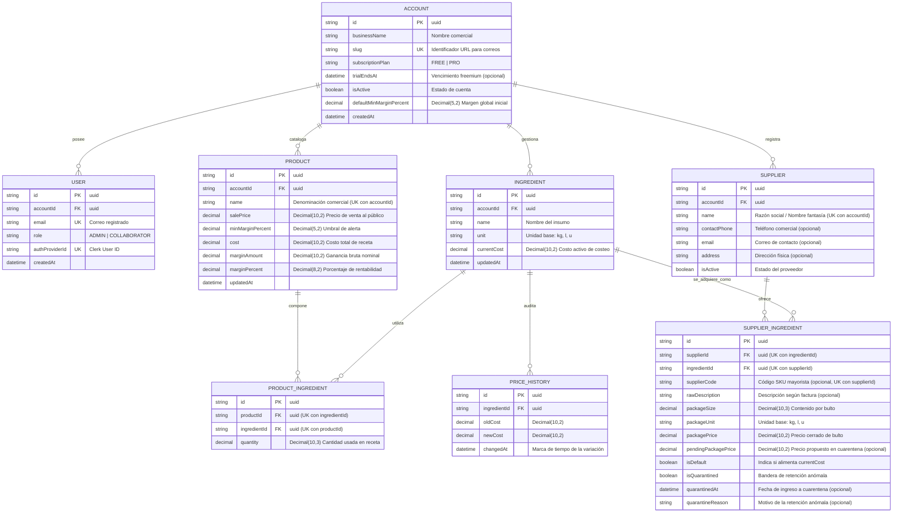
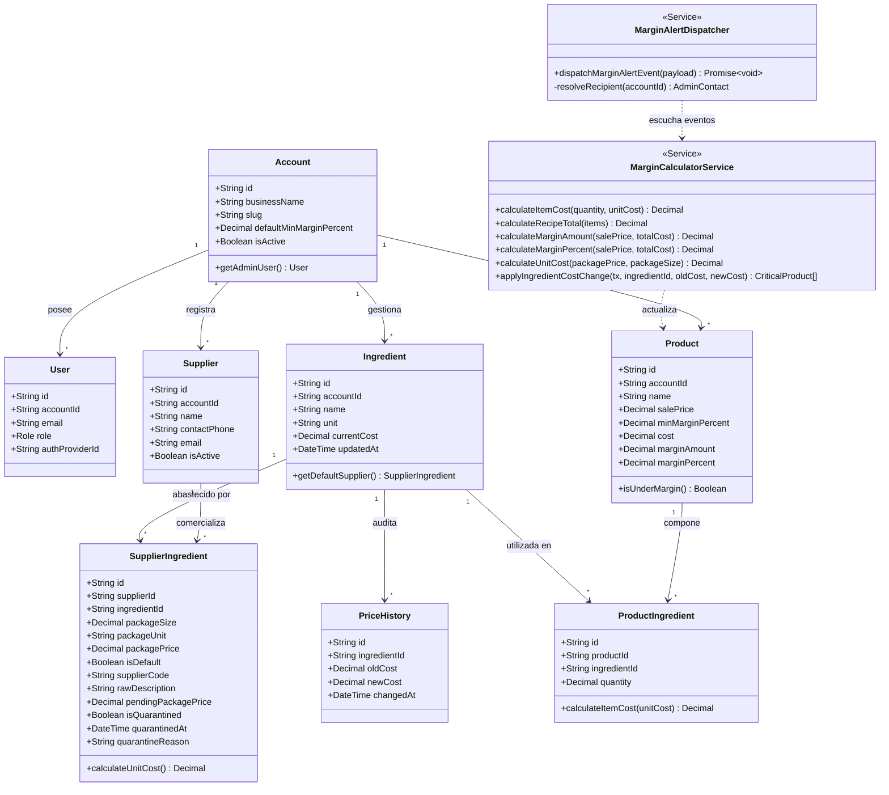
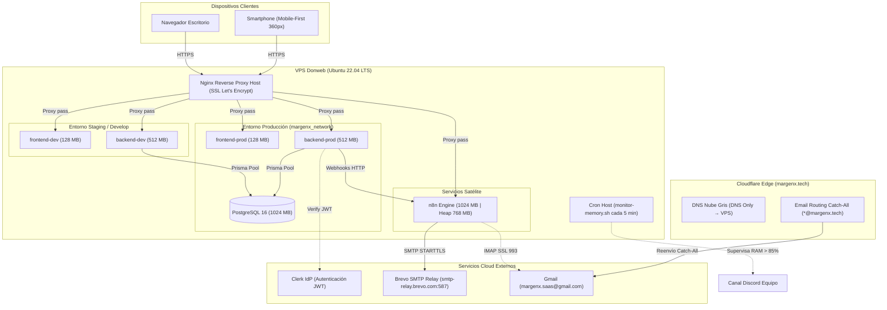

# Documento de Arquitectura de Software

## Proyecto: MargenX — Control de Márgenes en Tiempo Real
**Versión:** 2.2 (Sincronización Sprint 5 — integración real con n8n y backlog reprogramado)
**Fecha de Actualización:** 24 de Octubre de 2026

---

## 0. Estructura del Equipo

El equipo está compuesto por 4 personas. El Scrum Master asume los roles de **Scrum Master, DevOps y Arquitecto de Automatización (n8n)**. Los 3 roles restantes se asignan de forma estratégica para cubrir todo el ciclo de vida del producto sin solapamientos innecesarios ni cuellos de botella.

El rol de Scrum Master es **rotativo** por indicación de la cátedra, mientras que DevOps y la arquitectura de automatización permanecen en Darío Giménez durante todos los sprints. La rotación vigente es:

| Sprint | Scrum Master |
| :--- | :--- |
| Sprint 0 y Sprint 1 | Darío Giménez |
| Sprint 2 | Mauricio Barreras |
| Sprint 3 | Leandro Herrera |
| Sprint 4 | Federico Paal |
| Sprint 5 en adelante | Darío Giménez |

### Rol 1 — Scrum Master, DevOps & Arquitecto de Automatización

**Responsabilidad principal:** dueño de la infraestructura y el despliegue continuo en la VPS Donweb, la arquitectura de automatizaciones satélite con n8n, la gobernanza técnica del repositorio y la facilitación del marco ágil (Scrum). Es quien garantiza la estabilidad operativa del entorno, la seguridad perimetral, la ejecución atómica de migraciones y la eliminación de bloqueos técnicos y de flujo para el equipo.

- Facilitación de ceremonias ágiles (Planning, Dailies, Review, Retrospectivas) y automatización del tablero Kanban de GitHub Projects v2 mediante GitHub Actions y GraphQL API.
- Diseño, aprovisionamiento y mantenimiento de la infraestructura consolidada en la VPS Donweb (Ubuntu 22.04 LTS, Docker Compose, red interna `margenx_network` y proxy inverso Nginx nativo en el host con certificados SSL Let's Encrypt).
- Implementación y evolución de los pipelines de CI/CD en GitHub Actions (validaciones de código, compilación de imágenes Docker inmutables en Docker Hub y despliegue continuo vía SSH con ejecución atómica de migraciones de Prisma).
- Aprovisionamiento, securización y administración del orquestador satélite n8n desacoplado del monolito, gestionando workflows de alertas de margen y reportes semanales.
- Configuración de políticas de gobierno del repositorio: reglas de protección de ramas (branch protection en main y develop), plantillas obligatorias de Pull Request y canal de notificaciones automáticas de CI/CD vía Webhook de Discord.

### Rol 2 — Lead Frontend & UX/UI Mobile-First

**Responsabilidad principal:** dueño de toda la capa de presentación (React + TypeScript + Vite + Tailwind CSS v4). Es quien traduce las historias de usuario en pantallas funcionales, garantiza el cumplimiento mobile-first (RNF-02) y mantiene la consistencia visual del dashboard de márgenes, que es la pieza central de la demo.

- Implementación de componentes reutilizables (tablas, badges de margen, formularios de receta con líneas dinámicas).
- Integración con la API del backend (fetch/React Query) y manejo de estados de carga/vacío/error en el cliente.
- Responsable de que el recálculo en vivo (RNF-04) se sienta fluido en la interfaz.
- Co-responsable, junto al Lead Backend, del cumplimiento de accesibilidad básica (labels, contraste, no depender solo del color).

### Rol 3 — Lead Backend & Data Architect

**Responsabilidad principal:** dueño del modelo de datos, la API REST y la lógica de negocio del cálculo de costos/márgenes. Es quien garantiza la integridad referencial y el correcto diseño transaccional del sistema.

- Diseño y evolución del esquema Prisma/PostgreSQL (Cuentas, Usuarios/Roles, Insumos, Productos, Recetas, Proveedores e Historial de Precios).
- Implementación de los endpoints REST y de la lógica de recálculo en cascada (RF-08).
- Implementación de la autenticación con Clerk y el control de acceso por rol a nivel de API (no solo en el frontend — clave para RNF-09).
- Disparo de los webhooks salientes hacia n8n en los eventos de negocio definidos en la Sección 2.

### Rol 4 — QA Engineer & Product Owner de Apoyo

**Responsabilidad principal:** dueño de la calidad del producto y guardián del alcance. Actúa como Product Owner de apoyo (valida que cada historia cumpla su criterio de aceptación antes de darla por cerrada) y como responsable de testing automatizado.

- Redacción y mantenimiento de los criterios de aceptación en formato Gherkin junto al Scrum Master.
- Desarrollo y mantenimiento de la suite de pruebas E2E con Playwright y colecciones de API (Postman/Newman).
- Autoría y actualización del script de seed de datos realistas basados en los comercios piloto (*Panadería Central* y *Química GyJ*).
- Responsable de la documentación funcional (README, manual de usuario básico) y de mantener la Definition of Done como checklist activo en cada sprint review.

---

## 1. Definición del MVP y Recorte de Alcance

### Problema real y modelo de negocio

Los dueños de comercios gastronómicos chicos y emprendimientos de producción artesanal fijan precios de venta a partir de una estimación inicial de costos que rara vez actualizan. Cuando sube el precio de un insumo, el margen real de un producto puede caer por debajo de lo rentable sin que el dueño lo note, hasta que ya vendió varias unidades a pérdida. **Modelo de negocio:** SaaS B2B multiempresa, monetizable por suscripción mensual por cuenta/comercio.

### Flujo Principal Impecable (Camino Feliz)

1. El usuario (Administrador o Colaborador) inicia sesión en su cuenta de comercio.
2. Actualiza el costo de un insumo existente (ej. "Harina 000" de $740 a $900/kg).
3. El backend recalcula automáticamente el costo y margen de **todos** los productos cuya receta incluye ese insumo.
4. El Dashboard refleja en vivo la tabla de productos ordenada por margen, marcando en rojo los que cruzaron el umbral mínimo.
5. Se dispara un webhook hacia n8n, que envía una alerta por email al Administrador.
6. El Administrador entra al detalle del producto en alerta, revisa el desglose de costos y decide ajustar el precio de venta.

### Respuesta al Feedback Docente: Proveedores sin Sistemas Integrables
Ante la observación de la cátedra respecto a que las PyMEs argentinas operan con distribuidores mayoristas sin sistemas integrables ni APIs estandarizadas, MargenX implementa una **estrategia de abastecimiento en dos tiempos**:
1. **Carga Asistida en UI (Calculadora de Empaques Mayoristas):** El comerciante recibe la factura física y carga la presentación comercial adquirida (ej. Bolsa 50 kg a $35.000). La interfaz calcula en tiempo real el costo unitario equivalente ($700,00/kg) y, al seleccionarlo como predeterminado, actualiza el costo activo impactando las recetas.
2. **Ingesta Automática "Zero-Click" por Correo:** El comerciante reenvía las listas recibidas por email o WhatsApp a una casilla virtual estandarizada (`precios-<slug>@margenx.tech`). Cloudflare Catch-All redirige el correo hacia Gmail, n8n procesa el archivo adjunto (Excel/CSV) o enlace público de Google Sheets, y el backend actualiza exclusivamente los artículos mapeados descartando la polución sobrante.

### Lo que NO entra en el MVP (Out of Scope explícito)

- Lectura/OCR de remitos o facturas en papel — la carga se resuelve mediante plantilla simple de onboarding o reenvío digital de listas mayoristas (Excel/CSV).
- Pasarela de cobros o pasarelas de pago de suscripción SaaS real.
- Notificaciones mediante la API comercial de WhatsApp Business (Meta) — descartada en la fase de MVP debido a su modelo tarifario por conversación; la comunicación crítica se resuelve a costo $0 mediante relay SMTP autenticado vía Brevo, notificaciones In-App y Web Push Notifications.
- Multi-sucursal dentro de una misma cuenta de comercio.
- Historial exhaustivo de auditoría de modificaciones de usuarios (más allá de la trazabilidad de costos e historial de precios).

---

## 2. Arquitectura de Integración con n8n

### Comunicación entre el backend y n8n

Las dos direcciones se autentican con la cabecera `x-margenx-webhook-secret`.

| Evento | Dirección y disparador | Payload principal | Destino | Estado |
| :---- | :---- | :---- | :---- | :---- |
| `margin.alert.triggered` | Backend → n8n, después de la transacción en la que un producto cruzó su margen mínimo (edición manual del costo, presentación predeterminada o liberación de cuarentena) | `{ accountId, accountSlug, tradeName, ownerEmail, ingredient: { id, name }, affectedProductsCount, criticalProducts, triggeredAt }` | Webhook `margin-alert` de n8n (URL en `N8N_MARGIN_ALERT_WEBHOOK_URL`) | Implementado |
| `supplier.pricelist.received` | n8n → backend, al recibir una lista mayorista por correo | `{ accountSlug, items: [{ code, description, price }] }` | `POST /api/webhooks/supplier-prices` | Implementado (reglas en ADR-005) |
| `report.weekly.requested` | Cron de n8n los lunes a las 08:00, consultando la API | `{ accountId, ownerEmail, periodStart, periodEnd }` | A definir | Planificado (Sprint 6) |
| `ingredient.cost.updated` | Backend, en cada actualización de costo de insumo | `{ accountId, ingredientId, previousCost, newCost, updatedBy }` | A definir | Propuesta (no planificado) |

### Tareas resueltas por n8n

1. **Alertas de margen bajo:** al recibir `margin.alert.triggered`, n8n responde inmediatamente con `200 OK` al backend y procesa de forma asíncrona una plantilla HTML responsive con diseño accesible (WCAG AA). Despacha el correo a través del relay SMTP autenticado de Brevo (`smtp-relay.brevo.com:587`, STARTTLS) firmado por `alertas@margenx.tech`.
2. **Ingesta de listas de precios:** n8n lee el adjunto recibido en `precios-<slug>@margenx.tech`, normaliza las columnas, envía el lote al backend y manda al dueño el resumen con el resultado (`infra/n8n/README.md`, ADR-005).
3. **Reporte PDF semanal** · *Planificado (Sprint 6)*: n8n consultaría la API del backend, generaría un PDF con los márgenes de todos los productos y lo enviaría al Administrador los lunes. El endpoint de consulta todavía no existe.
4. **(Stretch goal)** Recordatorio automático si un insumo no actualiza su costo hace más de N días.

**Regla de arquitectura:** n8n **nunca** escribe directamente en la base de datos de producción ni contiene lógica de negocio (el cálculo de margen vive exclusivamente en el backend). n8n consume eventos, orquesta notificaciones y envía las listas de precios a la API, que es la única que escribe — esto mantiene el monolito como única fuente de verdad y evita acoplamientos frágiles.

### Observabilidad de Infraestructura
Para mitigar el riesgo de saturación de memoria RAM en el servidor ante procesos masivos de ingesta, se implementó en el host de la VPS Donweb un script centinela (`/opt/margenx-infra/scripts/monitor-memory.sh`) ejecutado vía `crontab` cada 5 minutos:
- Evalúa el consumo real de memoria del host.
- Si supera el umbral del **85%**, ejecuta `docker stats --no-stream` para identificar los contenedores que más demandan memoria.
- Construye y despacha un mensaje Embed enriquecido a Discord con mención a DevOps, incorporando un periodo de bloqueo de 30 minutos para evitar saturación de notificaciones.

---

## 3. Modelado y Diseño Orientado a Objetos (OOD)

### Diagrama Entidad-Relación Consolidado (Físico y Lógico)

---

### Diagrama de Clases UML del Dominio

---

### Justificación de Integridad Relacional: DB Cascade vs. Aplicación 409 Conflict

A nivel de base de datos relacional, la relación `ProductIngredient -> Ingredient` se declara con `onDelete: Cascade`.

1. **Justificación en PostgreSQL (`onDelete: Cascade`):** Al procesar la baja de una cuenta completa (`Account`), PostgreSQL resuelve las eliminaciones en cascada sin un orden determinístico entre tablas hermanas (`Ingredient` vs `Product`). Si existiese un `onDelete: Restrict` en `ProductIngredient -> Ingredient`, la eliminación de la cuenta fallaría si PostgreSQL intenta purgar `Ingredient` antes de haber vaciado `ProductIngredient`. Por ende, el esquema relacional declara cascada completa.
2. **Protección Defensiva en Aplicación (`409 Conflict`):** Para proteger al usuario de borrar accidentalmente un insumo del cual dependen recetas activas, la validación se ejecuta en el controlador Express (`DELETE /api/ingredients/:id`). El sistema verifica previamente si existen registros en `ProductIngredient`; de existir dependencias, aborta la operación respondiendo `409 Conflict` con el detalle de productos afectados.

### Casos de Uso Principales con Manejo de Transacciones

**CU-01: Actualizar costo de insumo y recalcular márgenes en cascada**

- Actor: Administrador o Colaborador.
- Precondición: el insumo existe y pertenece a la cuenta del usuario autenticado.
- Flujo:
  1. El sistema valida que el nuevo costo sea numérico y positivo (RNF-05).
  2. Si el costo no varió (`previousCost.equals(nextCost)`), la guarda Zero-Variation retorna inmediatamente sin abrir transacciones.
  3. Se actualiza `Ingredient.currentCost` dentro de una **transacción de base de datos** (`prisma.$transaction`) y se registra la variación en `PriceHistory`.
  4. Dentro de la misma transacción, se recorren todos los `ProductIngredient` que referencian ese insumo, se recalcula `Product.cost` y `Product.marginPercent` con `Prisma.Decimal` para cada producto afectado.
  5. Se hace commit de la transacción solo si todos los recálculos fueron exitosos (evita estados intermedios inconsistentes si falla un cálculo a mitad de camino).
  6. Tras el commit, se dispara de forma asíncrona (fuera de la transacción) el dispatcher `marginAlertDispatcher.ts`, enriqueciendo el payload con el nombre del comercio y correo del administrador antes de golpear el webhook de n8n.
- Postcondición: todos los productos afectados reflejan su margen actualizado; se registran los eventos de alerta correspondientes.

**CU-02: Control de acceso por rol y visibilidad operativa**

- Actor: Colaborador.
- Flujo: el Colaborador solicita el detalle o catálogo de productos. El backend valida el rol del token antes de resolver la consulta y devuelve una respuesta con los campos de margen y costos de receta omitidos mediante el middleware `sanitizeFinancialData` con cabecera `Cache-Control: private, no-store` (validado a nivel de API, según RNF-09). Se permite la visualización del precio de venta al público vigente, garantizando que el personal de salón pueda actualizar pizarras y sistemas de cobro sin acceder a la rentabilidad del negocio.

**CU-03: Alta de ficha de producto (receta)**

- Actor: Administrador o Colaborador.
- Flujo: se crea el producto y, en la misma operación transaccional, se insertan las filas de `ProductIngredient` correspondientes a la receta, calculando el costo inicial antes de persistir.

**CU-04: Ingesta automatizada de listas de precios mayoristas ("Zero-Click") y Filtro Anti-Pollution**

- Actor: Administrador (remitente vía correo) / Satélite n8n.
- Precondición: La cuenta posee un slug configurado y existen códigos de artículo vinculados a insumos.
- Flujo:
  1. Recepción de correo en Cloudflare Catch-All y reenvío a Gmail.
  2. n8n lee por IMAP, parsea los adjuntos (CSV/XLSX) y normaliza las columnas.
  3. n8n ejecuta un POST al webhook del backend con cabecera de secreto criptográfico.
  4. El backend valida el secreto en tiempo constante y ejecuta un matching implícito por `supplierCode` en lote.
  5. **Filtro Anti-Pollution:** El sistema actualiza los artículos mapeados y descarta las filas sobrantes o ambiguas sin contaminar la base de datos.
  6. Si el precio varía dentro de parámetros normales (<= 50%), actualiza el costo activo y dispara el recálculo en cascada.
  7. n8n responde al dueño con un resumen ejecutivo de la importación.
- Postcondición: Los costos mayoristas se actualizan y las recetas se recalculan sin intervención manual en la plataforma.

**CU-05: Auditoría, retención y resolución de precios en Cuarentena**

- Actor: Administrador.
- Precondición: Existen precios retenidos en cuarentena por el webhook de ingesta.
- Flujo:
  1. El webhook detecta una suba brusca (> 50%) o un precio unitario irrisorio (<= $0.01).
  2. **Retención en Cuarentena:** El sistema guarda el valor propuesto en `pendingPackagePrice` y marca `isQuarantined = true`, manteniendo intacto el `packagePrice` anterior para no romper las recetas.
  3. El Administrador accede a la vista de Cuarentena.
  4. Si elige **"Liberar"**, el sistema transaccional aplica el nuevo precio, actualiza el insumo y recalcula los márgenes de los productos afectados.
  5. Si elige **"Rechazar"**, se descarta el precio propuesto, se limpia el estado de cuarentena y se preserva el costo histórico seguro.
- Postcondición: La anomalía de precio queda resuelta, protegiendo la rentabilidad de variaciones erróneas o extremas.

---

## 4. Arquitectura de Despliegue y CI/CD

### Diagrama de Despliegue

---

### Flujo del Pipeline de GitHub Actions

1. **Trigger:** push o merge a la rama `main` (despliegue a producción, `margenx.tech`) o `develop` (despliegue al entorno de staging, `dev.margenx.tech`).
2. **Job 1 — Determinar entorno y tags:** según la rama de origen, resuelve dinámicamente el entorno destino (`production`/`staging`), el tag de imagen (`latest`/`dev`), los nombres de servicio (`backend-prod`/`backend-dev`, `frontend-prod`/`frontend-dev`) y la URL de API a inyectar en el build del frontend.
3. **Job 2 — Lint & Test:** instala dependencias, corre linter (ESLint), corre tests unitarios del backend (`vitest run`) y la suite E2E de Playwright contra un entorno efímero con base de datos de prueba.
4. **Job 3 — Build & Push a Docker Hub:** construye las imágenes Docker de frontend y backend, y las publica en Docker Hub (`dgimenezdeveloper/margenx-backend` y `margenx-frontend`) con el tag correspondiente al entorno.
5. **Job 4 — Deploy vía SSH a la VPS:** se conecta por SSH seguro (puerto no estándar con clave pública) a la VPS y ejecuta `docker compose pull` sobre los servicios del entorno correspondiente. La VPS nunca clona código fuente ni corre `npm install`: solo descarga las imágenes ya construidas.
6. **Job 5 — Migraciones:** ejecuta `docker compose run --rm <servicio-backend> npx prisma migrate deploy` contra la base de datos del entorno correspondiente (`margenx_dev` o `margenx_prod`), con mecanismo de fallo seguro, como paso previo al reinicio de contenedores.
7. **Job 6 — Reinicio de contenedores:** ejecuta `docker compose up -d --no-deps` sobre los servicios de frontend y backend del entorno correspondiente, sin afectar los contenedores de PostgreSQL ni n8n.

**Regla de DevOps:** ningún cambio llega a `main` sin pasar por Pull Request con al menos una aprobación y el pipeline de Lint & Test en verde (ver Sección 7).

### Confinamiento de Recursos y Memoria en la VPS

Para sostener los 6 contenedores de Staging y Producción dentro de los recursos de la VPS Donweb (8 GB de RAM total), se aplican las siguientes directivas en `/opt/margenx-infra/docker-compose.yml` e `infra/vps/docker-compose.prod.yml`:

- **Límites de memoria** (`deploy.resources.limits.memory`):
  - Postgres: 1024 MB (`1024M`).
  - n8n (`margenx_n8n_prod`): **1024 MB (`1024M`)** con reserva de 384 MB y **`NODE_OPTIONS=--max-old-space-size=768`**, eliminando caídas por agotamiento de heap de Node.js.
  - Backend (prod y dev): 512 MB c/u.
  - Frontend (prod y dev): 128 MB c/u.
  - Techo total del stack: ~3.3 GB, garantizando más de 4.5 GB libres en el servidor.
- **Rotación de logs** (`json-file`, `max-size: 10m`, `max-file: 3`) en todos los servicios, para evitar desbordes de disco.
- **Postgres protegido:** el puerto se vincula a `127.0.0.1:5435:5432` (solo loopback del host), eliminando exposición pública directa a internet.
- **`DATABASE_URL` por entorno:** cada servicio de backend la toma de su propio archivo de entorno (`.env.prod` / `.env.dev`).

---

## 5. Estrategia de Pruebas y Calidad (QA)

### Plan de pruebas E2E con Playwright — Flujo crítico

**Suite 1: Recálculo de márgenes en cascada**

Escenario: Actualizar el costo de un insumo recalcula el margen de todos los productos relacionados
  Dado que existe una cuenta con el producto "Hamburguesa Clásica" que usa el insumo "Carne picada" (200g, costo $3.500/kg)
  Y el producto tiene un precio de venta de $4.500 y margen mínimo configurado en 30%
  Cuando el Administrador actualiza el costo de "Carne picada" a $4.200/kg
  Entonces el margen de "Hamburguesa Clásica" se recalcula automáticamente
  Y el producto se muestra marcado visualmente como "en alerta" si su nuevo margen es menor al 30%
  Y el Dashboard refleja el cambio sin necesidad de recargar la página

**Suite 2: Control de acceso del rol Colaborador y protección financiera**

Escenario: Un usuario Colaborador visualiza precios de salón pero no costos ni márgenes
  Dado que el usuario "colaborador@comercio.com" tiene rol COLLABORATOR en la cuenta
  Cuando accede al catálogo o vista de productos
  Entonces el sistema debe mostrar el nombre y el precio de venta al público
  Y no debe mostrar el campo de margen, costo de insumos ni costo total de receta
  Y una solicitud directa a la API debe responder con dichos campos financieros omitidos

**Suite 3: Aislamiento multiempresa**

Escenario: Un usuario de una cuenta no puede acceder a datos de otra cuenta
  Dado que existen dos cuentas distintas, "Cafetería A" y "Panadería B", cada una con sus propios productos
  Cuando un usuario autenticado de "Cafetería A" intenta acceder al ID de un producto perteneciente a "Panadería B"
  Entonces el sistema debe responder con un error de acceso no autorizado (403/404), sin exponer datos de la otra cuenta

Estas 3 suites son las **mínimas obligatorias** para el DoD del proyecto. Se ejecutan en cada Pull Request hacia `main` como parte del pipeline de CI.

### Estrategia del Script de Seed

- Ubicado en `backend/prisma/seed.ts`, ejecutable con `npx prisma db seed`.
- Genera al menos **2 cuentas distintas** (para demostrar y testear el aislamiento multiempresa) con datos realistas:
  - Cuenta 1 ("Panadería Central"): 10 insumos típicos y 4 productos con recetas cargadas.
  - Cuenta 2 ("Química GyJ"): 10 insumos y 4 productos de limpieza, para reforzar que los datos no se mezclan entre cuentas.
- Al menos 2 productos quedan deliberadamente con margen bajo o negativo desde la carga inicial, para que las alertas y el estado "en riesgo" sean visibles sin necesidad de editar nada primero.
- El script es **idempotente** (se puede correr varias veces sin duplicar datos), usando `upsert` de Prisma.

---

## 6. Backlog de Producto y Sprint Planning (Sprint 0 al 6)

Para mitigar riesgos técnicos, evitar dependencias bloqueantes y asegurar el cumplimiento de los hitos académicos exigidos tanto por la cátedra de Práctica Profesional Supervisada (Product Owner) como por Metodologías Ágiles (Cliente), el proyecto se estructura en un **Sprint 0 de fundaciones** y **6 Sprints de desarrollo de 2 semanas cada uno** (14 semanas en total).

La distribución del trabajo adopta un enfoque **Contract-First**: en los primeros días de cada iteración se definen los contratos TypeScript y schemas de Zod, permitiendo al Frontend avanzar en vistas desacopladas mediante **Zustand** mientras el Backend implementa las transacciones de base de datos, garantizando integraciones limpias hacia el final de cada sprint.

### Definition of Done (DoD) — Matriz aplicable a toda historia de usuario

| Criterio | Obligatorio |
| :---- | :---: |
| Código revisado y aprobado en Pull Request por al menos 1 compañero (Peer Review) | Sí |
| Pipeline de CI (lint + typecheck estricto + tests unitarios y de compilación) en verde | Sí |
| Funcionalidad probada manualmente en el entorno estandarizado de DevContainers | Sí |
| Criterios de aceptación redactados en formato Gherkin cumplidos al 100% | Sí |
| Sin errores de consola ni advertencias críticas de linter en navegador o terminal | Sí |
| Diseño Mobile-First verificado desde 360px de ancho sin desbordes horizontales | Sí (historias Frontend) |
| Endpoints documentados formalmente con contratos TypeScript y códigos HTTP | Sí (historias Backend) |
| Desplegado y verificado en la VPS Donweb (`dev.margenx.tech` o `margenx.tech`) | Sí (Sprint 1 en adelante) |
| Colección de Postman o suite de Playwright actualizada según el módulo | Sí |

---

### Historias de Usuario y Tareas Técnicas por Sprint (Sprint 0 al 6)

#### Sprint 0: Setup Técnico y Arquitectura (22/08 al 04/09) — [Completado]
* **Hito Cátedra:** Requerimientos, backlog, diseño y arquitectura (Clase 05/09).
* **Entregable:** Entorno estandarizado con DevContainers, PostgreSQL 16 y n8n desplegados en VPS Donweb con SSL, esquema Prisma migrado, autenticación base con Clerk y módulo inicial de Insumos.
* **Tareas completadas:**
  * [FE] Setup base de Tailwind CSS y React Router (Completado).
  * [FE] Wireframes en Figma y maquetado estático inicial (Completado).
  * [BE] Migración inicial de Prisma y spike técnico con Clerk (Completado).
  * [BE] Endpoints CRUD para Insumos y extensión del modelo Account (Completado).
  * [QA] Planilla de Seed con comercios reales, casos Gherkin y setup de Playwright (Completado).
  * [DEVOPS] Setup VPS y n8n, Acta de Equipo, branch rules, plantilla PR y DNS/SSL (Completado).
  * [SCRUM/DOCS] Acta de Cierre Sprint 0, inicialización de ADRs y CHANGELOG (Completado).

#### Sprint 1: Gestión de Insumos, Productos Base y CI/CD en VPS (05/09 al 18/09) — [Completado]
* **Hito Cátedra:** Repositorio, ramas, Pull Requests y CI/CD configurado (Clase 19/09).
* **Entregable:** Módulo de Insumos y Productos base funcionando de punta a punta, validados con Zod, testeados en Postman, poblados con Seed idempotente y desplegados en la VPS Donweb (entornos dev y prod) con CD automático vía Docker Hub.
* **Frontend (Federico Paal):**
  * [FE] Maquetado de vista de Insumos y Productos con tablas responsive y Empty States (Completado).
  * [FE] Formularios con validación estricta Zod y React Hook Form (Completado).
  * [FE] Integración Frontend / Backend: ClerkProvider, capa de servicios y consumo de API (Completado).
  * [FE] Integración de API con manejo de estados de carga (Skeletons) y error (Completado).
* **Backend (Mauricio Barreras):**
  * [BE] Middleware global de manejo y estandarización de errores HTTP (Completado).
  * [BE] Paginación y Ordenamiento (Sorting) nativo para la API de Insumos (Completado).
* **QA / PO (Leandro Herrera):**
  * [QA/BE] Script de Seed idempotente en `prisma/seed.ts` para comercios piloto (Completado).
  * [QA] Redacción de Casos de Prueba manuales en Gherkin para Insumos y Productos (Completado).
  * [QA] Colección de Pruebas Automatizadas de API para Insumos en Postman/Newman (Completado).
  * [QA] Colección de Pruebas Automatizadas de API para Productos en Postman/Newman (Completado).
* **DevOps / SM (Darío Giménez):**
  * [DEVOPS] Pipeline de Despliegue Continuo (CD) a VPS vía Docker Hub y Nginx (Completado).
  * [DEVOPS] Automatización de migraciones de Prisma en el pipeline de deploy (Completado).
  * [DEVOPS] Configuración de notificaciones de CI/CD en Discord vía Webhooks (Completado).

#### Sprint 2: MVP Core — Recetas Compuestas y Cálculo en Vivo (19/09/2026 al 02/10/2026) — [Completado]
* **Hito Cátedra:** Demo del MVP Core desplegado en Producción (`https://margenx.tech`).
* **Entregable:** Ficha de producto terminada con receta compuesta, cálculo matemático en tiempo real, soporte para productos borrador sin costear, vista de detalle/edición dinámica y suite E2E de Playwright operativa.
* **Backend (Mauricio Barreras):**
  * [BE] Endpoints CRUD de Productos y Recetas con soporte de estado "Sin Costear" (RF-02 a RF-05, RF-16, Completado).
  * [BE] Motor de cálculo financiero con tipos `Prisma.Decimal` y tests unitarios de precisión aritmética (RF-04, RF-05, Completado).
* **Frontend (Federico Paal):**
  * [FE] Editor interactivo de recetas con selector dinámico de insumos y cálculo reactivo en Zustand (RF-03, RNF-04, Completado).
  * [FE] Vista dinámica de Detalle, Edición y Eliminación de Producto en `/productos/:id` para consultar y modificar fichas técnicas individuales (RF-02, RF-09, Completado).
  * [FE] Conexión de API para guardar productos con receta compuesta y manejo de estados de carga y error (RF-02, RF-03, Completado).
* **QA (Leandro Herrera):**
  * [QA] Suite de pruebas automatizadas E2E de Recálculo de Margen y Aislamiento en Playwright (TC-MRG-01, TC-SEC-01, Completado).
  * [QA] Validación de precisión aritmética en fórmulas financieras y casos borde de recetas (Completado).
* **DevOps (Darío Giménez):**
  * [DEVOPS] Integración de Playwright en GitHub Actions con bloqueo de PRs defectuosos y reportes HTML (Completado).
  * [DEVOPS] Puesta a punto y despliegue del entorno de Producción (`https://margenx.tech`) para la Demo oficial del MVP (Completado).

#### Sprint 3: Dashboard de Rentabilidad, Roles (RBAC) y Dominio Multi-Proveedor (03/10 al 10/10) — [Completado]
* **Hito Cátedra:** Pruebas en clase con usuarios reales y QA (Clase 17/10).
* **Entregable:** Dashboard con semáforo de rentabilidad, rol Colaborador restringido a nivel de API y UI sin acceso a costos/márgenes, modelo de base de datos multi-proveedor con historial de precios y factores de conversión de empaque, y optimización de imágenes Docker con límites de memoria en la VPS (Release v0.4.0).
* **Backend (Mauricio Barreras):**
  * [BE] Migración Prisma de los modelos `Supplier`, `SupplierIngredient` y `PriceHistory` (RF-13, Completado).
  * [BE] CRUD de Proveedores con registro automático de historial de precios (RF-13, RNF-08, Completado).
  * [BE] Lógica de conversión de empaques mayoristas a costo unitario equivalente (RF-13, Completado).
  * [BE] Middleware RBAC de sanitización financiera para el rol `COLLABORATOR` (RF-11, RF-12, RNF-09, Completado).
  * [BE] Endpoints de métricas agregadas para el Dashboard (RF-06, RF-09, Completado).
  * [BE] Upsert de precios de presentación de proveedor, reemplazando el 409 Conflict al reasociar un insumo con un proveedor ya existente (RF-13, Completado).
* **Frontend (Federico Paal, con colaboración de Darío Giménez):**
  * [FE] Dashboard integrado con métricas reales de la API (RF-09, Completado).
  * [FE] Semáforo de Margen con Recharts y histograma de distribución de salud financiera (RF-07, Completado).
  * [FE] Adaptación de UI por Rol: ocultamiento estricto de columnas financieras a Colaboradores (RF-12, Completado).
  * [FE] Gestión de proveedores por insumo con calculadora de empaques mayoristas (RF-13, Completado).
  * [FE] Visualización del historial de variaciones de costo en el insumo (RF-13, Completado).
  * [FE] Blindaje defensivo de UI ante campos ausentes/sanitizados para `COLLABORATOR` (RNF-09, Completado).
  * [FE] Comparativa de proveedores y conmutación de predeterminado en la ficha de insumo (RF-13, Completado).
* **QA / PO (Leandro Herrera):**
  * [QA/PO] Redacción del protocolo de pruebas in-situ con clientes reales en mobile 360px (Completado).
  * [QA] Suite E2E en Playwright (`rbac-security.spec.ts`) para verificación de seguridad RBAC (Completado).
  * [QA] Colección Postman/Newman de precisión en factores de conversión mayorista (Completado).
* **DevOps (Darío Giménez):**
  * [DEVOPS] Optimización de imágenes Docker con multi-stage builds, límites de memoria por contenedor y rotación de logs en la VPS (RNF-01, Completado).

#### Sprint 4: Recálculo en Cascada y Automatización n8n "Zero-Click" (11/10 al 24/10) — [Completado]
* **Hito Cátedra:** Presentación para el Product Owner y Pitch de venta comercial (Clase 31/10).
* **Entregable:** Motor transaccional de recálculo masivo en backend ante variaciones de costos de insumos, automatización de alertas por email en n8n y pipeline de ingesta masiva de listas de precios con descarte estricto anti-polución y reglas de cuarentena.
* **Backend (Mauricio Barreras):**
  * [BE] Recálculo en cascada transaccional masivo con guarda Zero-Variation (RF-08, Completado).
  * [BE] Endpoint de ingesta masiva con cabecera de secreto criptográfico y validación Zod (RF-14, Completado).
  * [BE] Disparo asíncrono de Webhook `margin.alert.triggered` tras commit transaccional enriquecido con contacto de comercio (Completado).
  * [BE] Lógica de Filtro Anti-Pollution batch y bandeja de Cuarentena para aumentos anómalos >50% (RF-14, Completado).
* **Frontend (Federico Paal):**
  * [FE] Refactorización y modularización de la Ficha Técnica de Producto en subcomponentes desacoplados (Completado).
  * [FE] Modularización de Catálogo de Insumos y Dashboard (Completado).
  * [FE] Reflejo reactivo en UI ante recálculos en cascada y sistema global de Toasts de alerta (RF-08, RNF-04, Completado).
* **DevOps / n8n (Darío Giménez):**
  * [DEVOPS] Infraestructura de Correo Catch-All en Cloudflare y relay SMTP autenticado en Brevo (Completado).
  * [DEVOPS] Workflow n8n de despacho de alertas críticas vía Brevo SMTP con plantilla HTML responsive y sin imágenes externas (RF-08, RNF-10, Completado).
  * [DEVOPS] Script de monitoreo preventivo de memoria RAM en VPS Donweb (`monitor-memory.sh`) con alertas Embed a Discord (Completado).
  * [DEVOPS] Workflow n8n para ingesta automatizada de listas mayoristas adjuntas por correo (CSV/Excel/Google Sheets) (RF-14, Completado).
* **QA / PO (Leandro Herrera):**
  * [QA] Ejecución presencial del protocolo de pruebas in-situ en 360px con Química GyJ (Completado).
  * [QA] Suite E2E en Playwright para validación del flujo integral de recálculo en cascada (Completado).
  * [QA] Pruebas de concurrencia y estrés sobre recálculos masivos de recetas (Completado).

#### Sprint 5: Proveedores, PWA, Deuda Técnica y Endurecimiento (25/10 al 07/11) — [En curso]
* **Hito Cátedra:** Ensayo general de defensa y revisión integral (Clase 14/11).
* **Entregable:** Vista y detalle de proveedores con cuarentena integrada, código de artículo y carga masiva de insumos (camino B); PWA instalable con sesión persistente y página offline; accesibilidad de diálogos y formularios; backup diario con ensayo de restauración; endurecimiento de la VPS y de Nginx; Node 22 LTS con CI completo; documentación sincronizada con el código. Smart Purchasing, el reporte PDF semanal y la meta de Lighthouse se reprogramaron al Sprint 6.
* **Backend:**
  * [BE] Integridad de datos en la base (unicidad y validación de decimales).
  * [BE] Código de artículo en el alta de presentaciones y detalle de proveedor.
  * [BE] Carga masiva de insumos por plantilla (camino B).
  * [BE] Recálculo en cascada en lote.
  * [BE] Límites de cuerpo, error 413 y cabeceras de seguridad con helmet.
  * [BE] Receta sin cantidades ni costos para el colaborador.
* **Frontend:**
  * [FE] Guards de rutas y nombres de producto; entrada numérica en formato es-AR; asociar empaque sin pisar el predeterminado.
  * [FE] Vista de proveedores, detalle de proveedor, cuarentena integrada y dirección de ingesta.
  * [FE] Carga masiva de insumos (camino B).
  * [FE] PWA instalable, sesión persistente en modo standalone, service worker y página offline; página de privacidad y guía de instalación (RNF-11).
  * [FE] Errores con reintento, diálogos accesibles y teclado, etiquetas y validación de formularios.
* **DevOps / n8n:**
  * [DEVOPS] Clerk de producción en una cuenta empresarial y cuenta Demo en producción.
  * [DEVOPS] Backup diario de PostgreSQL y ensayo de restauración.
  * [DEVOPS] Endurecimiento de la VPS y de Nginx (cabeceras, www y vencimientos de certificados).
  * [DEVOPS] Node 22 LTS, CI completo con auditoría de dependencias y Dependabot.
  * [N8N] Activación de la ingesta automática y rediseño del correo de resumen.
* **QA / Documentación:**
  * [QA] Cobertura unitaria del 90 % en backend y frontend; colecciones de Postman al contrato vigente.
  * [QA] Recorrido por rol en dispositivos reales y regresión del sprint con matriz de defectos.
  * [DOCS] ADR del costo vigente, la cuarentena y el canal de ingesta; especificación funcional unificada; convención de docs como código; documentos históricos; READMEs, runbook y manual de usuario.

#### Sprint 6: Smart Purchasing, Reporte PDF, Congelamiento de Release v1.0 y Defensa Final (08/11 al 21/11)
* **Hito Cátedra:** ENTREGA FINAL Y DEFENSA DE PPS (Clase 28/11).
* **Entregable:** Versión final Release v1.0 congelada, Smart Purchasing, reporte PDF semanal, documentación interactiva Swagger/OpenAPI, video demo comercial de 3 minutos y sistema listo para la defensa.
* **Frontend (Federico Paal):**
  * [FE] Vista de Smart Purchasing con comparador de ofertas y orden de compra sugerida (RF-15). *Reprogramado desde el Sprint 5.*
  * [FE] Solicitud y descarga del reporte consolidado de márgenes. *Reprogramado desde el Sprint 5.*
  * [FE] Verificación de compatibilidad cross-browser y pulido final de microinteracciones (RNF-07).
* **Backend (Mauricio Barreras):**
  * [BE] Motor de compras inteligentes y agrupación por proveedor óptimo (RF-15). *Reprogramado desde el Sprint 5.*
  * [BE] Endpoint de consulta para el reporte de márgenes. *Reprogramado desde el Sprint 5.*
  * [BE] Publicación de documentación interactiva de la API con Swagger / OpenAPI en `/api/docs`.
  * [BE] Congelamiento de código, remoción de endpoints de test y limpieza final.
* **QA / PO (Leandro Herrera):**
  * [QA/FE] Auditoría de accesibilidad y performance con Google Lighthouse > 90 pts (RNF-01, RNF-02). *Reprogramado desde el Sprint 5.*
  * [QA/PO] Versión final del Manual de Usuario y Guía Rápida para el comercio en formato PDF.
  * [QA] Reporte final de métricas de calidad y cierre formal de la matriz de trazabilidad.
* **DevOps / SM (Darío Giménez):**
  * [N8N] Workflow con disparador semanal para generar y enviar el PDF de márgenes. *Reprogramado desde el Sprint 5.*
  * [DEVOPS] Vitest y su cobertura en la misma versión mayor en backend y frontend.
  * [DEVOPS] Tagging formal de Release `v1.0.0` en Git y congelamiento de rama `main`.
  * [SCRUM/ALL] Grabación del Video Demo comercial, redacción del Acta de Cierre y diapositivas de defensa.

---

## 7. Estructura del Repositorio y Reglas de Trabajo

### 7.1. Estructura de Carpetas del Proyecto

El proyecto está organizado bajo la modalidad de monorepositorio ordenado, separando claramente la capa de presentación (Frontend SPA), la capa de servicios y datos (Backend REST con Prisma), la automatización satélite (n8n en VPS) y los entornos estandarizados de desarrollo (DevContainers):

[Clic sobre el diagrama o este link para abrirlo en alta resolución](https://drive.google.com/file/d/1TD8Mm97lGAnoF1H6eJ6Eto_Ltv8FDxgG/view?usp=sharing)

### 7.2. Convención de Ramas (GitFlow Simplificado)

Para garantizar la estabilidad del código en producción y permitir integración continua sin bloqueos, se adopta un flujo GitFlow simplificado con ramas protegidas:

* **main:** Rama de producción. Es inmutable mediante push directo; solo recibe código a través de Pull Requests aprobados desde develop o ramas de release. Cada merge exitoso dispara el despliegue automático hacia producción en la VPS Donweb (`margenx.tech`).
* **develop:** Rama de integración continua del equipo. Es la base de trabajo diaria donde convergen todas las funcionalidades finalizadas y verificadas por CI. Cada merge dispara el despliegue automático hacia staging (`dev.margenx.tech`).
* **`N-slug` (ramas de trabajo):** Una rama aislada por cada issue del tablero de GitHub Projects, sea funcionalidad, corrección de defectos o documentación. Se crea desde la issue con el botón **Create a branch** de GitHub, con base `develop`, y se reintegra exclusivamente hacia `develop` mediante Pull Request. `N` es el número de la issue y `slug` su título en minúsculas ASCII con guiones (ej. `31-fe-maquetado-insumos`); si el título tiene tildes o eñes, se editan en el diálogo del botón. El número de la issue debe ser el primer número del nombre, porque es el que usa la automatización del tablero (ver `docs/definition-of-done.md` §1).

### 7.3. Reglas de Pull Requests

1. **Prohibición de Push Directo:** Ningún integrante del equipo (incluidos administradores) puede realizar push directo a main o develop. Todo cambio ingresa por Pull Request.
2. **Revisión por Pares Obligatoria (Peer Review):** Todo Pull Request requiere la aprobación formal de al menos un compañero de equipo antes de habilitar su fusión (no se permite la autoaprobación).
3. **Integración Continua Obligatoria (CI en Verde):** El pipeline automatizado de GitHub Actions (linters, typecheck estricto de TypeScript y compilación de producción) debe finalizar con éxito. El botón de merge permanece bloqueado si el CI falla.
4. **Trazabilidad con el Backlog:** Todo Pull Request debe utilizar la plantilla estándar (`.github/PULL_REQUEST_TEMPLATE.md`) y vincular explícitamente el número de issue correspondiente mediante palabras clave de cierre (ej. `Closes #<numero-issue>`).
5. **Historial Limpio mediante Squash Merge:** Se utiliza obligatoriamente la estrategia de Squash and Merge hacia develop y main, condensando los commits intermedios de trabajo en un único commit descriptivo.
6. **Convención de Commits Semánticos:** Los mensajes de commit siguen la convención internacional Conventional Commits con la estructura `tipo(módulo): descripción breve` (ej. `feat(ingredients): agregar paginación y ordenamiento`, `fix(auth): corregir expiración del token jwt`).

### 7.4. Estándares de Documentación y Gobernanza Técnica (Docs-as-Code)

Para evitar la obsolescencia documental y garantizar que la arquitectura evolucione a la par del código fuente, el equipo adopta el estándar industrial de Docs-as-Code:

* **Registros de Decisiones de Arquitectura (ADRs):** Las decisiones de diseño no reversibles se documentan en archivos Markdown bajo `docs/adr/` con estructura de Contexto, Decisión y Consecuencias. Decisiones ya adoptadas:
  * **ADR-001:** Adopción de Clerk para autenticación delegada y control RBAC.
  * **ADR-002:** Despliegue Consolidado 100% en VPS Donweb (Frontend, Backend, PostgreSQL 16 interno y n8n bajo Docker Compose con Nginx Host y doble entorno Staging/Prod a costo $0), reemplazando la arquitectura híbrida Azure + VPS evaluada inicialmente.
  * **ADR-003:** Orquestador satélite n8n desacoplado del monolito vía Webhooks HTTP asíncronos para alertas y generación de PDFs.
  * **ADR-004:** Adopción del Margen Comercial sobre Precio de Venta (Profit Margin) en lugar del Recargo sobre Costo (Markup).
* **Contratos de API Vivos (Living Documentation):** La documentación de endpoints se mantiene sincronizada con el código mediante colecciones de Postman versionadas en `backend/tests/postman/` (formato JSON v2.1) y su posterior exportación a especificación OpenAPI / Swagger.
* **Registro de Cambios y Versionado Semántico (CHANGELOG):** Se adopta el estándar Keep a Changelog en el archivo raíz `CHANGELOG.md` junto a versionado semántico (SemVer), etiquetando cada cierre de sprint con tags anotados en Git (ej. `v0.1.0`, `v0.4.0`, `v1.0.0`).
* **README como Fuente Única de Onboarding:** El archivo `README.md` principal garantiza que cualquier desarrollador levante el stack local completo en menos de 10 minutos utilizando Docker DevContainers, documentando variables de entorno (`.env.example`), diagramas y comandos de test.