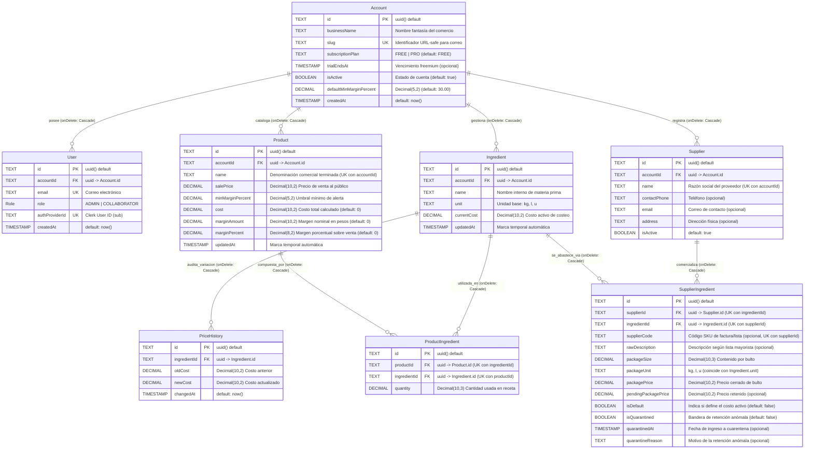
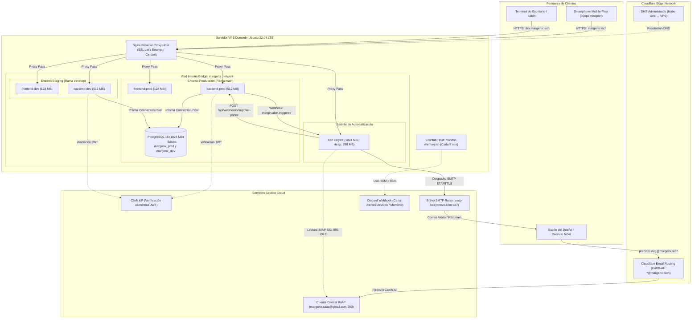

# MargenX — Especificación Técnica de Metodologías Ágiles y Arquitectura de Dominio

**Documento:** Consolidación Técnica de Casos de Uso, Modelo Físico y Despliegue de Infraestructura
**Versión:** 2.1 (Consolidada Sprint 4 — Automatización Operativa y Cuarentena)
**Materia:** Prácticas Profesionales Supervisadas (PPS) / Metodologías Ágiles — UNaB
**Fecha:** 24 de Octubre de 2026
**Equipo de Proyecto:**
* **Federico Paal:** Scrum Master (Sprint 4) & Lead Frontend / UX/UI Mobile-First
* **Darío Giménez:** DevOps, Infraestructura & Arquitecto de Automatización (n8n)
* **Mauricio Barreras:** Lead Backend & Data Architect
* **Leandro Herrera:** QA Engineer & Enlace con Clientes Piloto

---

## 1. Introducción y Alcance del Incremento

Durante el ciclo de desarrollo del **Sprint 4**, la plataforma evolucionó de un sistema de costeo reactivo manual a un ecosistema de **protección financiera automatizada y desatendida**. El presente documento formaliza:
1. La ampliación de la especificación de **Casos de Uso (CU)**, incorporando la *Ingesta Desatendida de Listas de Precios por Correo ("Zero-Click") con Filtro Anti-Pollution* y la *Gestión Integral de la Bandeja de Cuarentena de Precios Anómalos*.
2. La sincronización formal del **Modelo Físico de Base de Datos** con las tablas y campos activos en el motor PostgreSQL de producción (`margenx_prod`).
3. El **Diagrama de Despliegue de Infraestructura** consolidado en la VPS propia, reflejando el flujo de eventos satélite (n8n), enrutamiento de correo perimetral (Cloudflare Catch-All + Gmail IMAP) y relevo transaccional seguro (Brevo SMTP).

---

## 2. Especificación Formal de Casos de Uso (CU)

```
                            MAPA DE CASOS DE USO DE MARGENX
┌──────────────────────────────────────────────────────────────────────────────────┐
│ [ADMINISTRADOR]                                                                  │
│    ├── CU-01: Actualización de costo manual y recálculo en cascada               │
│    ├── CU-03: Alta/Edición de producto y composición de receta (BOM)            │
│    ├── CU-05: Auditoría, retención y resolución de precios en Cuarentena (NUEVO) │
│    └── CU-06: Homologación de empaques mayoristas y proveedor predeterminado     │
│                                                                                  │
│ [COLABORADOR DE SALÓN]                                                           │
│    └── CU-02: Consulta operativa de mostrador con sanitización financiera        │
│                                                                                  │
│ [SISTEMA SATÉLITE / n8n]                                                         │
│    └── CU-04: Ingesta masiva desatendida "Zero-Click" y Filtro Anti-Pollution    │
└──────────────────────────────────────────────────────────────────────────────────┘
```

---

### CU-01: Actualización de Costo Manual de Insumo y Recálculo en Cascada
* **Actor Principal:** Administrador.
* **Actores Secundarios:** Motor de Cálculo Financiero (`marginCalculator.ts`), Despachador de Alertas (`marginAlertDispatcher.ts`), n8n (Satélite).
* **Precondición:**
  1. El Administrador ha iniciado sesión y dispone de un JWT emitido por Clerk con rol `ADMIN`.
  2. El insumo existe y pertenece a la cuenta identificada por `accountId`.
* **Disparador:** El Administrador modifica el costo unitario de un insumo desde la interfaz web o mediante la API (`PUT /api/ingredients/:id`).
* **Flujo Principal (Camino Feliz):**
  1. El sistema valida sintáctica y semánticamente el payload de entrada mediante Zod (`name`, `unit`, `currentCost` > 0 y $\le \$99.999.999,99$).
  2. **Guarda Zero-Variation:** El backend compara el costo entrante contra el valor persistido. Si no existe variación numérica real (`previousCost.equals(nextCost)`), el sistema responde inmediatamente `HTTP 200 OK` retornando `affectedProductsCount: 0`, omitiendo la apertura de transacciones en base de datos.
  3. Si existe variación real, se inicia una transacción atómica ACID (`prisma.$transaction`):
     a. Se registra la variación histórica en la tabla `PriceHistory` (`oldCost`, `newCost`, `changedAt`).
     b. Se actualiza `Ingredient.currentCost = nextCost`.
     c. Se consultan todos los productos que contienen al insumo en su receta técnica (`ProductIngredient`).
     d. Para cada producto afectado, se recalculan con precisión arbitraria (`Prisma.Decimal`, redondeo `ROUND_HALF_UP` a 2 decimales) los campos `Product.cost`, `Product.marginAmount` y `Product.marginPercent`.
     e. Se actualiza el registro de cada `Product` afectado dentro de la misma transacción.
  4. Se consolida el commit de la transacción en la base de datos PostgreSQL.
  5. **Detección de Quiebre de Umbral:** El sistema analiza si algún producto cruzó el margen hacia abajo (es decir, `previousMargin >= minMargin` y `nextMargin < minMargin`).
  6. Si existen productos en estado crítico, el backend despacha de forma asíncrona un evento webhook HTTP POST hacia n8n (`margin.alert.triggered`), autenticado mediante la cabecera `x-margenx-webhook-secret`.
  7. El frontend recibe la respuesta JSON y despliega una cola secuencial de alertas Toast (`ToastAlert`) informando la cantidad de recetas afectadas y alertando sobre los productos en riesgo.
* **Flujos Alternativos:**
  * **FA-1 (Intento de modificación por rol no autorizado):** Si la petición proviene de un usuario con rol `COLLABORATOR`, el middleware `blockCollaboratorMutations` interrumpe la ejecución y retorna `HTTP 403 Forbidden` (`{"error": "Acceso denegado. Se requiere rol ADMIN."}`).
  * **FA-2 (Falla durante el recálculo de algún producto):** Si ocurre un error de base de datos durante la actualización de un producto, la transacción completa ejecuta rollback. No se persiste la variación del insumo ni el historial, y se retorna `HTTP 500 Internal Server Error`.
* **Postcondición:** El costo del insumo, el historial de precios y todos los productos vinculados quedan sincronizados de forma atómica en `margenx_prod`.

---

### CU-02: Consulta Operativa de Salón y Sanitización Financiera para Colaboradores
* **Actor Principal:** Colaborador (Cajero / Empleado de mostrador).
* **Precondición:** El usuario ha iniciado sesión con rol `COLLABORATOR`.
* **Disparador:** El Colaborador accede a `/productos` o `/dashboard`.
* **Flujo Principal (Camino Feliz):**
  1. El cliente envía la solicitud HTTP acompañada del Bearer Token de Clerk.
  2. El middleware `authMiddleware` valida la firma asimétrica del token (RS256) contra la clave pública del entorno (`CLERK_JWT_KEY`) y recupera el registro del usuario en PostgreSQL.
  3. El middleware `sanitizeFinancialData` intercepta la respuesta saliente:
     a. Configura la cabecera HTTP defensiva `Cache-Control: private, no-store` para impedir que proxys o el navegador almacenen datos sensibles en caché.
     b. Sobrescribe el método `res.json` para purgar de manera recursiva todos los campos financieros prohibidos (`cost`, `marginAmount`, `marginPercent`, `minMarginPercent`, `defaultMinMarginPercent`, `packagePrice`, `packageSize`, `unitCost`, `suppliers`).
  4. El controlador resuelve la consulta filtrando por `accountId`.
  5. La respuesta JSON sanitizada viaja hacia el cliente conteniendo únicamente el nombre del producto, la presentación y el `salePrice` (precio de venta al público).
  6. En el frontend, el componente `MarginBadge` y los bloques de detalle verifican el rol mediante `useUserRole()` y eliminan por completo los nodos del DOM correspondientes a costos o márgenes.
* **Flujos Alternativos:**
  * **FA-1 (Intento de acceso directo por URL a `/insumos`):** El guardia de rutas del frontend `AdminOnlyRoute` detecta el rol `COLLABORATOR` y redirige forzosamente hacia `/productos`. Si se invoca directamente la API (`GET /api/ingredients`), la ruta purga el campo `currentCost` y omite proveedores.
* **Postcondición:** El colaborador opera en salón y visualiza precios actualizados sin riesgo de filtración de rentabilidad, fórmulas o acuerdos con proveedores.

---

### CU-03: Alta y Edición de Ficha Técnica de Producto (Bill of Materials)
* **Actor Principal:** Administrador.
* **Precondición:** El usuario está autenticado como `ADMIN`. Existen materias primas cargadas en el catálogo de insumos.
* **Disparador:** El Administrador ingresa a `/productos/nuevo` o `/productos/:id`.
* **Flujo Principal (Camino Feliz):**
  1. El Administrador define el nombre del producto y el precio de venta sugerido (`salePrice`).
  2. El sistema aplica reactivamente el `defaultMinMarginPercent` de la cuenta (herencia comercial) como margen objetivo inicial, permitiendo su modificación manual.
  3. A través del selector reactivo gestionado por Zustand (`useRecipeStore`), el Administrador agrega insumos seleccionando unidades de receta (`gr`, `ml`, `u`) y cantidades utilizadas.
  4. La interfaz recalcula en memoria en $<50\text{ ms}$ la conversión a la unidad base de costeo (`kg`, `l`, `u`), el costo proporcional del ítem, el costo total de la tanda y el margen resultante.
  5. El Administrador presiona "Guardar Producto".
  6. El backend procesa la petición en `POST /api/products` dentro de una transacción atómica:
     a. Valida que todos los `ingredientId` existan y pertenezcan al `accountId` del token.
     b. Calcula el costo total de la receta y valida que los valores numéricos no desborden los límites máximos permitidos ($\le \$99.999.999,99$).
     c. Inserta el registro del producto y las tuplas de relación en `ProductIngredient`.
  7. El sistema retorna `HTTP 201 Created` con el producto normalizado.
* **Flujos Alternativos:**
  * **FA-1 (Soporte de Producto Borrador "Sin Receta"):** Si el comerciante crea un producto sin insumos asociados (`ingredients: []`), el sistema lo admite en modo borrador fijando `cost = 0.00`, `marginAmount = 0.00` y `marginPercent = 0.00%`. El producto se renderiza con el badge neutro *"Sin Receta"* sin disparar alertas erróneas de rentabilidad.
* **Postcondición:** La ficha técnica queda persistida y vinculada relacionalmente al catálogo de insumos.

---

### CU-04 (NUEVO): Ingesta Automatizada de Precios "Zero-Click" y Filtro Anti-Pollution
* **Actor Principal:** Dueño del Comercio (Remitente) / Satélite n8n.
* **Actores Secundarios:** Cloudflare Email Routing, Google Gmail (IMAP), Backend MargenX (`/api/webhooks/supplier-prices`).
* **Precondición:**
  1. La cuenta comercial posee un slug configurado (ej. `panaderia-central`).
  2. Existen códigos de artículo (`supplierCode`) vinculados a insumos mediante `SupplierIngredient`.
  3. El webhook satélite dispone del secreto criptográfico `INTERNAL_WEBHOOK_SECRET`.
* **Disparador:** Un proveedor envía una lista de precios por correo o WhatsApp. El dueño reenvía el archivo a `precios+<slug>@margenx.tech`.
* **Flujo Principal (Camino Feliz):**
  1. **Captura y Enrutamiento:** Cloudflare Email Routing (regla Catch-All) recibe el correo dirigido a `*@margenx.tech` y lo deposita en la casilla central de Gmail.
  2. **Disparo IMAP:** El nodo `EmailReadImap` de n8n detecta el nuevo correo vía IDLE, extrae el slug comercial del encabezado `To:` (`precios+panaderia-central@...`) e identifica el archivo adjunto (`.xlsx`, `.xls` o `.csv`). La cabecera `From:` se ignora para la identificación comercial.
  3. **Parseo y Normalización en n8n:** El workflow ejecuta la normalización de columnas (detectando sinónimos de código, descripción y precio) y convierte importes de moneda argentina (`1.234,56`) o formato inglés (`1,234.56`) a números flotantes estándar. Si el lote supera los 5.000 ítems, lo fragmenta en batches.
  4. **Despacho Seguro:** n8n realiza una petición `POST /api/webhooks/supplier-prices` incluyendo el cuerpo JSON y la cabecera de autenticación `x-margenx-webhook-secret`.
  5. **Validación en Backend:**
     a. El backend verifica el secreto mediante comparación en tiempo constante (`crypto.timingSafeEqual`) para prevenir ataques de timing.
     b. Valida el esquema del payload mediante Zod (`supplierPricesIngestSchema`).
     c. Resuelve la cuenta activa por `slug`.
     d. Deduplica ítems por `code` dentro del lote recibido.
  6. **Filtro Anti-Pollution (Lógica Batch en BD):**
     a. El sistema ejecuta una consulta en lote buscando todas las tuplas de `SupplierIngredient` cuyos `supplierCode` coincidan con los códigos del lote y pertenezcan a la cuenta.
     b. **Descarte Estricto:** Si el código no está mapeado en la base de datos, o corresponde a un proveedor inactivo, la fila se contabiliza como `discarded` (`reason: NOT_FOUND` o `INACTIVE_SUPPLIER`) y se descarta silenciosamente sin crear registros espurios.
     c. **Resolución de Ambigüedad:** Si un mismo código coincide con múltiples proveedores activos, se descarta marcándolo como `AMBIGUOUS` para evitar aplicar un precio erróneo.
  7. **Evaluación de Cuarentena (por ítem mapeado):**
     a. Calcula el costo unitario equivalente: `newUnitCost = newPrice / packageSize`.
     b. Compara `newUnitCost` frente al costo vigente.
     c. Si la variación supera el **50%** en valor absoluto ($|\Delta\%| > 50\%$) o el costo calculado es insuficiente ($\le \$0.01$), el precio entra en **Cuarentena** (continúa en CU-05).
     d. Si el precio no sufrió variación (`newPrice.equals(previousPrice)`), se contabiliza como `unchanged`.
     e. Si el precio es válido y razonable, se actualiza `SupplierIngredient.packagePrice = newPrice`.
  8. **Recálculo en Cascada de Proveedor Predeterminado:** Si el ítem actualizado tiene `isDefault = true`, se actualiza `Ingredient.currentCost = newUnitCost` y se dispara transaccionalmente `applyIngredientCostChange` sobre todas las recetas afectadas.
  9. **Resumen al Dueño:** El backend retorna el conteo veraz (`received`, `updated`, `unchanged`, `quarantined`, `duplicates`, `discarded`, `discardedCodes`, `account.ownerEmail`, `criticalProductsAlerts`). n8n procesa la respuesta y despacha un correo de resumen consolidado al correo del Administrador.
* **Flujos Alternativos:**
  * **FA-1 (Secreto de webhook inválido o ausente):** El backend rechaza la petición con `HTTP 401 Unauthorized`. n8n captura el código de estado, emite una alerta crítica a Discord mediante webhook de infraestructura y notifica al remitente sobre una falla de autenticación interna.
  * **FA-2 (Slug inexistente o cuenta inactiva):** El backend responde `HTTP 404 Not Found`. n8n responde al remitente indicando que la dirección comercial no pertenece a una cuenta registrada.
  * **FA-3 (Falla transitoria o caída de red):** Si el backend responde 5xx o agota el timeout, n8n ejecuta una política de hasta 3 reintentos exponenciales (esperas de 2s, 5s y 10s).
* **Postcondición:** Los insumos mapeados actualizan sus costos mayoristas, las recetas se recalculan, el catálogo permanece libre de basura de datos y el dueño recibe la notificación de impacto.

---

### CU-05 (NUEVO): Auditoría, Retención y Resolución de Precios en Cuarentena
* **Actor Principal:** Administrador.
* **Actores Secundarios:** Satélite n8n (Origen del precio anómalo), Backend MargenX.
* **Precondición:** Existen registros en `SupplierIngredient` con `isQuarantined = true` retenidos por el Filtro Anti-Pollution (CU-04).
* **Disparador:** El Administrador ingresa a `/proveedores/cuarentena` para evaluar precios observados.
* **Flujo Principal — Consulta y Decisión (Camino Feliz):**
  1. El Administrador navega a la bandeja de cuarentena. La interfaz invoca `GET /api/suppliers/quarantine`.
  2. El backend retorna los ítems en cuarentena de su cuenta con los campos calculados: `currentPrice`, `proposedPrice`, `variationPercent` y `quarantineReason` (`VARIACION_MAYOR_50_POR_CIENTO` o `COSTO_UNITARIO_INSUFICIENTE`).
  3. La interfaz renderiza las tarjetas táctiles (mobile) y la tabla (desktop) destacando en rojo los aumentos excesivos y en verde las caídas bruscas.
  4. **Opción A — Liberar Precio (Aprobación):**
     a. El Administrador presiona "Liberar" sobre un ítem. Se abre un diálogo modal de confirmación explicando el impacto en recetas.
     b. El usuario confirma. El cliente envía `POST /api/suppliers/quarantine/:id/release`.
     c. En backend, dentro de una transacción atómica:
        - Se actualiza `SupplierIngredient`: `packagePrice = pendingPackagePrice`, `pendingPackagePrice = null`, `isQuarantined = false`, `quarantinedAt = null`, `quarantineReason = null`.
        - Si la presentación es predeterminada (`isDefault = true`), se recalcula el costo unitario, se actualiza `Ingredient.currentCost` y se disparan los recálculos en cascada sobre los productos afectados.
     d. Si algún producto cae por debajo de su margen mínimo, se dispara de forma asíncrona la alerta `margin.alert.triggered`.
     e. El backend responde informando los productos afectados y críticos. El ítem se remueve de la bandeja local en Zustand (`removeItemLocally`).
  5. **Opción B — Rechazar Precio (Descarte Defensivo):**
     a. El Administrador presiona "Rechazar". El diálogo modal confirma que el precio propuesto será purgado manteniendo intacto el costo anterior.
     b. El cliente envía `POST /api/suppliers/quarantine/:id/reject`.
     c. En backend, se ejecuta:
        - `pendingPackagePrice = null`, `isQuarantined = false`, `quarantinedAt = null`, `quarantineReason = null`.
        - El campo `packagePrice` conserva el valor histórico seguro previo a la anomalía.
        - El costo del insumo y las recetas asociadas no sufren ninguna alteración.
     d. El backend retorna `HTTP 200 OK`. El ítem se elimina de la lista en pantalla y se emite un Toast de confirmación.
* **Flujos Alternativos:**
  * **FA-1 (Llegada de una nueva lista con el precio normalizado):** Si entra una lista posterior donde el precio vuelve a coincidir con el valor vigente, el webhook de ingesta (CU-04) detecta la coincidencia y limpia automáticamente el estado de cuarentena (`isQuarantined = false`), evitando retenciones innecesarias.
* **Postcondición:** La anomalía de precio queda resuelta; el catálogo refleja el costo validado por el dueño o preserva el valor histórico seguro.

---

### CU-06 (NUEVO): Homologación de Empaques Mayoristas y Proveedor Predeterminado
* **Actor Principal:** Administrador.
* **Precondición:** El insumo base existe en el catálogo interno (`Ingredient`). Existen distribuidores dados de alta en `Supplier`.
* **Disparador:** El Administrador recibe una factura o lista física y desea vincular una presentación comercial cerrada (ej. bolsa de 50 kg) en `/insumos`.
* **Flujo Principal (Camino Feliz):**
  1. El Administrador selecciona un insumo en `/insumos` y presiona **"Asociar otro empaque"**.
  2. Se despliega el modal `SupplierPackagingModal`. El usuario selecciona el proveedor mayorista del desplegable (o crea uno rápido inline si no existe).
  3. Ingresa la cantidad del bulto (`packageSize`, ej: `50`) y el precio total facturado (`packagePrice`, ej: `$35.000,00`). La unidad base se hereda de forma estricta (`packageUnit = kg`).
  4. La **Calculadora de Equivalencia** interna muestra en tiempo real el costo unitario resultante:
     $$\text{Costo Unitario} = \frac{\$35.000,00}{50\text{ kg}} = \$700,00/\text{kg}$$
     e indica comparativamente el porcentaje de ahorro o incremento frente al costo activo de las recetas.
  5. El usuario marca el switch **"Marcar como proveedor predeterminado"** y presiona "Guardar".
  6. El cliente despacha `POST /api/suppliers/:id/ingredients`.
  7. El backend procesa la solicitud mediante lógica transaccional de **Upsert**:
     a. Si la presentación para ese `(supplierId, ingredientId)` no existía, la crea (`HTTP 201 Created`). Si ya existía, actualiza sus valores sin arrojar conflicto (`HTTP 200 OK`).
     b. Al ser predeterminado (`isDefault = true`), desmarca a cualquier otra presentación previa del insumo (`isDefault = false`).
     c. Si el nuevo costo unitario difiere del costo vigente del insumo, registra el cambio en `PriceHistory`, actualiza `Ingredient.currentCost = 700.00` y ejecuta transaccionalmente el recálculo en cascada (`applyIngredientCostChange`).
  8. La interfaz actualiza la lista de proveedores asociados en `/insumos`, mostrando el badge *"Predeterminado"* y reflejando el nuevo costo base.
* **Postcondición:** El insumo queda homologado contra el bulto mayorista del proveedor, permitiendo que futuras importaciones automáticas reconozcan el código y el factor de empaque sin intervención humana.

---

## 3. Modelo Físico de Base de Datos Sincronizado (`margenx_prod`)

El modelo físico de persistencia en PostgreSQL 16 refleja la estructura definitiva de la base de datos de producción (`margenx_prod`), consolidada tras las migraciones de proveedores, índices cronológicos, aislamiento por slug y atributos de cuarentena.

### 3.1. Diagrama Entidad-Relación Físico (Mermaid ERD)



---

### 3.2. Diccionario de Datos Físico

#### Tabla: `Account` (Aislamiento Multi-Tenant)
Almacena las organizaciones o comercios clientes. Cada tenant opera aislado en base a su clave primaria.
* `id` (`TEXT`, PK, UUID): Identificador único global de la cuenta comercial.
* `businessName` (`TEXT`, NOT NULL): Nombre fantasía o razón social del comercio.
* `slug` (`TEXT`, UNIQUE, NOT NULL): Identificador único URL-safe en minúsculas (ej: `panaderia-central`). Es utilizado por Cloudflare y n8n para resolver el destinatario en la ingesta por correo.
* `subscriptionPlan` (`TEXT`, NOT NULL, DEFAULT `'FREE'`): Plan de suscripción contratado.
* `trialEndsAt` (`TIMESTAMP(3)`, NULL): Fecha de expiración de período de prueba.
* `isActive` (`BOOLEAN`, NOT NULL, DEFAULT `true`): Permite deshabilitar el acceso a nivel global.
* `defaultMinMarginPercent` (`DECIMAL(5,2)`, NOT NULL, DEFAULT `30.00`): Margen objetivo configurado en el perfil de la empresa; se hereda automáticamente al crear nuevos productos.
* `createdAt` (`TIMESTAMP(3)`, NOT NULL, DEFAULT `CURRENT_TIMESTAMP`).

#### Tabla: `User` (Identidad y Roles RBAC)
Usuarios con acceso al sistema dentro de una cuenta específica.
* `id` (`TEXT`, PK, UUID): Identificador interno del usuario.
* `accountId` (`TEXT`, FK -> `Account.id`, ON DELETE CASCADE, NOT NULL).
* `email` (`TEXT`, UNIQUE, NOT NULL): Correo electrónico del operador.
* `role` (`ENUM ('ADMIN', 'COLLABORATOR')`, NOT NULL, DEFAULT `'COLLABORATOR'`): Define los privilegios de visualización y mutación en la API.
* `authProviderId` (`TEXT`, UNIQUE, NOT NULL): Identificador de sujeto (`sub`) emitido por Clerk Authentication.
* `createdAt` (`TIMESTAMP(3)`, NOT NULL, DEFAULT `CURRENT_TIMESTAMP`).

#### Tabla: `Ingredient` (Catálogo de Materias Primas)
Materias primas básicas expresadas en su unidad canónica de costeo.
* `id` (`TEXT`, PK, UUID): Identificador único del insumo.
* `accountId` (`TEXT`, FK -> `Account.id`, ON DELETE CASCADE, NOT NULL).
* `name` (`TEXT`, NOT NULL): Nombre descriptivo interno del insumo.
* `unit` (`TEXT`, NOT NULL): Unidad de medida de la despensa (`kg`, `l` o `u`).
* `currentCost` (`DECIMAL(10,2)`, NOT NULL): Costo unitario activo utilizado por el motor para calcular el costo de las recetas.
* `updatedAt` (`TIMESTAMP(3)`, NOT NULL).

#### Tabla: `Supplier` (Contactos Mayoristas)
Directorio de proveedores comerciales vinculados a la cuenta.
* `id` (`TEXT`, PK, UUID): Identificador del proveedor.
* `accountId` (`TEXT`, FK -> `Account.id`, ON DELETE CASCADE, NOT NULL).
* `name` (`TEXT`, NOT NULL): Nombre comercial o razón social.
* `contactPhone` (`TEXT`, NULL): Teléfono de ventas.
* `email` (`TEXT`, NULL): Correo electrónico de contacto.
* `address` (`TEXT`, NULL): Dirección física de entrega o retiro.
* `isActive` (`BOOLEAN`, NOT NULL, DEFAULT `true`): Permite suspender temporalmente compras a un proveedor.
* *Restricción Única:* `@@unique([accountId, name])`.

#### Tabla: `SupplierIngredient` (SKU Cross-Reference y Cuarentena)
Tabla intermedia de equivalencias de compra mayorista, factores de empaque y buffer defensivo de cuarentena.
* `id` (`TEXT`, PK, UUID): Identificador de la presentación.
* `supplierId` (`TEXT`, FK -> `Supplier.id`, ON DELETE CASCADE, NOT NULL).
* `ingredientId` (`TEXT`, FK -> `Ingredient.id`, ON DELETE CASCADE, NOT NULL).
* `supplierCode` (`TEXT`, NULL): Código de artículo asignado por el distribuidor (SKU de factura). Utilizado para matching automático en ingestas.
* `rawDescription` (`TEXT`, NULL): Denominación textual en el catálogo mayorista.
* `packageSize` (`DECIMAL(10,3)`, NOT NULL): Contenido neto del bulto cerrado (ej. 25.000 kg).
* `packageUnit` (`TEXT`, NOT NULL): Unidad del bulto (debe coincidir con `Ingredient.unit`).
* `packagePrice` (`DECIMAL(10,2)`, NOT NULL): Precio facturado por el bulto cerrado.
* `pendingPackagePrice` (`DECIMAL(10,2)`, NULL): **Campo de Cuarentena v2.** Precio propuesto retenido tras detectar anomalía, preservando el `packagePrice` previo activo.
* `isDefault` (`BOOLEAN`, NOT NULL, DEFAULT `false`): Determina si esta presentación alimenta automáticamente el `currentCost` del insumo.
* `isQuarantined` (`BOOLEAN`, NOT NULL, DEFAULT `false`): Marca si el ítem está bloqueado en cuarentena.
* `quarantinedAt` (`TIMESTAMP(3)`, NULL): Fecha y hora exacta de captura de la anomalía.
* `quarantineReason` (`TEXT`, NULL): Razón del bloqueo (`VARIACION_MAYOR_50_POR_CIENTO` o `COSTO_UNITARIO_INSUFICIENTE`).
* *Restricciones Únicas:* `@@unique([supplierId, ingredientId])` y `@@unique([supplierId, supplierCode])`.

#### Tabla: `PriceHistory` (Trazabilidad Inflacionaria)
Auditoría cronológica inmutable de variaciones de costos de materias primas.
* `id` (`TEXT`, PK, UUID): Identificador del registro.
* `ingredientId` (`TEXT`, FK -> `Ingredient.id`, ON DELETE CASCADE, NOT NULL).
* `oldCost` (`DECIMAL(10,2)`, NOT NULL): Costo anterior.
* `newCost` (`DECIMAL(10,2)`, NOT NULL): Costo nuevo tras la variación.
* `changedAt` (`TIMESTAMP(3)`, NOT NULL, DEFAULT `CURRENT_TIMESTAMP`).
* *Índice Compuesto:* `CREATE INDEX "PriceHistory_ingredientId_changedAt_idx" ON "PriceHistory"("ingredientId", "changedAt")`.

#### Tabla: `Product` (Catálogo Comercial Terminado)
Productos elaborados ofrecidos a la venta al público.
* `id` (`TEXT`, PK, UUID): Identificador del producto.
* `accountId` (`TEXT`, FK -> `Account.id`, ON DELETE CASCADE, NOT NULL).
* `name` (`TEXT`, NOT NULL): Nombre comercial del producto (almacenado en minúsculas en base de datos para garantizar unicidad insensible a mayúsculas).
* `salePrice` (`DECIMAL(10,2)`, NOT NULL): Precio de venta final cobrado al público en mostrador.
* `minMarginPercent` (`DECIMAL(5,2)`, NOT NULL, DEFAULT `30.00`): Margen mínimo porcentual esperado antes de disparar semáforo rojo y alertas.
* `cost` (`DECIMAL(10,2)`, NOT NULL, DEFAULT `0.00`): Costo total liquidado por la receta.
* `marginAmount` (`DECIMAL(10,2)`, NOT NULL, DEFAULT `0.00`): Ganancia bruta nominal en pesos ($V - C$).
* `marginPercent` (`DECIMAL(8,2)`, NOT NULL, DEFAULT `0.00`): Margen comercial sobre precio de venta:
  $$\text{Margen \%} = \frac{\text{Precio de Venta} - \text{Costo Total}}{\text{Precio de Venta}} \times 100$$
  *(Almacenado como Decimal(8,2) para tolerar ventas a pérdida con margen negativo extremo).*
* `updatedAt` (`TIMESTAMP(3)`, NOT NULL).
* *Restricción Única:* `@@unique([accountId, name])`.

#### Tabla: `ProductIngredient` (Línea de Receta / Ficha Técnica)
Matriz relacional que asocia insumos a productos con sus cantidades de formulación.
* `id` (`TEXT`, PK, UUID): Identificador de la línea.
* `productId` (`TEXT`, FK -> `Product.id`, ON DELETE CASCADE, NOT NULL).
* `ingredientId` (`TEXT`, FK -> `Ingredient.id`, ON DELETE CASCADE, NOT NULL).
* `quantity` (`DECIMAL(10,3)`, NOT NULL): Proporción requerida de materia prima en la unidad base del insumo.
* *Restricción Única:* `@@unique([productId, ingredientId])`.

---

## 4. Arquitectura y Diagrama de Despliegue de Infraestructura

El despliegue opera bajo el modelo **Consolidado 100% en VPS Linux** (Ubuntu 22.04 LTS, IP no publicada), implementando un esquema de doble entorno (Staging y Producción) dentro de una misma máquina mediante Docker Compose, aislando bases de datos y confinando el uso de memoria a un techo de $\approx 3.3\text{ GB}$.

### 4.1. Diagrama de Despliegue Físico y Topología de Red (Mermaid)



---

### 4.2. Especificaciones de Despliegue y Parámetros Operativos

#### Puertos y Conexiones Internas
* **Nginx Host (Perímetro):** Escucha en puertos `80` (HTTP con redirección forzosa 301 a HTTPS) y `443` (HTTPS TLSv1.2 / TLSv1.3 con certificados emitidos por Certbot).
* **Mapeo de Contenedores en Host (Loopback 127.0.0.1):**
  * `frontend-prod`: `127.0.0.1:3010 -> 80`
  * `backend-prod`: `127.0.0.1:3011 -> 3000`
  * `frontend-dev`: `127.0.0.1:3020 -> 80`
  * `backend-dev`: `127.0.0.1:3021 -> 3000`
  * `n8n`: `127.0.0.1:5678 -> 5678`
  * `postgres`: `127.0.0.1:5435 -> 5432` *(Puerto protegido: únicamente accesible vía localhost o túnel SSH, impidiendo exposición a la red pública).*

#### Confinamiento de Recursos y Resiliencia
Para garantizar que los 6 contenedores coexistan en los 8 GB de memoria de la VPS sin riesgo de activación del *OOM Killer (Out Of Memory)*, el archivo `/opt/margenx-infra/docker-compose.yml` aplica límites estrictos:
* **PostgreSQL:** Límite `1024M` / Reserva `512M`.
* **n8n Engine:** Límite `1024M` / Reserva `384M`. Variable de entorno: `NODE_OPTIONS=--max-old-space-size=768` (previene la saturación del heap de V8 al procesar planillas de cálculo grandes en memoria).
* **Backends (Prod y Dev):** Límite `512M` c/u / Reserva `256M`.
* **Frontends Nginx (Prod y Dev):** Límite `128M` c/u / Reserva `64M`.
* **Techo total de consumo:** $\approx 3.3\text{ GB}$ sobre los 8 GB disponibles.
* **Rotación de Logs:** Configuración de driver `json-file` con `max-size: "10m"` y `max-file: "3"` en todos los servicios.

#### Centinela de Memoria (`monitor-memory.sh`)
Ubicado en el host en `/opt/margenx-infra/scripts/monitor-memory.sh` y ejecutado vía `crontab` cada 5 minutos:
1. Evalúa el uso porcentual de RAM del host: `free | grep Mem | awk '{print int($3/$2 * 100)}'`.
2. Si el consumo es $\ge 85\%$, obtiene el top 5 de contenedores con mayor demanda mediante `docker stats --no-stream`.
3. Despacha un Embed formateado a Discord en el canal de infraestructura con mención a DevOps.
4. Aplica un mecanismo de cooldown de 30 minutos vía lockfile (`/tmp/margenx_mem_alert.lock`) para evitar saturación de mensajes.

---

## 5. Matriz de Trazabilidad entre Casos de Uso, Endpoints y Modelo Físico

| Caso de Uso | Endpoints / Webhooks Involucrados | Tablas Afectadas | Componentes Frontend Clave |
| :--- | :--- | :--- | :--- |
| **CU-01:** Recálculo Manual en Cascada | `PUT /api/ingredients/:id`<br>`POST n8n /webhook/margin-alert` | `Ingredient`<br>`PriceHistory`<br>`Product`<br>`ProductIngredient` | `IngredientUpsertSheet.tsx`<br>`ToastAlert.tsx`<br>`MarginBadge.tsx` |
| **CU-02:** Consulta Operativa de Salón (RBAC) | `GET /api/products`<br>`GET /api/dashboard/metrics`<br>`GET /api/auth/me` | `Product`<br>`Account` | `AdminOnlyRoute.tsx`<br>`useUserRole.ts`<br>`BottomNav.tsx` |
| **CU-03:** Ficha Técnica (BOM) | `POST /api/products`<br>`PUT /api/products/:id` | `Product`<br>`ProductIngredient`<br>`Ingredient` | `ProductMasterDataForm.tsx`<br>`ProductRecipeBOM.tsx`<br>`useRecipeStore.ts` |
| **CU-04:** Ingesta Zero-Click (Anti-Pollution) | `POST /api/webhooks/supplier-prices` | `SupplierIngredient`<br>`Ingredient`<br>`PriceHistory`<br>`Product` | Workflow n8n `ingesta-listas.json`<br>Servidor IMAP / Cloudflare Catch-All |
| **CU-05:** Gestión de Cuarentena | `GET /api/suppliers/quarantine`<br>`POST /api/suppliers/quarantine/:id/release`<br>`POST /api/suppliers/quarantine/:id/reject` | `SupplierIngredient`<br>`Ingredient`<br>`PriceHistory`<br>`Product` | `/proveedores/cuarentena`<br>`QuarantineList.tsx`<br>`useQuarantineStore.ts` |
| **CU-06:** Homologación Mayorista | `POST /api/suppliers/:id/ingredients` | `Supplier`<br>`SupplierIngredient`<br>`Ingredient`<br>`PriceHistory` | `SupplierPackagingModal.tsx`<br>`IngredientSupplierList.tsx` |

---

## 6. Conclusión y Estado de Madurez de la Arquitectura

Con la consolidación de estos componentes al término del **Sprint 4**, la arquitectura de MargenX alcanza los siguientes estándares de ingeniería:
1. **Integridad Financiera:** Eliminación definitiva de errores de coma flotante mediante el estándar `Prisma.Decimal`, manteniendo trazabilidad auditable en `PriceHistory`.
2. **Defensa de Datos y Calidad de Catálogo:** El desacoplamiento entre el catálogo interno (`Ingredient`) y los distribuidores mayoristas (`SupplierIngredient`), potenciado por el *Filtro Anti-Pollution* y la *Bandeja de Cuarentena*, protege a la PyME de aumentos desmedidos y suciedad en la base de datos.
3. **Seguridad y Confidencialidad Multi-Tenant:** El control de acceso RBAC de doble capa garantiza que la rentabilidad permanezca exclusivamente en manos del dueño, mientras el personal operativo dispone de precios actualizados para atención al público.