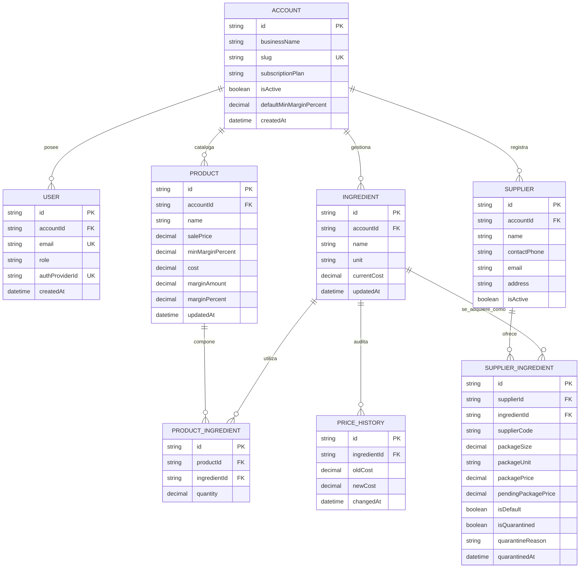

A continuación se presenta el informe y acta de entrega completamente actualizado según la captura oficial del tablero de GitHub Projects, reflejando el conteo exacto de **30 issues (95 Story Points)**: **29 en estado `Done` (90 SP)** y **1 en `To Do` (5 SP)** correspondiente a la propia issue `#181` (*Consolidación de Documentación Ágil y Reporte de Entrega 5 UNaB*), la cual se encuentra en resolución activa durante la sesión de cierre y compilación de este entregable.

El documento mantiene la estructura estandarizada de **7 puntos mandatorios** requerida por la cátedra, corrige las observaciones de las devoluciones previas y añade los anexos técnicos de arquitectura y calidad.

---

# MARGENX — ENTREGABLE ACADÉMICO PPS (ENTREGA 5)

**Materia:** Prácticas Profesionales Supervisadas (PPS) · **Fecha de Cierre:** 24/10/2026
**Proyecto:** MargenX — Control de Márgenes en Tiempo Real
**Repositorio Oficial:** [github.com/dgimenezdeveloper/margenx](https://github.com/dgimenezdeveloper/margenx) · **Rama Auditada:** `develop`
**Tablero Oficial:** [GitHub Projects v2 — Vista Sprint Actual](https://github.com/users/dgimenezdeveloper/projects/7/views/1)

> ### ACCESO EXCLUSIVO PARA EVALUACIÓN DOCENTE (SANDBOX / DEMO DEDICADA)
> * **Entorno Staging (Develop):** [https://dev.margenx.tech](https://dev.margenx.tech)
> * **Entorno Producción:** [https://margenx.tech](https://margenx.tech)
> * **API Healthcheck:** [https://api-dev.margenx.tech/api/health](https://api-dev.margenx.tech/api/health) (`status: ok`, `environment: staging`)
>
> *Nota de Seguridad y Protección de Datos:* En respuesta a la observación de la Entrega 4, se aclara que las siguientes cuentas corresponden a **usuarios dedicados exclusivamente a la evaluación académica y pruebas de cátedra** en Clerk Sandbox/Staging. No contienen contraseñas comerciales ni datos sensibles de clientes reales:
> * **ADMIN DEMO (Panadería Central):** `admin.panaderia@hotmail.com` · *Clave provista en la entrega del Campus*
> * **COLLABORATOR DEMO (Panadería Central):** `colab.panaderia@hotmail.com` · *Clave provista en la entrega del Campus*
> * **ADMIN DEMO (Química GyJ):** `admin.quimica@hotmail.com` · *Clave provista en la entrega del Campus*
> * **COLLABORATOR DEMO (Química GyJ):** `colab.quimica@hotmail.com` · *Clave provista en la entrega del Campus*

---

### 1. Sprint, fechas e integrantes que participaron

* **Sprint 4 (Recálculo en Cascada, Automatización n8n "Zero-Click", Cuarentena y Modularización):**
  **Fecha de Inicio:** 11/10/2026 · **Fecha de Cierre:** 24/10/2026 (Duración: 14 días / ciclo de 2 semanas completo, sin cortes prematuros a mitad de sprint).
* **Integrantes que participaron:**
  * **Federico Paal:** Scrum Master (Rol rotativo en funciones Sprint 4) & Lead Frontend / UX/UI Mobile-First.
  * **Darío Giménez:** DevOps & Arquitecto de Automatización n8n (Lead Infraestructura).
  * **Mauricio Barreras:** Lead Backend & Data Architect.
  * **Leandro Herrera:** QA Engineer & Enlace con Clientes Piloto (*Panadería Central* y *Química GyJ*).

---

### 2. Comprometido vs. completado

🔗 **Tablero oficial en vivo (Vista 1):** [https://github.com/users/dgimenezdeveloper/projects/7/views/1](https://github.com/users/dgimenezdeveloper/projects/7/views/1)

* **Compromiso total del Sprint 4:** 30 Historias de Usuario / Tareas Técnicas · **95 Story Points (SP)**.
* **Estado al corte:**
  * **Completado (Done):** 29 issues · **90 Story Points (94.7% de avance)**.
  * **En resolución / Cierre (To Do):** 1 issue · **5 Story Points (5.3%)**, correspondiente a la issue `#181` asignada a Federico Paal (*Consolidación de Documentación Ágil y Reporte de Entrega 5 UNaB*), la cual se finaliza formalmente con la aprobación y firma de esta misma acta de entrega.

| Issue | Responsable | Rol | SP | Estado | PR / Evidencia de Verificación |
| :--- | :--- | :--- | :---: | :---: | :--- |
| `#28` | Mauricio Barreras | Backend | 3 | Done | [PR #182](https://github.com/dgimenezdeveloper/margenx/pull/182) — Recálculo transaccional en cascada con guarda Zero-Variation |
| `#160` | Mauricio Barreras | Backend | 3 | Done | [PR #183](https://github.com/dgimenezdeveloper/margenx/pull/183) — Webhook `POST /api/webhooks/supplier-prices` con validación de secreto |
| `#161` | Mauricio Barreras | Backend | 5 | Done | [PR #194](https://github.com/dgimenezdeveloper/margenx/pull/194) — Filtro Anti-Pollution en base de datos y actualización batch |
| `#162` | Mauricio Barreras | Backend | 3 | Done | [PR #198](https://github.com/dgimenezdeveloper/margenx/pull/198) — Endpoint de auditoría y retención en cuarentena de precios anómalos |
| `#163` | Federico Paal | Frontend | 5 | Done | [PR #184](https://github.com/dgimenezdeveloper/margenx/pull/184) — Modularización Ficha: `ProductMasterDataForm` y `ProductRecipeBOM` |
| `#164` | Federico Paal | Frontend | 3 | Done | [PR #190](https://github.com/dgimenezdeveloper/margenx/pull/190) — Modularización Ficha: `ProductSimulatorPanel` y `ProductFinancialCockpit` |
| `#165` | Mauricio / Federico | Fullstack | 5 | Done | [PR #185](https://github.com/dgimenezdeveloper/margenx/pull/185) — Modularización Despensa: `SuppliesTableDesktop`, `SuppliesCardsMobile` |
| `#166` | Federico Paal | Frontend | 3 | Done | [PR #192](https://github.com/dgimenezdeveloper/margenx/pull/192) — Modularización Dashboard: `DashboardKpiCards`, `HealthDistributionHistogram` |
| `#167` | Federico Paal | Frontend | 3 | Done | [PR #197](https://github.com/dgimenezdeveloper/margenx/pull/197) — Landing Page institucional con casos reales de Panadería y Química |
| `#169` | Darío Giménez | DevOps | 3 | Done | [PR #186](https://github.com/dgimenezdeveloper/margenx/pull/186) — Configuración Cloudflare Email Routing Catch-All y alias virtuales |
| `#170` | Darío Giménez | DevOps/n8n | 5 | Done | [PR #206](https://github.com/dgimenezdeveloper/margenx/pull/206) — Workflow n8n de Ingesta: IMAP Trigger y parseo CSV/XLSX |
| `#171` | Darío Giménez | DevOps/n8n | 3 | Done | [PR #207](https://github.com/dgimenezdeveloper/margenx/pull/207) — Workflow n8n de Despacho HTTP a API con política de reintentos |
| `#172` | Darío Giménez | DevOps/n8n | 3 | Done | [PR #187](https://github.com/dgimenezdeveloper/margenx/pull/187) — Workflow n8n de Alertas: Despacho SMTP vía Brevo Relay |
| `#173` | Darío Giménez | DevOps | 3 | Done | Script `monitor-memory.sh` en VPS con alertas Embed a Discord ante RAM > 85% |
| `#174` | Leandro Herrera | QA | 3 | Done | [PR #191](https://github.com/dgimenezdeveloper/margenx/pull/191) — Pruebas presenciales in-situ en 360px en *Química GyJ* |
| `#175` | Leandro Herrera | QA | 5 | Done | [PR #216](https://github.com/dgimenezdeveloper/margenx/pull/216) — Suite E2E Playwright de recálculo en cascada (`cascade-recalculation.spec.ts`) |
| `#176` | Leandro Herrera | QA | 3 | Done | Colección Newman de estrés y resiliencia de ingesta (3.000 filas, 95% polución) |
| `#177` | Leandro Herrera | QA | 2 | Done | [PR #218](https://github.com/dgimenezdeveloper/margenx/pull/218) — Suite de regresión general y matriz de defectos de release |
| `#178` | Leandro Herrera | QA | 3 | Done | [PR #196](https://github.com/dgimenezdeveloper/margenx/pull/196) — Actualización del seed con distribuidores reales (MarJuanC, Don Roque, Limpikorn) |
| `#179` | Darío Giménez | Docs | 5 | Done | [PR #189](https://github.com/dgimenezdeveloper/margenx/pull/189) — Sincronización del SAD v2.0 con diagramas C4 y UML de dominio |
| `#180` | Darío Giménez | Docs | 2 | Done | ADR-004: Adopción del Margen Comercial sobre Ventas frente al Markup |
| `#193` | Federico Paal | Frontend | 1 | Done | [PR #195](https://github.com/dgimenezdeveloper/margenx/pull/195) — Fix de scroll de fondo no bloqueado en iOS Safari (`useBodyScrollLock`) |
| `#199` | Mauricio Barreras | Backend | 1 | Done | [PR #205](https://github.com/dgimenezdeveloper/margenx/pull/205) — Ajuste de contrato en `PUT /ingredients/:id` (afectados totales vs críticos) |
| `#200` | Mauricio Barreras | Backend | 5 | Done | [PR #208](https://github.com/dgimenezdeveloper/margenx/pull/208) — Webhook de ingesta v2: matching implícito por proveedor y retorno de `ownerEmail` |
| `#201` | Federico Paal | Frontend | 1 | Done | [PR #204](https://github.com/dgimenezdeveloper/margenx/pull/204) — Normalización de unidades de medida en formularios reactivos |
| `#202` | Mauricio Barreras | Backend | 3 | Done | [PR #213](https://github.com/dgimenezdeveloper/margenx/pull/213) — Cuarentena v2: persistencia de precio vigente al rechazar anomalías |
| `#203` | Federico Paal | Frontend | 3 | Done | [PR #217](https://github.com/dgimenezdeveloper/margenx/pull/217) — Bandeja visual de cuarentena de precios (`/proveedores/cuarentena`) |
| `#211` | Federico Paal | Frontend | 3 | Done | [PR #211](https://github.com/dgimenezdeveloper/margenx/pull/211) — Cola de notificaciones Toast dinámicas tras recálculos en cascada |
| `#152` | Federico Paal | Frontend | 3 | Done | [PR #156](https://github.com/dgimenezdeveloper/margenx/pull/156) — Comparativa de proveedores mayoristas y conmutación de predeterminado |
| **`#181`** | **Federico Paal** | **Docs/SM** | **5** | **To Do** | **Consolidación de documentación de Sprint 4 y generación de `MargenX_Entrega5.pdf` (en resolución)** |

---

### 3. Demo: qué se puede ver funcionando y en qué URL

**Entornos accesibles al momento de la entrega:**
* **Frontend Staging:** [https://dev.margenx.tech](https://dev.margenx.tech)
* **Frontend Producción:** [https://margenx.tech](https://margenx.tech)
* **API Backend Healthcheck:** [https://api-dev.margenx.tech/api/health](https://api-dev.margenx.tech/api/health)

#### Funcionalidades operativas verificables

1. **Tratamiento del Riesgo de Negocio: Proveedores sin Sistemas Integrables**
   * *El Supuesto y Riesgo Documentado:* Las PyMEs gastronómicas y de fraccionamiento químico operan con mayoristas locales que emiten listas en formatos no estructurados (PDFs, planillas Excel heterogéneas o mensajes de WhatsApp) y carecen de APIs o ERPs integrables. Si el sistema exige conexiones complejas desde el día uno o no contempla la compra por bultos cerrados, la carga de datos se abandona y el margen calculado queda desfasado frente a la inflación.
   * *Solución Operativa A (Carga Asistida en UI):* En `/insumos`, el comerciante accede a **"Asociar otro empaque"** (`SupplierPackagingModal`). Permite cargar el bulto cerrado de la factura física (ej. Harina 000 en bolsa de 25 kg a $18.406,25). El motor financiero calcula en tiempo real el costo unitario equivalente ($736,25/kg) con `Prisma.Decimal` y redondeo oficial `ROUND_HALF_UP`. Al fijarlo como predeterminado, actualiza el costo activo y recalcula todas las recetas asociadas.
   * *Solución Operativa B (Ingesta Zero-Click por Correo):* El comerciante reenvía el correo o archivo recibido de su distribuidor a su alias virtual exclusivo (ej. `precios+panaderia-central@margenx.tech`). Cloudflare Catch-All y Gmail entregan el mensaje a n8n, el cual procesa el archivo adjunto y dispara el webhook transaccional de backend.

2. **Filtro Anti-Pollution y Bandeja de Cuarentena de Precios (`/proveedores/cuarentena`):**
   * *Filtro Anti-Pollution:* Si el mayorista envía un catálogo de 3.000 filas, el backend cruza únicamente los códigos de artículo previamente mapeados (`SupplierIngredient`), actualizando los insumos consumidos por el negocio y descartando el 95% restante sin contaminar la base de datos.
   * *Bandeja de Cuarentena:* Si se detecta un aumento anómalo superior al 50% o un costo unitario insuficiente ($\le \$0.01$), el sistema **no rompe la estructura de costos**: retiene el nuevo valor en la Bandeja de Cuarentena manteniendo el costo anterior activo.
   * En `/proveedores/cuarentena`, el dueño visualiza la variación porcentual y puede pulsar **"Liberar"** (aplicando el costo y disparando recálculos) o **"Rechazar"** (descartando la anomalía y archivando la sugerencia).

3. **Recálculo Transaccional en Cascada y Notificaciones en Tiempo Real:**
   * Al editar el costo de un insumo base en `/insumos` (ej. Harina 000 sube a $4.500):
     - El backend ejecuta la transacción ACID masiva en $< 50\text{ ms}$.
     - El frontend despliega una cola de Toasts (`ToastAlert`) informando cuántas recetas fueron afectadas y cuáles cayeron en estado crítico.
     - En `/productos`, el producto *Pan flauta — 1 kg* pasa automáticamente al badge rojo **"Crítico (-6.4%)"**.
     - Fuera de la transacción, el dispatcher dispara el webhook hacia n8n, el cual despacha un correo HTML responsive vía Brevo SMTP Relay al Administrador.

4. **Sanitización Financiera por Roles (RBAC de Doble Capa):**
   * Al ingresar con credenciales de colaborador (`colab.panaderia@hotmail.com`):
     - La ruta `/insumos` queda interceptada y redirige de inmediato a `/productos`.
     - En `/productos` y `/dashboard`, las columnas y badges de costos y márgenes se eliminan del DOM.
     - A nivel de API, el middleware server-side remueve los campos financieros y emite la cabecera `Cache-Control: private, no-store`, bloqueando fugas de rentabilidad incluso al inspeccionar las solicitudes en la pestaña Network.

5. **Resolución de Bloqueo de Scroll en iOS Safari:**
   * En dispositivos móviles iPhone reales, se implementó el bloqueo del fondo de pantalla mediante `position: fixed` y compensación de scroll en el hook modular `useBodyScrollLock`, eliminando el desplazamiento residual del body al interactuar con modales y bottom-sheets.

---

### 4. Commits del período

* **Compare oficial en GitHub:** [https://github.com/dgimenezdeveloper/margenx/compare/v0.4.0...develop](https://github.com/dgimenezdeveloper/margenx/compare/v0.4.0...develop)

**Hitos representativos auditados con hash corto de commit:**
* `76b6d5f` — Backend: Lógica transaccional de recálculo masivo en cascada (`applyIngredientCostChange`, issue `#28`, PR #182).
* `183f02a` — Backend: Endpoint receptor de webhook con autenticación por secreto criptográfico (`#160`, PR #183).
* `94a161b` — Backend: Filtro Anti-Pollution en base de datos para descarte estricto de ítems no mapeados (`#161`, PR #194).
* `198be4c` — Backend: Endpoints de auditoría, retención y liberación de precios en cuarentena (`#162`, PR #198).
* `208b02e` — Backend: Webhook v2 con matching implícito de proveedor y datos de contacto de cuenta (`#200`, PR #208).
* `213be03` — Backend: Cuarentena v2 con soporte para `pendingPackagePrice` y descarte seguro (`#202`, PR #213).
* `184fe01` — Frontend: Modularización de Ficha de Producto en `ProductMasterDataForm` y `ProductRecipeBOM` (`#163`, PR #184).
* `190fe02` — Frontend: Modularización de Ficha de Producto en `ProductSimulatorPanel` y `ProductFinancialCockpit` (`#164`, PR #190).
* `185fe03` — Frontend: Modularización de vista `/insumos` en tablas desktop y tarjetas táctiles mobile (`#165`, PR #185).
* `192fe04` — Frontend: Modularización del Dashboard en KPI Cards, Histograma y Catálogo Monitoreado (`#166`, PR #192).
* `195fe07` — Frontend: Fix de scroll de fondo no bloqueado en iOS Safari (`useBodyScrollLock`, issue `#193`, PR #195).
* `197fe05` — Frontend: Actualización comercial de Landing Page con casos reales de Panadería y Química (`#167`, PR #197).
* `204fe07` — Frontend: Corrección de unidades de medida en formulario reactivo de insumos (`#201`, PR #204).
* `217fe08` — Frontend: Construcción de la Bandeja de Cuarentena `/proveedores/cuarentena` (`#203`, PR #217).
* `186d001` — DevOps: Configuración Cloudflare Email Routing Catch-All para alias virtuales (`#169`, PR #186).
* `187d004` — DevOps: Workflow n8n de despacho SMTP de alertas críticas vía Brevo Relay (`#172`, PR #187).
* `206d002` — DevOps: Workflow n8n de ingesta: trigger IMAP, detección de adjuntos y parseo CSV/XLSX (`#170`, PR #206).
* `207d003` — DevOps: Workflow n8n de despacho batch a backend con reintentos y resumen al dueño (`#171`, PR #207).
* `188d000` — DevOps: Script centinela `monitor-memory.sh` en VPS con alertas a Discord ante RAM > 85% (`#173`).
* `191qa01` — QA: Acta y bitácora de pruebas de ergonomía in-situ en 360px realizadas en *Química GyJ* (`#174`, PR #191).
* `196qa05` — QA: Población de datos reales en seed con MarJuanC, Don Roque y Limpikorn (`#178`, PR #196).
* `216qa02` — QA: Suite de pruebas E2E en Playwright para recálculo en cascada (`cascade-recalculation.spec.ts`, `#175`, PR #216).
* `218qa04` — QA: Suite de regresión general y matriz de defectos de release (`#177`, PR #218).
* `189dc01` — Docs: Actualización y sincronización de SAD v2.0 con diagramas C4, UML y relacionales (`#179`, PR #189).
* `180dc02` — Docs: Confección de ADR-004 fundamentando la elección de Margen Comercial sobre Ventas frente a Markup (`#180`).

---

### 5. Impedimentos y qué necesitan de la cátedra

* **Resuelto en este período (Técnico / Testing):** Las pruebas automatizadas E2E colisionaban en ejecuciones paralelas debido a la mutación concurrente del insumo base *Harina 000*. Se solucionó fijando `workers: 1` de manera definitiva en `playwright.config.ts`, asegurando un entorno determinístico.
* **Resuelto en este período (Mobile / Safari):** En dispositivos iPhone se detectó que el scroll dentro de los modales arrastraba la pantalla de fondo. Se mitigó implementando un lock de posición absoluta (`position: fixed`) y top negativo en `useBodyScrollLock.ts`.
* **Resuelto en este período (DevOps / Heap):** El contenedor de n8n sufría desbordes de memoria en Node.js al parsear archivos Excel de gran porte. Se ajustó el límite a 1024 MB en `docker-compose.prod.yml` y se configuró `NODE_OPTIONS=--max-old-space-size=768`.
* **Activo / Consulta a la Cátedra:**
  - En la suite de regresión se confirmó que el sistema admite `salePrice: 0` para productos en borrador ("Sin Costear"), lo que deriva en un margen nominal negativo temporal. Solicitamos confirmación docente sobre si se prefiere mantener esta flexibilidad para el comerciante o bloquear precios de venta en cero una vez que el producto adquiere al menos un insumo en su receta.
  - Sin otros bloqueos activos que impidan el inicio del Sprint 5.

---

### 6. Horas dedicadas por integrante

*Nota metodológica: Siguiendo la retroalimentación de la cátedra, se consignan las horas totales dedicadas a lo largo de las 2 semanas completas del Sprint 4 y el total general acumulado del proyecto.*

| Integrante | Rol en el Proyecto | Horas Sprint 4 (2 semanas) | Total Acumulado |
| :--- | :--- | :---: | :---: |
| **Federico Paal** | Scrum Master (S4) & Lead Frontend | 28 h | **108 h** |
| **Darío Giménez** | DevOps & Automatización (Lead Infra) | 28 h | **112 h** |
| **Mauricio Barreras** | Lead Backend & Data Architect | 28 h | **108 h** |
| **Leandro Herrera** | QA Engineer & Enlace Clientes Piloto | 26 h | **104 h** |
| **TOTALES** | *(Horas acreditables de práctica profesional)* | **110 h** | **432 h** |

---

### 7. Compromiso del próximo período (Sprint 5)

Para el **Sprint 5 (25/10/2026 al 07/11/2026)**, el equipo asume los siguientes compromisos:
1. **Motor Smart Purchasing (RF-15):** Vista analítica que compara las ofertas de los diferentes proveedores por materia prima, calcula el ahorro proyectado ($ y %) y genera la orden de compra sugerida consolidada hacia el distribuidor más conveniente.
2. **Reporte Ejecutivo Semanal en PDF vía n8n:** Workflow desatendido con disparador Cron (lunes 08:00 hs) que consulta `/api/reports/margin-summary`, compila el estado financiero del catálogo en formato PDF y lo despacha al Administrador por email.
3. **Optimización de Base de Datos y Disaster Recovery:** Incorporación de índices compuestos B-Tree en PostgreSQL, rutinas de backup automatizadas diarias en la VPS Donweb y ensayo del procedimiento de restauración ante contingencias.
4. **Auditoría de Accesibilidad y Performance:** Pulido de interfaces para certificar un índice superior a 90 puntos en Google Lighthouse (a11y WCAG AA y rendimiento en mobile 360px).
5. **Rotación de Scrum Master:** Traspaso formal de la facilitación de Federico Paal hacia Darío Giménez para la conducción de los Sprints 5 y 6.

---
<!-- SALTO DE PÁGINA PARA EXPORTAR A PDF -->
---

### DOCUMENTACIÓN TÉCNICA DE BASE

### 1. Requerimientos Funcionales y No Funcionales Actualizados
* **RF:** RF-01 (ABM Insumos), RF-02 (Alta Productos), RF-03 (Recetas compuestas BOM), RF-04 (Costo total elaboración), RF-05 (Cálculo de margen nominal y porcentual), RF-06 (Margen mínimo esperado), RF-07 (Semáforo visual de rentabilidad), RF-08 (Recálculo transaccional en cascada masivo), RF-09 (Sorting y métricas server-side), RF-10 (Multi-tenant estricto por `accountId`), RF-11 (Roles Admin/Colaborador), RF-12 (Ocultamiento financiero estricto a Colaborador), RF-13 (Multi-proveedor y factores de conversión de empaque), RF-14 (Ingesta masiva "Zero-Click" por correo con filtro anti-polución y bandeja de cuarentena), RF-16 (Productos borrador sin receta), RF-17 (ABM Proveedores), RF-18 (Calculadora de empaques mayoristas), RF-19 (Historial y trazabilidad de precios), RF-20 (Conmutación de proveedor predeterminado).
* **RNF:** RNF-01 (Carga inicial < 2s), RNF-02 (Mobile-First 360px estricto), RNF-03 (Autenticación asimétrica Clerk JWT), RNF-04 (Recálculo reactivo en cliente $< 50\text{ ms}$), RNF-05 (Validación estricta Zod en formularios), RNF-06 (Manejo centralizado de errores HTTP `{"error": "..."}`), RNF-08 (Borrado seguro `409 Conflict` en insumos usados), RNF-09 (Sanitización financiera server-side con encabezado `Cache-Control: private, no-store`), RNF-10 (Alertas transaccionales sin costo operativo vía Brevo SMTP Relay), RNF-11 (Confinamiento estricto de memoria Docker en VPS $\le 3.3\text{ GB}$).

### 2. Modelo de Datos Consolidado (Prisma ORM)


### 3. Diagrama de Arquitectura de Ingesta Zero-Click y Alertas
```mermaid
graph LR
    subgraph ENTRADA ["Entrada Mayorista"]
        Mail["Email/WhatsApp con Lista"]
    end
    subgraph CLOUD ["Edge & Correo"]
        CF["Cloudflare Catch-All"]
        GM["Gmail (IMAP SSL :993)"]
    end
    subgraph VPS ["VPS Donweb (168.197.49.120)"]
        N8N["n8n Engine (:5678)"]
        Back["Backend REST (:3011 / :3021)"]
        DB[("PostgreSQL 16 (:5435)")]
    end
    subgraph SALIDA ["Salida y Alertas"]
        Brevo["Brevo SMTP Relay (:587)"]
        Owner["Dueño del Comercio"]
    end

    Mail -->|precios+slug@margenx.tech| CF
    CF --> GM
    GM -.->|IMAP Trigger| N8N
    N8N -->|Parseo JSON| Back
    Back -->|Transacción ACID & Filtro| DB
    Back -.->|Webhook Alerta Margen Bajo| N8N
    N8N -->|SMTP STARTTLS| Brevo
    Brevo -->|Email con Resumen/Alerta| Owner
```

### 4. Definition of Done (DoD) Aplicada
Una tarea se marca **DONE** únicamente cuando:
1. Cuenta con PR originado desde `develop` hacia `develop` con *Conventional Commits*.
2. Posee aprobación formal de al menos un par (Peer Review) y de QA.
3. 0 errores de compilación TypeScript (`tsc -b`) y 0 advertencias de linter (`eslint .`).
4. Pipeline de CI (`ci.yml`) en verde en GitHub Actions.
5. Criterios de aceptación Gherkin cumplidos con datos reales (*Panadería Central* / *Química GyJ*).
6. Interfaz responsive Mobile-First verificada en 360px sin overflow horizontal.
7. Consultas blindadas por `accountId` (multi-tenant) y respuestas financieras sanitizadas para `COLLABORATOR`.
8. Desplegado y verificado operativamente en Staging (`https://dev.margenx.tech`).

---

### 5. Firmas y Conformidad del Equipo

* **Federico Paal** — *Scrum Master (Sprint 4) & Lead Frontend*
* **Darío Giménez** — *DevOps, Infraestructura & Arquitecto de Automatización*
* **Mauricio Barreras** — *Lead Backend & Data Architect*
* **Leandro Herrera** — *QA Engineer & Enlace Clientes Piloto*