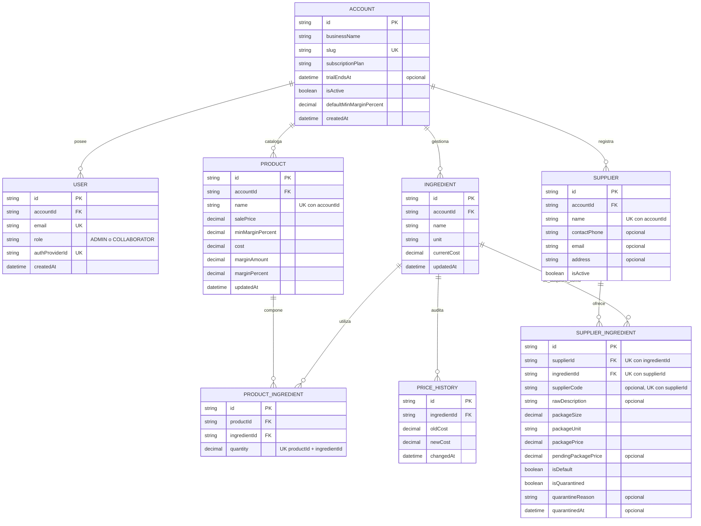

---
## MARGENX — ENTREGABLE ACADÉMICO PPS (ENTREGA 5)
**Materia:** Prácticas Profesionales Supervisadas (PPS) · **Fecha de cierre del Sprint 4 y de entrega:** 24/10/2026
**Repositorio:** [github.com/dgimenezdeveloper/margenx](https://github.com/dgimenezdeveloper/margenx) · **Tablero:** [GitHub Projects v2 MargenX](https://github.com/users/dgimenezdeveloper/projects/7/views/6?filterQuery=sprint%3A%22Sprint+4%22) · **Release:** [v0.5.0](https://github.com/dgimenezdeveloper/margenx/releases/tag/v0.5.0)

---

### 1. Sprint, fechas e integrantes que participaron
* **Sprint 4 (Recálculo en cascada, ingesta Zero-Click por correo, cuarentena de precios y modularización del frontend):** 11/10/2026 al 24/10/2026 (2 semanas completas; el cierre del sprint coincide con la fecha de entrega).
* **Integrantes:**
  * **Federico Paal:** Scrum Master del Sprint 4 y Lead Frontend (UX/UI Mobile-First).
  * **Darío Giménez:** DevOps y automatización (infraestructura, n8n, release).
  * **Mauricio Barreras:** Lead Backend y arquitectura de datos.
  * **Leandro Herrera:** QA y enlace con los comercios piloto.
* **Contexto del cronograma:** el Sprint 3 (Scrum Master: Leandro Herrera) duró una sola semana, del 03/10 al 10/10, para alinear los cierres de sprint con las fechas de entrega. Desde el Sprint 4 los sprints son de dos semanas y terminan el día de la entrega.

### 2. Comprometido vs. completado
🔗 **Tablero oficial (filtrado por Sprint 4):** [ver en GitHub Projects](https://github.com/users/dgimenezdeveloper/projects/7/views/6?filterQuery=sprint%3A%22Sprint+4%22)

* **Compromiso inicial:** 30 issues · **95 Story Points (SP)**.
* **Incorporado durante el cierre:** 3 issues · **4 SP** (`#220`, `#222`, `#224`), todas derivadas de la devolución de la Entrega 4 y de las pruebas de cierre. Total del sprint: **33 issues · 99 SP**.
* **Estado al cierre:** 33 de 33 issues completadas (**99 de 99 SP, 100 %**). Ninguna historia se arrastra al Sprint 5; la deuda técnica detectada se detalla en el punto 5.

| Issue | Responsable | Área | SP | Estado | PR / evidencia |
| :--- | :--- | :--- | :-: | :-: | :--- |
| `#28` | Mauricio Barreras | Backend | 3 | Done | [PR #182](https://github.com/dgimenezdeveloper/margenx/pull/182) — Recálculo transaccional en cascada |
| `#160` | Mauricio Barreras | Backend | 3 | Done | [PR #183](https://github.com/dgimenezdeveloper/margenx/pull/183) — Webhook de ingesta masiva con secreto compartido |
| `#161` | Mauricio Barreras | Backend | 5 | Done | [PR #194](https://github.com/dgimenezdeveloper/margenx/pull/194) — Filtro anti-pollution y actualización batch |
| `#162` | Mauricio Barreras | Backend | 3 | Done | [PR #198](https://github.com/dgimenezdeveloper/margenx/pull/198) — Auditoría y cuarentena de precios anómalos |
| `#163` | Federico Paal | Frontend | 5 | Done | [PR #184](https://github.com/dgimenezdeveloper/margenx/pull/184) — Modularización de la ficha de producto (datos maestros y BOM) |
| `#164` | Federico Paal | Frontend | 3 | Done | [PR #190](https://github.com/dgimenezdeveloper/margenx/pull/190) — Modularización de la ficha (simulador y modales) |
| `#165` | Mauricio Barreras | Frontend | 5 | Done | [PR #185](https://github.com/dgimenezdeveloper/margenx/pull/185) — Modularización de la despensa de insumos |
| `#166` | Federico Paal | Frontend | 3 | Done | [PR #192](https://github.com/dgimenezdeveloper/margenx/pull/192) — Modularización del dashboard |
| `#167` | Federico Paal | Frontend | 3 | Done | [PR #197](https://github.com/dgimenezdeveloper/margenx/pull/197) — Landing con los casos piloto |
| `#168` | Federico Paal | Frontend | 2 | Done | [PR #211](https://github.com/dgimenezdeveloper/margenx/pull/211) — Notificaciones enriquecidas tras recálculos en cascada |
| `#169` | Darío Giménez | DevOps | 3 | Done | [PR #186](https://github.com/dgimenezdeveloper/margenx/pull/186) — Cloudflare Email Routing con alias virtuales |
| `#170` | Darío Giménez | DevOps / n8n | 5 | Done | [PR #206](https://github.com/dgimenezdeveloper/margenx/pull/206) — Workflow de ingesta (IMAP, CSV/XLSX) |
| `#171` | Darío Giménez | DevOps / n8n | 3 | Done | [PR #207](https://github.com/dgimenezdeveloper/margenx/pull/207) — Despacho al backend con reintentos y resumen al dueño |
| `#172` | Darío Giménez | DevOps / n8n | 3 | Done | [PR #187](https://github.com/dgimenezdeveloper/margenx/pull/187) — Workflow de alertas de margen por correo (Brevo) |
| `#173` | Darío Giménez | DevOps | 3 | Done | [PR #188](https://github.com/dgimenezdeveloper/margenx/pull/188) — Monitor de memoria del VPS con aviso a Discord |
| `#174` | Leandro Herrera | QA | 3 | Done | [PR #191](https://github.com/dgimenezdeveloper/margenx/pull/191) — Pruebas in-situ a 360 px en el comercio piloto |
| `#175` | Leandro Herrera | QA | 5 | Done | [PR #216](https://github.com/dgimenezdeveloper/margenx/pull/216) — Suite E2E de recálculo en cascada (Playwright) |
| `#176` | Leandro Herrera | QA | 3 | Done | [PR #215](https://github.com/dgimenezdeveloper/margenx/pull/215) — Pruebas de estrés y resiliencia de la ingesta (3.000 filas) |
| `#177` | Leandro Herrera | QA | 2 | Done | [PR #218](https://github.com/dgimenezdeveloper/margenx/pull/218) — Regresión general y matriz de defectos |
| `#178` | Leandro Herrera | QA | 3 | Done | [PR #196](https://github.com/dgimenezdeveloper/margenx/pull/196) — Seed con proveedores mayoristas y mapeo de SKU |
| `#179` | Darío Giménez | Docs | 5 | Done | [PR #189](https://github.com/dgimenezdeveloper/margenx/pull/189) — SAD sincronizado (C4, UML, ER) |
| `#180` | Darío Giménez | Docs | 2 | Done | ADR-004 — Margen sobre ventas frente a markup (`docs/adr/0004-calculo-margen-ventas-vs-markup.md`, commit `e4af603`) |
| `#181` | Federico Paal | Docs | 5 | Done | Consolidación documental, CHANGELOG `[0.5.0]` y este reporte |
| `#193` | Federico Paal | Frontend | 1 | Done | [PR #195](https://github.com/dgimenezdeveloper/margenx/pull/195) — Fix de scroll de fondo en modales de iOS Safari |
| `#199` | Mauricio Barreras | Backend | 1 | Done | [PR #205](https://github.com/dgimenezdeveloper/margenx/pull/205) — Contrato de `PUT /api/ingredients/:id` |
| `#200` | Mauricio Barreras | Backend | 5 | Done | [PR #208](https://github.com/dgimenezdeveloper/margenx/pull/208) — Webhook de ingesta v2 (matching por proveedor, datos del dueño) |
| `#201` | Federico Paal | Frontend | 1 | Done | [PR #204](https://github.com/dgimenezdeveloper/margenx/pull/204) — Unidades de medida del formulario de insumos |
| `#202` | Mauricio Barreras | Backend | 3 | Done | [PR #213](https://github.com/dgimenezdeveloper/margenx/pull/213) — Cuarentena v2: conserva el precio vigente al rechazar |
| `#203` | Federico Paal | Frontend | 3 | Done | [PR #217](https://github.com/dgimenezdeveloper/margenx/pull/217) — Bandeja de cuarentena (listar, liberar, rechazar) |
| `#209` | Darío Giménez | Docs | 1 | Done | [PR #210](https://github.com/dgimenezdeveloper/margenx/pull/210) — CHANGELOG v0.4.0 regularizado y rotación de Scrum Master |
| `#220` | Darío Giménez | DevOps / Backend | 2 | Done | [PR #221](https://github.com/dgimenezdeveloper/margenx/pull/221) — Cuenta de demo dedicada "Demo MargenX" *(incorporada)* |
| `#222` | Darío Giménez | Backend / DevOps | 1 | Done | [PR #223](https://github.com/dgimenezdeveloper/margenx/pull/223) — El link de las alertas respeta el entorno *(incorporada)* |
| `#224` | Darío Giménez | DevOps / Docs | 1 | Done | [PR #225](https://github.com/dgimenezdeveloper/margenx/pull/225) — Limpieza de datos sensibles del repositorio público *(incorporada)* |

### 3. Demo: qué se ve funcionando y en qué URL
* **Entorno de evaluación:** [https://dev.margenx.tech](https://dev.margenx.tech) · **Healthcheck:** [https://api-dev.margenx.tech/api/health](https://api-dev.margenx.tech/api/health) (`status: ok`, entorno `development`).
* **Cuentas de prueba (devolución de la Entrega 4):** el entorno tiene dos usuarios dedicados al comercio ficticio **"Demo MargenX"**, con datos inventados: `demo-admin@margenx.tech` (rol ADMIN) y `demo-colab@margenx.tech` (rol COLLABORATOR). Las contraseñas se entregan por el Campus. Son credenciales de un **entorno de prueba**: no se reutilizan en producción ni con datos de clientes reales, y se rotan al cerrar la cursada. Los comercios piloto reales (Panadería Central y Química GyJ) **no** se usan en la demo.
* **Producción** ([https://margenx.tech](https://margenx.tech)) corre con datos de los comercios piloto; por eso la evaluación se hace en el entorno de prueba.

**Recorrido sugerido con la cuenta ADMIN (cada paso cubre una funcionalidad del sprint):**
1. **Despensa (`/insumos`):** 8 insumos con costo vigente y proveedores asociados.
2. **Catálogo (`/productos`):** 3 productos con semáforo de rentabilidad (verde/amarillo/rojo) según su margen mínimo.
3. **Cuarentena (`/proveedores/cuarentena`):** un insumo (cacao amargo) llegó con un aumento del 75 %, superior al umbral del 50 %; el sistema **no lo aplica**, conserva el costo anterior y deja al dueño elegir **Liberar** o **Rechazar**.
4. **Recálculo en cascada y alerta:** con el cacao ya liberado de la cuarentena ($21.000/kg) y el margen mínimo de la Torta de Chocolate en 40 %, subir el cacao a $24.000/kg baja su margen de 41,0 % a 38,53 %; el sistema notifica en pantalla las recetas afectadas y envía por correo la alerta "Producto con margen bajo detectado" al administrador (cadena: backend → n8n → Brevo).
5. **Rol COLLABORATOR (`demo-colab`):** no ve costos ni márgenes en `/productos` y `/dashboard`, la ruta `/insumos` lo redirige, y la API no devuelve campos financieros.

**Qué pasa cuando el proveedor no entrega precios en un formato integrable** *(corrección 3 de la cátedra)*. Los mayoristas de los comercios piloto envían listas en PDF, planillas heterogéneas o mensajes sueltos, y no tienen APIs. Sin ese dato no hay margen que calcular, por eso el sistema ofrece dos caminos que no rompen el cálculo:
* **Carga manual guiada.** En `/insumos`, "Asociar otro empaque" permite registrar el bulto de la factura (ej.: bolsa de 25 kg a $18.406,25). El sistema calcula el costo unitario ($736,25/kg) con `Prisma.Decimal` y redondeo `ROUND_HALF_UP`, y al marcarlo como predeterminado recalcula todas las recetas.
* **Ingesta por correo (Zero-Click).** El comerciante reenvía la lista del distribuidor a su alias `precios-<comercio>@margenx.tech` (el workflow también acepta `precios+<comercio>@`); Cloudflare y Gmail la entregan a n8n, que la convierte y envía al backend. El backend actualiza solo los artículos que el comercio ya mapeó, **descarta con motivo** el resto, **retiene en cuarentena** los precios anómalos (variación del costo unitario superior al 50 %, en alza o en baja, o costo unitario ≤ $0,01) y envía al dueño un resumen por correo. El dato dudoso nunca se aplica solo, de modo que un error del proveedor no distorsiona los márgenes.

### 4. Commits del período
* **Comparación oficial:** [v0.4.0...v0.5.0](https://github.com/dgimenezdeveloper/margenx/compare/v0.4.0...v0.5.0)
* **Hitos verificables (hash corto del commit en `develop`):**
  * `720b454` — recálculo transaccional en cascada (`#28`, PR #182)
  * `16d39d8` — webhook de ingesta masiva (`#160`, PR #183)
  * `8498558` — filtro anti-pollution (`#161`, PR #194)
  * `7fb6346` — auditoría y cuarentena de precios (`#162`, PR #198)
  * `f398531` — webhook de ingesta v2 (`#200`, PR #208)
  * `4af8079` — cuarentena v2 (`#202`, PR #213)
  * `ce7b0d6` — ficha de producto modular, datos maestros y BOM (`#163`, PR #184)
  * `dd6388f` — ficha de producto modular, simulador (`#164`, PR #190)
  * `d6585b1` — despensa modular (`#165`, PR #185)
  * `326f562` — dashboard modular (`#166`, PR #192)
  * `450e50b` — landing con casos piloto (`#167`, PR #197)
  * `8ae2e08` — notificaciones tras recálculo (`#168`, PR #211)
  * `a0c19fa` — fix de scroll en iOS Safari (`#193`, PR #195)
  * `87740c0` — unidades de medida (`#201`, PR #204)
  * `af672fe` — bandeja de cuarentena (`#203`, PR #217)
  * `398823c` — Cloudflare Email Routing (`#169`, PR #186)
  * `dd008a0` — workflow n8n de ingesta (`#170`, PR #206)
  * `7e4c91a` — despacho al backend con reintentos (`#171`, PR #207)
  * `adf952d` — workflow n8n de alertas (`#172`, PR #187)
  * `4f221c0` — monitor de memoria del VPS (`#173`, PR #188)
  * `d9a0ee1` — pruebas in-situ a 360 px (`#174`, PR #191)
  * `db01a36` — suite E2E de recálculo (`#175`, PR #216)
  * `1f1b224` — estrés y resiliencia de la ingesta (`#176`, PR #215)
  * `cea5816` — regresión general y matriz de defectos (`#177`, PR #218)
  * `d5a9c25` — seed con proveedores mayoristas (`#178`, PR #196)
  * `21955da` — SAD sincronizado (`#179`, PR #189)
  * `94f4c71` — cuenta de demo dedicada (`#220`, PR #221)

### 5. Impedimentos y qué necesitan de la cátedra
**Resueltos en este período**
* **Pruebas E2E inestables:** colisionaban por la mutación concurrente del mismo insumo; se fijó una ejecución determinística (`workers: 1`) y la suite quedó estable.
* **Scroll en iOS Safari:** el fondo se desplazaba con un modal abierto; se corrigió con un bloqueo de posición en el hook `useBodyScrollLock` (`#193`).
* **Memoria de n8n:** el procesamiento de planillas grandes agotaba el heap de Node; se ajustó el límite del contenedor y de Node en la configuración de producción.
* **Credenciales en la documentación (devolución de la Entrega 4):** se creó la cuenta Demo dedicada (`#220`) y se retiraron del repositorio los datos de los comercios piloto y los ejemplos de contraseña (`#224`). Queda un límite honesto: los valores anteriores siguen en el historial de git, por lo que las claves que figuraron en entregas previas se rotan al cierre de la cursada.
* **Link de las alertas apuntaba siempre a producción:** corregido para que respete el entorno (`#222`).

**Pendientes conocidos (registro de hallazgos, con severidad)**

| Hallazgo | Severidad | Estado |
| :--- | :-: | :--- |
| El modal de proveedores se cierra sin avisar si hay cambios sin guardar | Media | Planificado en Sprint 5 |
| Moneda única: la base guarda solo ARS; no hay conversión a USD | Media | Decisión del equipo: ARS en este corte; conversión con cotización BCRA/BNA en Sprint 5 |
| El mensaje de error (toast) queda tapado por el modal abierto | Media | Planificado en Sprint 5 |
| La sesión de Clerk vuelve a pedir verificación por dispositivo nuevo (*corrección 5 de la cátedra*) | Media | Sigue pendiente: prod y dev comparten una instancia de desarrollo de Clerk; en Sprint 5 se separan las instancias y se ajusta la duración de la sesión |
| La imagen de producción incluye los archivos de seed pero no puede ejecutarlos (`tsx` es una dependencia de desarrollo y se elimina con `npm prune --omit=dev`) | Baja | Sprint 5 |
| Nombres de producto con "De" en mayúscula en la interfaz | Baja (cosmético) | Sprint 5 |
| Sin backup automático de la base | Media | Sprint 5 (backup diario y ensayo de restauración) |

**Activo / consulta a la cátedra:** el sistema admite `salePrice: 0` en productos en borrador ("Sin costear"), lo que produce un margen negativo transitorio. Solicitamos confirmar si se prefiere mantener esa flexibilidad o bloquear precios en cero cuando el producto ya tiene insumos. Fuera de eso, **sin bloqueos activos** para iniciar el Sprint 5.

### 6. Horas dedicadas por integrante
| Integrante | Rol en el proyecto | Horas Sprint 4 (2 semanas) | Total acumulado |
| :--- | :--- | :-: | :-: |
| **Federico Paal** | Scrum Master (S4) y Lead Frontend | 28 h | **108 h** |
| **Darío Giménez** | DevOps y automatización | 28 h | **112 h** |
| **Mauricio Barreras** | Lead Backend y arquitectura de datos | 28 h | **108 h** |
| **Leandro Herrera** | QA y enlace con comercios piloto | 26 h | **104 h** |
| **TOTALES** | *(horas acreditables de práctica profesional)* | **110 h** | **432 h** |

*Horas totales del sprint, no semanales. El acumulado parte de las 322 h informadas en la Entrega 3 (cierre del Sprint 3, de una semana) más las 110 h de este sprint.*

### 7. Compromiso del próximo período
**Sprint 5 (25/10/2026 al 07/11/2026) · Scrum Master: Darío Giménez, hasta la entrega final.**
1. **Smart Purchasing (RF-15):** comparación de ofertas por insumo, ahorro proyectado ($ y %) y orden de compra sugerida al proveedor más conveniente.
2. **Reporte ejecutivo semanal en PDF por n8n:** disparo programado (lunes 08:00), compilado desde `/api/reports/margin-summary` y enviado al administrador.
3. **Moneda y cotización:** conversión ARS/USD con cotización BCRA/BNA.
4. **Sesión y seguridad:** separar las instancias de Clerk de producción y desarrollo, ajustar la duración de sesión y rotar las credenciales de entregas anteriores al cierre de la cursada.
5. **Datos y continuidad:** índices compuestos en PostgreSQL, backup automático diario en el VPS y ensayo de restauración.
6. **Calidad y deuda:** corregir los hallazgos del punto 5, convertir las sugerencias no bloqueantes de las revisiones en issues (etiqueta `review-followup`) y auditoría de accesibilidad y rendimiento (objetivo: más de 90 puntos en Lighthouse a 360 px).

---
<!-- SALTO DE PÁGINA PARA EXPORTAR A PDF -->
---

### DOCUMENTACIÓN TÉCNICA DE BASE

### 1. Requerimientos funcionales y no funcionales
* **RF:** RF-01 (ABM de insumos), RF-02 (alta de productos), RF-03 (recetas compuestas BOM), RF-04 (costo total de elaboración), RF-05 (margen nominal y porcentual), RF-06 (margen mínimo esperado), RF-07 (semáforo de rentabilidad), RF-08 (recálculo transaccional en cascada), RF-09 (orden y métricas server-side), RF-10 (multi-tenant por `accountId`), RF-11 (roles Admin/Colaborador), RF-12 (ocultamiento financiero al Colaborador), RF-13 (multi-proveedor y factores de conversión de empaque), RF-14 (ingesta por correo con filtro anti-pollution y cuarentena), RF-16 (productos borrador sin receta), RF-17 (ABM de proveedores), RF-18 (calculadora de empaques mayoristas), RF-19 (historial de precios), RF-20 (proveedor predeterminado).
* **RNF:** RNF-01 (carga inicial < 2 s), RNF-02 (Mobile-First desde 360 px), RNF-03 (autenticación JWT con Clerk), RNF-04 (recálculo reactivo en cliente), RNF-05 (validación con Zod), RNF-06 (errores HTTP uniformes `{"error": "..."}`), RNF-08 (borrado seguro con `409 Conflict`), RNF-09 (sanitización financiera server-side con `Cache-Control: private, no-store`), RNF-10 (alertas transaccionales sin costo vía Brevo), RNF-11 (memoria de contenedores acotada en el VPS).

### 2. Modelo de datos

*Fuente: `backend/prisma/schema.prisma` en `develop` (24/10/2026). Todas las relaciones hijas usan borrado en cascada; las restricciones de unicidad son `(supplierId, ingredientId)` y `(supplierId, supplierCode)` en `SupplierIngredient`.*

### 3. Arquitectura de ingesta Zero-Click y alertas
```mermaid
graph LR
subgraph ENTRADA ["Entrada del mayorista"]
Mail["Correo con lista de precios"]
end
subgraph CLOUD ["Borde y correo"]
CF["Cloudflare Email Routing"]
GM["Gmail (IMAP)"]
end
subgraph VPS ["VPS"]
N8N["n8n"]
Back["Backend REST"]
DB[("PostgreSQL 16")]
end
subgraph SALIDA ["Salida y alertas"]
Brevo["Brevo SMTP Relay"]
Owner["Dueño del comercio"]
end

Mail -->|precios-comercio@margenx.tech| CF
CF --> GM
GM -.->|IMAP Trigger| N8N
N8N -->|JSON| Back
Back -->|Transacción y filtro| DB
Back -.->|Webhook de alerta de margen| N8N
N8N -->|SMTP| Brevo
Brevo -->|Resumen o alerta| Owner
```

### 4. Calidad y evidencia
* **Pruebas automatizadas del flujo crítico:** suite E2E de recálculo en cascada con Playwright (`#175`, PR #216) y regresión general con matriz de defectos (`#177`, PR #218; informe en `docs/qa/reporte-calidad-sprint4.md`).
* **Estrés y resiliencia de la ingesta:** colección Newman con 3.000 filas y 95 % de ítems no mapeados (`#176`, PR #215), con casos límite documentados.
* **Manejo de errores:** el backend responde con `{"error": "..."}` uniforme, el frontend muestra mensajes y estados vacíos en lugar de pantallas en blanco, y el borrado de un insumo que forma parte de recetas devuelve `409 Conflict`.
* **Decisiones de arquitectura:** ADR-002 (arquitectura híbrida en VPS) y ADR-004 (margen sobre ventas frente a markup); SAD v2.0 sincronizado (`#179`).

### 5. Definition of Done (DoD) del equipo
Una tarea se considera **DONE** solo cuando: (1) tiene un PR desde una rama de feature hacia `develop`, con *Conventional Commits*; (2) cuenta con la aprobación de al menos un par (peer review) y de QA; (3) no hay errores de TypeScript (`tsc -b`) ni advertencias del linter; (4) el pipeline de CI está en verde; (5) se cumplen los criterios de aceptación Gherkin con datos verosímiles; (6) la interfaz es Mobile-First y se verificó a 360 px sin desborde horizontal; (7) las consultas están acotadas por `accountId` y las respuestas financieras se sanitizan para `COLLABORATOR`; (8) está desplegada y verificada en el entorno de pruebas (`dev.margenx.tech`).

### 6. Firmas y conformidad del equipo
* **Federico Paal** — Scrum Master (Sprint 4) y Lead Frontend
* **Darío Giménez** — DevOps, infraestructura y automatización
* **Mauricio Barreras** — Lead Backend y arquitectura de datos
* **Leandro Herrera** — QA y enlace con comercios piloto
