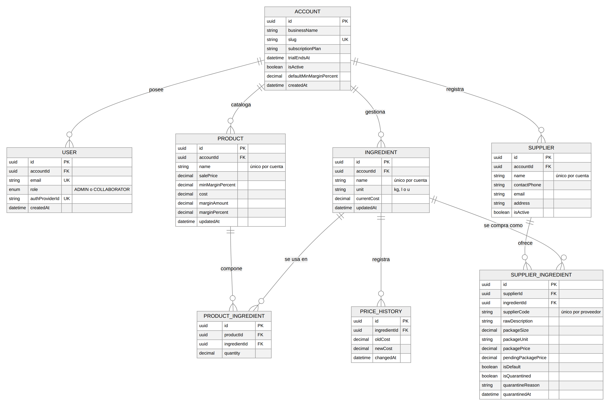
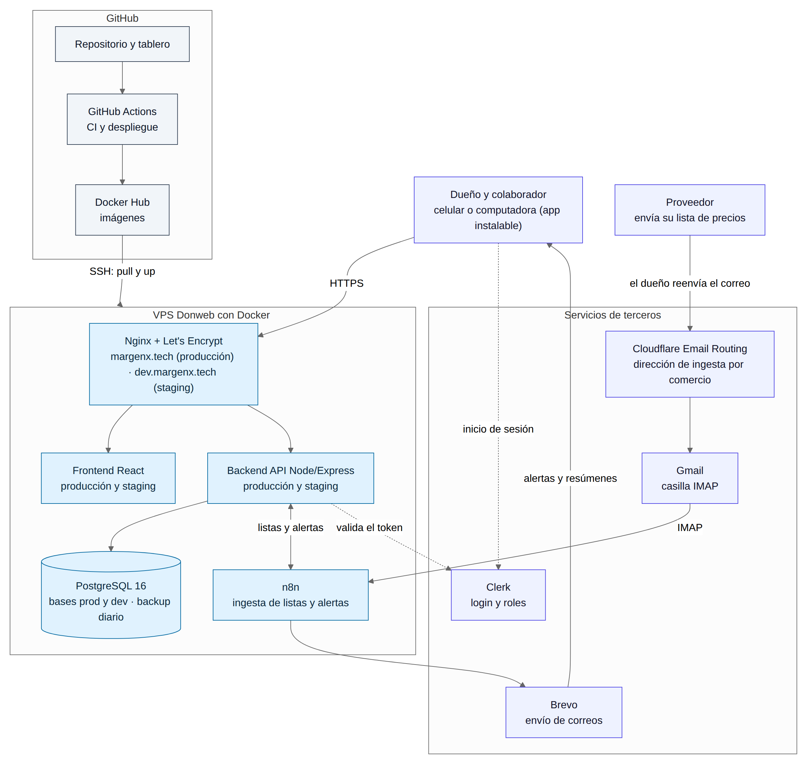
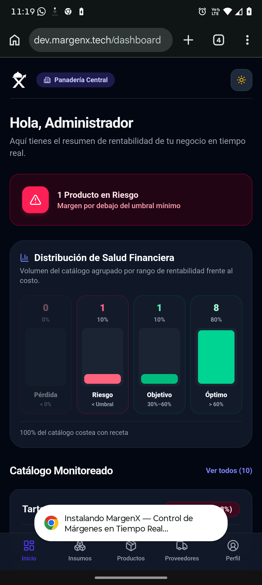
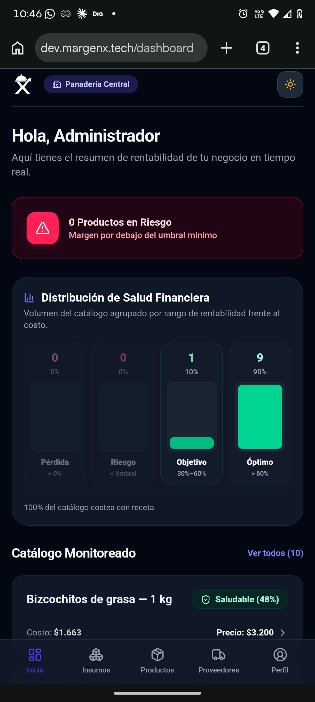
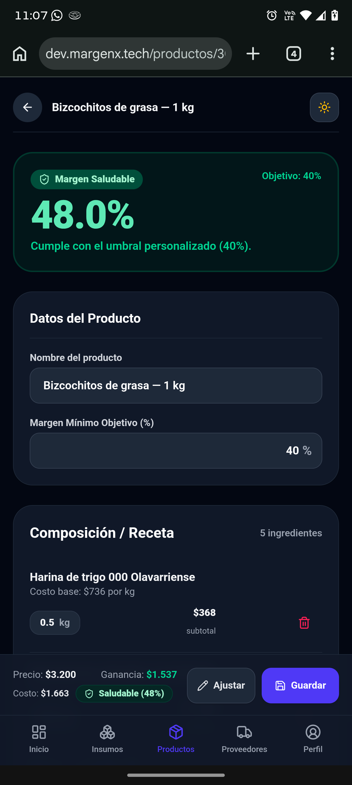
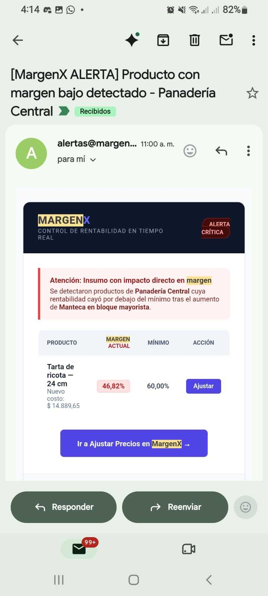
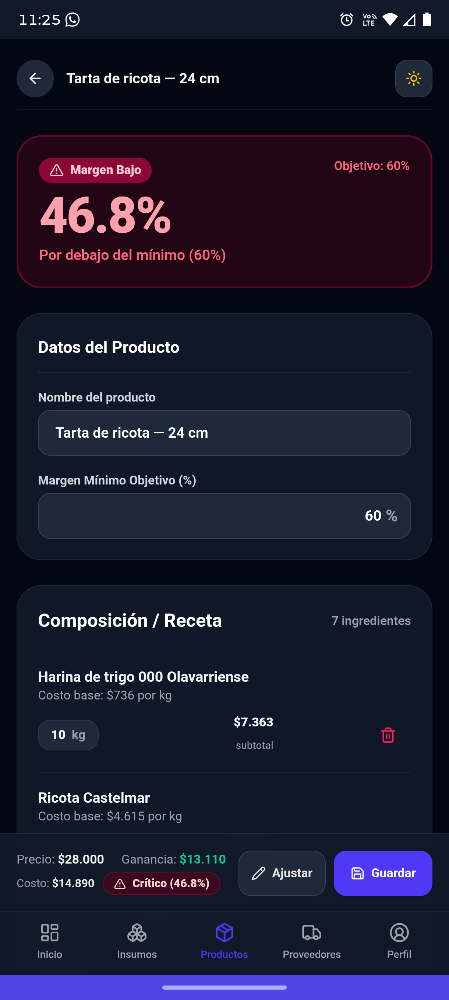
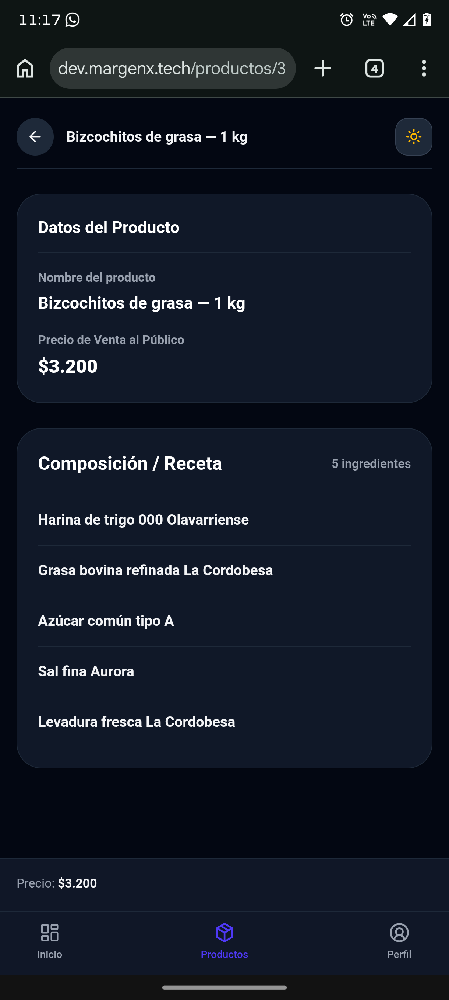

## MARGENX — ENTREGABLE ACADÉMICO PPS (ENTREGA 6)
**Materia:** Prácticas Profesionales Supervisadas (PPS) · **Fecha de cierre del Sprint 5 y de entrega:** 07/11/2026

**Repositorio:** [github.com/dgimenezdeveloper/margenx](https://github.com/dgimenezdeveloper/margenx) · **Tablero:** [GitHub Projects v2 MargenX](https://github.com/users/dgimenezdeveloper/projects/7/views/6?filterQuery=sprint%3A%22Sprint+5%22) · **Release:** [v0.6.0](https://github.com/dgimenezdeveloper/margenx/releases/tag/v0.6.0) (publicada el 07/11/2026)

Este documento reúne el reporte de avance del Sprint 5 con el template fijo de 7 puntos, la **documentación técnica** (cómo levantar el proyecto, variables de entorno, endpoints de la API y modelo de datos actualizado) y un **manual de usuario breve con capturas** (anexo).

---

### 1. Sprint, fechas e integrantes que participaron

* **Sprint 5 (Proveedores, PWA, deuda técnica y endurecimiento):** 25/10/2026 al 07/11/2026 (2 semanas completas; el cierre del sprint coincide con la fecha de entrega).
* **Integrantes:**
  * **Darío Giménez:** Scrum Master del Sprint 5, DevOps y automatización (infraestructura, n8n, release).
  * **Federico Paal:** Lead Frontend (UX/UI Mobile-First).
  * **Mauricio Barreras:** Lead Backend y arquitectura de datos.
  * **Leandro Herrera:** QA y enlace con los comercios piloto.

### 2. Comprometido vs. completado
🔗 **Tablero oficial (filtrado por Sprint 5):** [ver en GitHub Projects](https://github.com/users/dgimenezdeveloper/projects/7/views/6?filterQuery=sprint%3A%22Sprint+5%22)

* **Compromiso total del Sprint 5:** 46 issues · **140 Story Points (SP)**. Incluye 4 incorporadas durante el sprint (`#305`, `#310`, `#322` y la configuración de cobertura `#276`, esta última sin estimación).
* **Estado al cierre (07/11):** 45 de 46 issues completadas (**137 de 140 SP, 98 %**). La restante es `#273` (cierre del sprint y este documento), que se completa con su PR; no cambia el producto.

| Issue | Responsable | Área | SP | Estado | PR / evidencia |
| :--- | :--- | :--- | :-: | :-: | :--- |
| `#233` | Darío Giménez | DevOps | 2 | Done | [PR #278](https://github.com/dgimenezdeveloper/margenx/pull/278) · `e103ed2` — Quick wins de infraestructura y CI |
| `#234` | Darío Giménez | Docs | 1 | Done | [PR #286](https://github.com/dgimenezdeveloper/margenx/pull/286) · `d3cbb18` — ADR-005: costo vigente, cuarentena y canal de ingesta |
| `#235` | Federico Paal | Frontend | 3 | Done | [PR #279](https://github.com/dgimenezdeveloper/margenx/pull/279) · `d0b5ed2` — Entrada numérica en formato es-AR |
| `#236` | Federico Paal | Frontend | 3 | Done | [PR #289](https://github.com/dgimenezdeveloper/margenx/pull/289) · `a1ca43d` — Guards, rutas y nombres de producto |
| `#237` | Federico Paal | Frontend | 3 | Done | [PR #291](https://github.com/dgimenezdeveloper/margenx/pull/291) · `e60359f` — Asociar empaque sin pisar el predeterminado |
| `#238` | Darío Giménez | DevOps | 5 | Done | Merge de la rama 238 en `develop` · `9dc2a37` — Clerk de producción con la cuenta empresarial |
| `#239` | Darío Giménez | DevOps | 3 | Done | [PR #287](https://github.com/dgimenezdeveloper/margenx/pull/287) · `fb7292d` — Backup diario y ensayo de restauración |
| `#240` | Darío Giménez | DevOps | 3 | Done | [PR #324](https://github.com/dgimenezdeveloper/margenx/pull/324) · `c6de4c7` — Cuenta Demo en producción, login real y prueba del webhook |
| `#241` | Darío Giménez | Frontend | 2 | Done | [PR #330](https://github.com/dgimenezdeveloper/margenx/pull/330) · `6fcbf31` — Sesión persistente en la app instalada |
| `#242` | Mauricio Barreras | Backend | 5 | Done | [PR #323](https://github.com/dgimenezdeveloper/margenx/pull/323) · `498f81a` — Integridad de datos en la base |
| `#243` | Darío Giménez y Federico Paal | Frontend | 2 | Done | [PR #333](https://github.com/dgimenezdeveloper/margenx/pull/333) · `e754131` — PWA instalable |
| `#244` | Leandro Herrera | Frontend | 2 | Done | [PR #317](https://github.com/dgimenezdeveloper/margenx/pull/317) · `444f2aa` — Página de privacidad y guía de instalación |
| `#245` | Mauricio Barreras | Backend | 3 | Done | [PR #318](https://github.com/dgimenezdeveloper/margenx/pull/318) · `3b05cd7` · [PR #340](https://github.com/dgimenezdeveloper/margenx/pull/340) · `ddc3053` — Código de artículo en el alta de presentaciones |
| `#246` | Mauricio Barreras | Backend | 5 | Done | [PR #335](https://github.com/dgimenezdeveloper/margenx/pull/335) · `a688368` — Presentaciones y detalle de proveedor |
| `#247` | Mauricio Barreras | Backend | 2 | Done | [PR #319](https://github.com/dgimenezdeveloper/margenx/pull/319) · `e1affb5` — Carga masiva de insumos (Camino B), backend |
| `#248` | Darío Giménez | Frontend | 3 | Done | [PR #336](https://github.com/dgimenezdeveloper/margenx/pull/336) · `3b15634` — Service worker y página offline |
| `#249` | Darío Giménez | Frontend | 5 | Done | [PR #338](https://github.com/dgimenezdeveloper/margenx/pull/338) · `0511672` — Vista de proveedores |
| `#250` | Federico Paal | Frontend | 5 | Done | [PR #341](https://github.com/dgimenezdeveloper/margenx/pull/341) · `fdaaecb` — Detalle de proveedor |
| `#251` | Darío Giménez | Frontend | 3 | Done | [PR #339](https://github.com/dgimenezdeveloper/margenx/pull/339) · `0b67b93` — Cuarentena integrada y dirección de ingesta |
| `#252` | Federico Paal | Frontend | 3 | Done | [PR #337](https://github.com/dgimenezdeveloper/margenx/pull/337) · `adfbf16` — Carga masiva de insumos (Camino B), frontend |
| `#253` | Darío Giménez | DevOps | 2 | Done | [PR #334](https://github.com/dgimenezdeveloper/margenx/pull/334) · `fba4990` — Activar la ingesta automática en n8n |
| `#255` | Leandro Herrera | QA | 5 | Done | [PR #342](https://github.com/dgimenezdeveloper/margenx/pull/342) · `1ab4d47` — Recorrido por rol y validación en dispositivos reales |
| `#256` | Mauricio Barreras | Backend | 2 | Done | [PR #280](https://github.com/dgimenezdeveloper/margenx/pull/280) · `118e033` — Límites de cuerpo, error 413 y helmet |
| `#257` | Federico Paal | Frontend | 2 | Done | [PR #320](https://github.com/dgimenezdeveloper/margenx/pull/320) · `2cb2646` — Errores con reintento |
| `#258` | Mauricio Barreras | Frontend | 3 | Done | [PR #285](https://github.com/dgimenezdeveloper/margenx/pull/285) · `fa3ce12` — Roles: receta oculta para el colaborador |
| `#259` | Mauricio Barreras | Backend | 5 | Done | [PR #332](https://github.com/dgimenezdeveloper/margenx/pull/332) · `77ca495` — Recálculo en cascada en lote |
| `#260` | Darío Giménez | DevOps | 5 | Done | [PR #290](https://github.com/dgimenezdeveloper/margenx/pull/290) · `721d4cd` — Node 22 LTS y CI completo |
| `#261` | Darío Giménez | DevOps | 3 | Done | [PR #288](https://github.com/dgimenezdeveloper/margenx/pull/288) · `8e2be71` — Nginx: cabeceras, www y vencimientos |
| `#262` | Federico Paal | Frontend | 3 | Done | [PR #331](https://github.com/dgimenezdeveloper/margenx/pull/331) · `89a6206` — Diálogos accesibles |
| `#263` | Mauricio Barreras | Frontend | 5 | Done | [PR #340](https://github.com/dgimenezdeveloper/margenx/pull/340) · `ddc3053` — Teclado, etiquetas y validación de formularios |
| `#264` | Leandro Herrera | QA | 3 | Done | [PR #281](https://github.com/dgimenezdeveloper/margenx/pull/281) · `22ecb8e` — Colecciones Postman al contrato vigente |
| `#265` | Leandro Herrera | QA | 3 | Done | [PR #315](https://github.com/dgimenezdeveloper/margenx/pull/315) · `afe441f` — Cosecha de comentarios no bloqueantes |
| `#266` | Darío Giménez | Seguridad | 2 | Done | [PR #292](https://github.com/dgimenezdeveloper/margenx/pull/292) · `c16b0f7` — Endurecimiento de la VPS |
| `#267` | Leandro Herrera | Docs | 3 | Done | [PR #284](https://github.com/dgimenezdeveloper/margenx/pull/284) · `d327129` — Convención de docs como código |
| `#268` | Leandro Herrera | Docs | 3 | Done | [PR #316](https://github.com/dgimenezdeveloper/margenx/pull/316) · `c562903` — READMEs, infraestructura y datos sensibles |
| `#269` | Darío Giménez | Docs | 5 | Done | [PR #308](https://github.com/dgimenezdeveloper/margenx/pull/308) · `4f7095e` — Documento de diseño e históricos |
| `#270` | Leandro Herrera | QA | 2 | Done | [PR #344](https://github.com/dgimenezdeveloper/margenx/pull/344) · `6702eba` — Regresión del Sprint 5 con matriz de defectos |
| `#271` | Darío Giménez | DevOps | 2 | Done | [PR #345](https://github.com/dgimenezdeveloper/margenx/pull/345) · `4dcf62d` · [PR #346](https://github.com/dgimenezdeveloper/margenx/pull/346) · `0f43a99` — Release v0.6.0 (runbook, copia, ensayo de migraciones y publicación) |
| `#272` | Mauricio Barreras | Docs | 3 | Done | [PR #343](https://github.com/dgimenezdeveloper/margenx/pull/343) · `6a304b6` — Runbook y manual de usuario |
| `#273` | Darío Giménez | Docs | 3 | In Progress | PR de cierre (este documento) — Cierre del Sprint 5 |
| `#274` | Darío Giménez | Docs | 5 | Done | [PR #275](https://github.com/dgimenezdeveloper/margenx/pull/275) · `4718c48` — Formato de revisión y especificación funcional unificada |
| `#276` | Darío Giménez | QA | — | Done | [PR #282](https://github.com/dgimenezdeveloper/margenx/pull/282) · `a9def8e` — Cobertura del frontend con umbral del 90 % *(incorporada)* |
| `#277` | Darío Giménez | QA | 3 | Done | [PR #283](https://github.com/dgimenezdeveloper/margenx/pull/283) · `81f2575` — Cobertura unitaria del backend del 51 % a más del 90 % |
| `#305` | Darío Giménez | DevOps | 1 | Done | [PR #306](https://github.com/dgimenezdeveloper/margenx/pull/306) · `b49660c` — Dependabot: tablero y versiones mayores *(incorporada)* |
| `#310` | Leandro Herrera | QA | 2 | Done | [PR #321](https://github.com/dgimenezdeveloper/margenx/pull/321) · `4828f33` — E2E: limpieza de specs y bandeja de cuarentena *(incorporada)* |
| `#322` | Federico Paal | Frontend | 2 | Done | [PR #325](https://github.com/dgimenezdeveloper/margenx/pull/325) · `53e13ed` — Ajustes de feedback de la Entrega 5: toast y modal mayorista *(incorporada)* |

**Cambios de alcance respecto de la Entrega 5.** En el punto 7 de la Entrega 5 figuraban como candidatos del Sprint 5 ítems que se replanificaron en el Sprint Planning del 25/10:

* **Smart Purchasing (RF-15), reporte semanal en PDF y meta de Lighthouse > 90:** pasan al Sprint 6. El sprint se dedicó a cerrar la deuda técnica señalada en la devolución (ver punto 5) y a dejar el producto usable en el celular (PWA, sesión persistente, accesibilidad).
* **Moneda y cotización ARS/USD:** pasa a la fase 2, fuera del alcance de la cursada. Los comercios piloto compran y venden en pesos.
* **Cuenta Demo:** ahora existe en `dev.margenx.tech` y en producción, con login real verificado (`#240`).

### 3. Demo: qué se ve funcionando y en qué URL

* **Producción (v0.6.0):** [https://margenx.tech](https://margenx.tech) · **Healthcheck:** [https://api.margenx.tech/api/health](https://api.margenx.tech/api/health) (HTTP 200, verificado el 07/11 después del release).
* **Staging:** [https://dev.margenx.tech](https://dev.margenx.tech) · **Healthcheck:** [https://api-dev.margenx.tech/api/health](https://api-dev.margenx.tech/api/health) (HTTP 200, verificado el 07/11). Corre la misma versión que producción; el recorrido de abajo sirve en los dos entornos.
* **Cuentas de prueba:** `demo-admin@margenx.tech` (ADMIN) y `demo-colab@margenx.tech` (COLLABORATOR), del comercio ficticio *Demo MargenX*. Las contraseñas se entregan por el Campus. Los comercios piloto reales no se usan en la evaluación.

**Recorrido sugerido con la cuenta ADMIN (cada paso cubre una funcionalidad del sprint):**

1. **Instalar la app (`/instalar`):** en Android, Chrome ofrece "Instalar app"; en iPhone, Safari › Compartir › Agregar a inicio. Abierta desde el ícono, la sesión no se cierra al salir (`#243`, `#241`).
2. **Despensa (`/insumos`) → "Cargar desde planilla":** descargar la plantilla, completarla y subirla. La vista previa separa filas válidas, repetidas y con error, con el número de fila y el motivo (`#247`, `#252`).
3. **Proveedores (`/proveedores`):** lista, alta y detalle del mayorista con sus presentaciones, código de artículo y dirección de ingesta para copiar (`#249`, `#250`, `#245`).
4. **Cuarentena (pestaña en Proveedores):** precios retenidos por variar más de un 50 %, con Liberar y Rechazar (`#251`).
5. **Sin conexión:** con el modo avión activado, la app muestra un aviso y una página "Sin conexión" con Reintentar, en lugar de un error del navegador (`#248`).
6. **Rol COLLABORATOR (`demo-colab`):** ve productos y recetas sin costos ni márgenes, y las rutas de Insumos y Proveedores lo redirigen (`#258`).

### 4. Commits del período

* **Comparación oficial:** [v0.5.0...v0.6.0](https://github.com/dgimenezdeveloper/margenx/compare/v0.5.0...v0.6.0): 60 commits sin contar merges, de 52 PRs mergeados a `develop`.
* **Hitos verificables:** el hash corto de cada issue está en la tabla del punto 2. Todos se tomaron de `git log v0.5.0..v0.6.0` y se verificaron contra GitHub el 07/11; ninguno está escrito de memoria.
* **Commits de mantenimiento del período (Dependabot, sin issue):** `d9a4044` (acciones de CI), `28d5931` (imagen de nginx), `94f9e0b`, `b443e14` (backend), `78922b2`, `b034699`, `19bd633` (frontend).
* **Merge del release v0.6.0 en `main`:** `0f43a99` ([PR #346](https://github.com/dgimenezdeveloper/margenx/pull/346)), con merge commit (sin squash), etiqueta anotada [`v0.6.0`](https://github.com/dgimenezdeveloper/margenx/releases/tag/v0.6.0) sobre ese commit.

### 5. Impedimentos y qué necesitan de la cátedra
**Deuda técnica de la Entrega 5: estado al cierre del Sprint 5** *(la devolución pidió atenderla)*

| Hallazgo de la Entrega 5 | Severidad | Estado |
| :--- | :-: | :--- |
| El modal de proveedores se cerraba sin avisar si había cambios sin guardar | Media | Resuelto (`#322`, PR #325) |
| El mensaje de error (toast) quedaba tapado por el modal abierto | Media | Resuelto (`#322`, PR #325) |
| La sesión de Clerk pedía verificación por dispositivo nuevo (*corrección 5 de la cátedra*) | Media | Resuelto: instancias de Clerk separadas para producción (`#238`) y sesión persistente en la app instalada (`#241`) |
| Sin backup automático de la base | Media | Resuelto: backup diario con ensayo de restauración (`#239`) |
| La imagen de producción no podía ejecutar los seeds | Baja | Resuelto: `infra/scripts/seed-remoto.sh` compila los seeds antes de correrlos (`#240`) |
| Nombres de producto con "De" en mayúscula | Baja | Resuelto (`#236`) |
| Moneda única: solo ARS | Media | Fase 2 (ver punto 2) |
| (a) Producción sin login autenticado verificado | — | Resuelto (`#240`) |
| (b) Webhook de ingesta y alerta sin probar en producción | — | Resuelto (`#240`) |
| (c) Rotación de credenciales de entregas anteriores | — | Pendiente para el cierre de la cursada, como estaba previsto |
| (d) Datos de conexión en docs y archivos de ejemplo | — | Resuelto (`#268`) |
| (e) La IP de la VPS sigue en el historial de git | — | Sin cambios: no se reescribe el historial; la mitigación es el firewall y el endurecimiento de la VPS (`#266`) |

**Impedimentos del período:** tres colecciones de Postman (Insumos, Productos y Proveedores) no se pudieron correr en la regresión porque la instancia de Clerk disponible no tiene los usuarios de Química GyJ; quedan para cuando el equipo cree esa configuración (`docs/qa/reporte-calidad-sprint5.md` §3.4 y §3.7). Las otras tres colecciones y el E2E de roles pasaron sin fallas.

**Pendientes conocidos que pasan al Sprint 6 (issues de seguimiento):** `#254` (rediseño del mail de resumen de ingesta), `#307` (misma versión mayor de Vitest en backend y frontend), `#311` (bandeja de cuarentena: toast y estados), `#312` y `#313` (colecciones Newman y estrés de ingesta), `#314` (regla de no atribuir commits a herramientas), `#328` (vencimiento de sesión de Clerk en staging) y `#329` (enlace de respaldo del mail de alerta, hallado durante el sprint y sin estimar).

**Activo / consulta a la cátedra:** sin consultas. Sin bloqueos activos para iniciar el Sprint 6.

### 6. Horas dedicadas por integrante
| Integrante | Rol en el proyecto | Horas Sprint 5 (2 semanas) | Total acumulado |
| :--- | :--- | :-: | :-: |
| **Darío Giménez** | Scrum Master (S5), DevOps y automatización | 68 h | **180 h** |
| **Federico Paal** | Lead Frontend | 27 h | **135 h** |
| **Mauricio Barreras** | Lead Backend y arquitectura de datos | 42 h | **150 h** |
| **Leandro Herrera** | QA y enlace con comercios piloto | 44 h | **148 h** |
| **TOTALES** | *(horas acreditables de práctica profesional)* | **181 h** | **613 h** |

*Horas totales del sprint, no semanales, confirmadas por cada integrante. El acumulado parte de las 432 h informadas en la Entrega 5.*

### 7. Compromiso del próximo período
**Sprint 6 (08/11/2026 al 21/11/2026) · Scrum Master: Darío Giménez · Entrega final y defensa: 28/11.** Candidatos a confirmar en el Sprint Planning del 08/11:

1. **Smart Purchasing (RF-15):** comparación de ofertas por insumo y orden de compra sugerida al proveedor más conveniente.
2. **Reporte semanal de márgenes en PDF:** endpoint de consulta en el backend y workflow de n8n que lo envía los lunes.
3. **Documentación interactiva de la API con Swagger / OpenAPI** en `/api/docs`.
4. **Accesibilidad y rendimiento:** Lighthouse por encima de 90 a 360 px.
5. **Release v1.0.0:** congelamiento de código, limpieza de endpoints de prueba y tag en `main`.
6. **Defensa:** video demo comercial de 3 minutos, manual de usuario final en PDF y acta de cierre.
7. **Seguimiento:** las issues listadas en el punto 5.

---

### DOCUMENTACIÓN TÉCNICA

### 1. Requerimientos funcionales y no funcionales

* **RF implementados:** RF-01 (ABM de insumos), RF-02 (alta de productos), RF-03 (recetas compuestas BOM), RF-04 (costo total de elaboración), RF-05 (margen nominal y porcentual), RF-06 (margen mínimo esperado), RF-07 (semáforo de rentabilidad), RF-08 (recálculo transaccional en cascada), RF-09 (orden y métricas server-side), RF-10 (multi-tenant por `accountId`), RF-11 (roles Admin/Colaborador), RF-12 (ocultamiento financiero al Colaborador), RF-13 (multi-proveedor y factores de conversión de empaque), RF-14 (ingesta por correo con filtro anti-pollution y cuarentena), RF-16 (productos borrador sin receta), RF-17 (ABM de proveedores), RF-18 (calculadora de empaques mayoristas), RF-19 (historial de precios), RF-20 (proveedor predeterminado).
* **Pendiente:** RF-15 (Smart Purchasing), en el Sprint 6.
* **RNF:** RNF-01 (carga inicial < 2 s), RNF-02 (Mobile-First desde 360 px), RNF-03 (autenticación JWT con Clerk), RNF-04 (recálculo reactivo en cliente), RNF-05 (validación con Zod), RNF-06 (errores HTTP uniformes `{"error": "..."}`), RNF-08 (borrado seguro con `409 Conflict`), RNF-09 (sanitización financiera server-side), RNF-10 (alertas transaccionales por correo), RNF-11 (memoria de contenedores acotada en la VPS).

### 2. Cómo levantar el proyecto
El repositorio tiene dos paquetes independientes, `backend/` (API) y `frontend/` (app web instalable). Se levanta con Node.js 22 LTS (versión fijada en `.nvmrc`) y PostgreSQL 16.

| Entorno | App | API | Uso |
| :--- | :--- | :--- | :--- |
| Local | http://localhost:5173 | http://localhost:3000/api | Desarrollo |
| Staging | https://dev.margenx.tech | https://api-dev.margenx.tech/api | Pruebas y evaluación con la cuenta Demo |
| Producción | https://margenx.tech | https://api.margenx.tech/api | Comercios piloto |

**Opción A — DevContainer de VS Code (recomendada):** instalar Docker Desktop, VS Code y la extensión Dev Containers; clonar `https://github.com/dgimenezdeveloper/margenx.git`, abrir la carpeta y elegir **Dev Containers: Reopen in Container**. El contenedor trae Node.js 22 y PostgreSQL 16. Después, seguir desde el paso 3 de la opción B.

**Opción B — manual:**
```bash
# 1. Node de .nvmrc
nvm use
# 2. PostgreSQL 16
docker run --name margenx_postgres_dev -e POSTGRES_USER=postgres -e POSTGRES_PASSWORD=<tu_password_local> -e POSTGRES_DB=margenx_dev -p 5432:5432 -d postgres:16-alpine
# 3. Backend
cd backend && npm ci && cp .env.example .env
npx prisma migrate dev
SEED_CONFIRM_TARGET=localhost:5432/margenx_dev npx prisma db seed
npm run dev            # API en http://localhost:3000/api (GET /api/health)
# 4. Frontend, en otra consola
cd frontend && npm ci && cp .env.example .env
npm run dev            # App en http://localhost:5173
```

**Pruebas:** `npm test` en cada paquete (Vitest, cobertura mínima del 90 % de líneas con `npm run test:coverage`) y `npm run test:e2e` en `frontend/` (Playwright). El CI de GitHub Actions corre build, lint, pruebas unitarias, auditoría de dependencias y E2E en cada PR; los despliegues a staging y producción se hacen al mergear a `develop` y a `main`. La operación de la VPS está en `docs/runbook-operacion.md`, `docs/runbook-backup.md` y `docs/runbook-ingesta.md`.

**Costos de infraestructura.** Lo único que se paga es la VPS y el dominio; el resto es software libre o planes gratuitos.

| Servicio | Para qué | Costo |
| :--- | :--- | :--- |
| VPS Donweb (Cloud Server: 8 vCPU, 8 GB de RAM, 100 GB SSD) | Aloja toda la aplicación, la base y n8n, en producción y staging | $333.450 por año (unos $27.800 por mes), pagado hasta el 09/02/2027 |
| Dominio `margenx.tech` | Direcciones de la app y de ingesta por correo | Pago anual al registrador del dominio |
| PostgreSQL, n8n, Nginx, Docker | Base de datos, automatización y servidor web | Gratis (software libre) |
| Clerk | Inicio de sesión y roles | Gratis (plan Hobby; la sesión dura como máximo 7 días) |
| Brevo, Cloudflare Email Routing, Gmail | Envío y recepción de correos | Gratis |
| GitHub, GitHub Actions, Docker Hub | Código, tablero, CI/CD e imágenes | Gratis |

### 3. Variables de entorno
Cada paquete trae un `.env.example`; se copia a `.env` y se completa. Ningún valor real está en el repositorio.

**Backend (`backend/.env`)**

| Variable | Obligatoria | Descripción |
| :--- | :-: | :--- |
| `PORT` | No | Puerto de la API (por defecto `3000`). |
| `NODE_ENV` | No | `development` o `production`. |
| `DATABASE_URL` | Sí | Conexión a PostgreSQL que usa Prisma. |
| `CLERK_SECRET_KEY` | Sí | Clave secreta de Clerk para validar sesiones. |
| `CLERK_JWT_KEY` | Sí | Clave pública para verificar el JWT de Clerk. |
| `N8N_MARGIN_ALERT_WEBHOOK_URL` | No | Webhook de n8n que envía la alerta de margen; sin ella no hay alertas. |
| `INTERNAL_WEBHOOK_SECRET` | Sí, para alertas e ingesta | Secreto compartido con n8n (cabecera `x-margenx-webhook-secret`). Si falta, no se despachan alertas. |
| `APP_BASE_URL` | No | URL de la app para el enlace "Ajustar" de los correos. |
| `SEED_CONFIRM_TARGET` / `SEED_DEMO_CONFIRM` | Solo para seeds | Confirman contra qué base corren el seed de pilotos y el de la cuenta Demo. |
| `ALLOW_PRODUCTION_SEED` | Solo en producción | Habilita el seed en producción (`npm run db:seed:prod`). |
| `SEED_DEMO_ADMIN_AUTH_ID` / `SEED_DEMO_COLAB_AUTH_ID` | Solo en producción | Usuarios de Clerk de producción de la cuenta Demo. |

**Frontend (`frontend/.env`)**

| Variable | Obligatoria | Descripción |
| :--- | :-: | :--- |
| `VITE_API_URL` | Sí | URL base de la API (local: `http://localhost:3000/api`). |
| `VITE_CLERK_PUBLISHABLE_KEY` | Sí | Clave pública de Clerk para el inicio de sesión. |
| `VITE_INACTIVITY_TIMEOUT_MS` | No | Inactividad antes de cerrar la sesión en el navegador (por defecto 30 minutos; no aplica a la app instalada). |

La VPS usa además `infra/vps/.env.example` (Docker Compose): bases de staging y producción, claves de Clerk por entorno, casilla IMAP de n8n, URL de la API por entorno para la ingesta y webhooks de Discord. Detalle en `infra/vps/README.md`.

### 4. Endpoints de la API
27 rutas bajo `/api`. Salvo `/api/health` y el webhook de n8n, requieren `Authorization: Bearer <token de Clerk>`, y toda consulta se limita a la cuenta del usuario autenticado. Para el colaborador, las lecturas de insumos y productos llegan sin costos, márgenes ni cantidades de receta. Contrato completo (cuerpos, respuestas y códigos de error) en [`docs/api.md`](https://github.com/dgimenezdeveloper/margenx/blob/develop/docs/api.md); la versión interactiva con Swagger está planificada para el Sprint 6.

| Método | Ruta | Rol | Para qué |
| :--- | :--- | :--- | :--- |
| GET | `/api/health` | Pública | Estado de la API |
| GET | `/api/auth/me` | Con sesión | Usuario, rol y comercio |
| PATCH | `/api/auth/account/margin` | Admin | Margen mínimo por defecto del comercio |
| GET | `/api/dashboard/metrics` | Admin | Productos en riesgo y salud del catálogo |
| GET | `/api/ingredients` · `/api/ingredients/:id` | Admin y colaborador | Listar y ver insumos |
| GET | `/api/ingredients/:id/history` | Admin | Historial de costos |
| POST | `/api/ingredients` | Admin | Crear un insumo |
| POST | `/api/ingredients/bulk` | Admin | Carga desde planilla (hasta 500 filas, una transacción) |
| PUT | `/api/ingredients/:id` | Admin | Editar un insumo; recalcula en cascada y dispara alertas |
| DELETE | `/api/ingredients/:id` | Admin | Borrar un insumo (`409` si una receta lo usa) |
| GET | `/api/products` · `/api/products/:id` | Admin y colaborador | Listar y ver productos con su receta |
| POST · PUT · DELETE | `/api/products` · `/api/products/:id` | Admin | Crear, editar y borrar productos |
| GET · POST | `/api/suppliers` | Admin | Listar y crear proveedores |
| GET · PUT · DELETE | `/api/suppliers/:id` | Admin | Ver, editar y borrar un proveedor |
| POST | `/api/suppliers/:id/ingredients` | Admin | Crear o editar una presentación |
| DELETE | `/api/suppliers/:id/ingredients/:ingredientId` | Admin | Quitar una presentación |
| GET | `/api/suppliers/quarantine` | Admin | Precios retenidos en cuarentena |
| POST | `/api/suppliers/quarantine/:id/release` · `/reject` | Admin | Aplicar o descartar un precio retenido |
| POST | `/api/webhooks/supplier-prices` | n8n con `x-margenx-webhook-secret` | Lista de precios leída del correo (hasta 5 MB y 5.000 filas) |

Códigos comunes: `400` datos inválidos, `401` sin sesión o secreto incorrecto, `403` rol sin permiso, `404` no existe, `409` nombre repetido o insumo en uso, `413` lote demasiado grande.

### 5. Modelo de datos (actualizado al 07/11/2026)



*Fuente: `backend/prisma/schema.prisma` en `develop` al 07/11/2026. Cambio respecto de la Entrega 5: índices únicos `(accountId, lower(name))` en `Ingredient`, `Product` y `Supplier` (migración `20261030224224_case_insensitive_unique_names`, `#242`). Los importes son `Decimal` (ADR-004) y el costo vigente sale de la presentación predeterminada, con cuarentena para variaciones mayores al 50 % (ADR-005). Todas las relaciones hijas se borran en cascada.*

### 6. Arquitectura y despliegue



Toda la aplicación corre en una VPS propia (Donweb) con Docker Compose: Nginx con certificados de Let's Encrypt publica producción (`margenx.tech`) y staging (`dev.margenx.tech`); el frontend, el backend, PostgreSQL 16 y n8n son contenedores en la misma red interna. GitHub Actions construye las imágenes, las publica en Docker Hub y las despliega por SSH al mergear a `develop` (staging) o a `main` (producción). Las listas de precios entran por correo: Cloudflare Email Routing las deriva a una casilla de Gmail, n8n las lee por IMAP y se las envía al backend; las alertas y los resúmenes salen por Brevo.

*Cambios del Sprint 5: un solo n8n despacha a producción o a staging según la cuenta (`#253`) y el recálculo en cascada de la ingesta se hace en lote (`#259`).*

### 7. Calidad y evidencia

* **Cobertura unitaria:** umbral del 90 % de líneas en `frontend/` (`#276`) y en `backend/` (de 51 % a más del 90 %, `#277`), exigido por `npm run test:coverage`.
* **CI completo con Node 22:** build, lint, pruebas unitarias, auditoría de dependencias de producción y E2E de Playwright como checks obligatorios de cada PR (`#260`).
* **Validación en dispositivos reales:** recorrido por rol en Android e iPhone, con capturas en `docs/qa/evidencias/255/` (`#255`).
* **Colecciones Postman / Newman** actualizadas al contrato vigente (`#264`).
* **Rendimiento (medido el 07/11 con el código de `develop`, en una base aislada sembrada con los comercios piloto; equipo local AMD Ryzen 5 5500U, Node 20):**

| Escenario | Resultado |
| :--- | :--- |
| Lista de precios por correo de 3.000 filas (10 códigos reales y 2.990 sin vincular), 5 corridas | 111 ms de mediana, 237 ms la más lenta |
| Lista de 5.000 filas, el tope del contrato | 139 ms; con 5.001 filas responde `400`, como corresponde |
| 15 listas de 3.000 filas enviadas a la vez | 823 ms en total, las 15 con `200` |
| Carga desde planilla de 500 insumos, en una transacción | 493 ms, 500 creados |
| Cambio de costo de un insumo usado en 9 recetas (recálculo en cascada) | 26 ms de mediana, 35 ms en el percentil 95 |
| Panel, lista de productos y lista de insumos | Menos de 10 ms en el percentil 95 |

Memoria de la API durante la prueba: de 72 MB a 168 MB como máximo. Ningún error en el log; se registraron 130 cambios de costo y ningún precio quedó retenido por error. Los tiempos en la VPS pueden diferir: la medición con `docker stats` en el servidor queda para el Sprint 6 (`#313`).

* **Regresión del Sprint 5 con matriz de defectos:** `docs/qa/reporte-calidad-sprint5.md` (`#270`, PR #344). Resultado: colecciones Postman de Webhooks, Colaborador RBAC y Alertas de margen en verde (0 fallas) y E2E de RBAC con 7 de 7 pruebas en verde en el CI; ningún defecto grave abierto. Las colecciones de Insumos, Productos y Proveedores no se corrieron porque falta la configuración de Clerk de Química GyJ, y pasan al Sprint 6 (§3.3 a §3.7 del reporte).
* **Decisiones de arquitectura:** ADR-005 (costo vigente, cuarentena e ingesta, `#234`), ADR-006 (sesión persistente en la app instalada, `#241`) y ADR-007 (roles fijos frente a permisos granulares).

### 8. Definition of Done (DoD) del equipo
Una tarea se considera **DONE** solo cuando: (1) tiene un PR desde una rama de feature hacia `develop`, con *Conventional Commits*; (2) cuenta con la aprobación de al menos un par y de QA; (3) no hay errores de TypeScript ni advertencias del linter; (4) el pipeline de CI está en verde, con cobertura mínima del 90 %; (5) se cumplen los criterios de aceptación Gherkin con datos verosímiles; (6) la interfaz es Mobile-First y se verificó a 360 px sin desborde horizontal; (7) las consultas están acotadas por `accountId` y las respuestas financieras se sanitizan para `COLLABORATOR`; (8) la documentación afectada se actualiza en el mismo PR; (9) está desplegada y verificada en `dev.margenx.tech`.

---

### ANEXO — MANUAL DE USUARIO BREVE
Capturas tomadas en un Android real sobre `dev.margenx.tech` (`#255`). El manual completo está en `docs/manual-usuario/`.

**1. Instalar MargenX en el celular.** Entrá a [dev.margenx.tech/instalar](https://dev.margenx.tech/instalar) (también en producción desde la v0.6.0) y seguí los pasos de tu teléfono: en Android, Chrome › "Instalar app"; en iPhone, Safari › Compartir › "Agregar a inicio". La app queda en la pantalla de inicio y no cierra la sesión al salir.



**2. Ver cómo está el negocio.** El panel de inicio muestra cuántos productos están en riesgo y cómo se reparte el catálogo entre pérdida, riesgo, objetivo y óptimo.



**3. Cargar los insumos.** En **Insumos**, cargalos uno por uno con **Nuevo Insumo** (nombre, unidad y costo) o todos juntos con **Cargar desde planilla**. Los costos se escriben en formato argentino: `1.234,56`.

**4. Armar la receta de un producto.** En **Productos**, abrí un producto, cargá su precio de venta, su margen mínimo y los insumos con su cantidad. El margen se calcula al instante, con un estado de color y su texto (Saludable, Bajo, Crítico).



**5. Actuar cuando llega una alerta.** Si una suba de un insumo deja un producto debajo de su margen mínimo, llega un correo con el producto, el margen actual y el botón **Ajustar**, que abre ese producto para corregir el precio.

 

**6. Actualizar precios con la lista del proveedor.** Reenviá el correo con la lista del mayorista a la dirección de tu comercio (`precios-<comercio>@margenx.tech`, se copia desde **Proveedores**). MargenX actualiza los insumos vinculados por código de artículo y retiene en **Cuarentena** los precios que cambian más de un 50 %, hasta que los apruebes.

**7. Trabajar con un colaborador.** El colaborador entra con su propia cuenta y ve los productos y sus recetas, pero no ve costos, márgenes ni proveedores.



---

### Firmas y conformidad del equipo

* **Darío Giménez** — Scrum Master (Sprint 5), DevOps, infraestructura y automatización
* **Federico Paal** — Lead Frontend
* **Mauricio Barreras** — Lead Backend y arquitectura de datos
* **Leandro Herrera** — QA y enlace con comercios piloto
