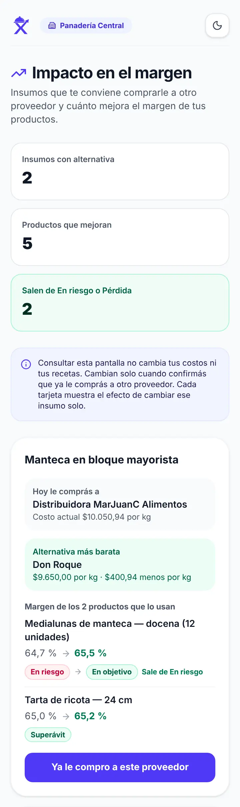
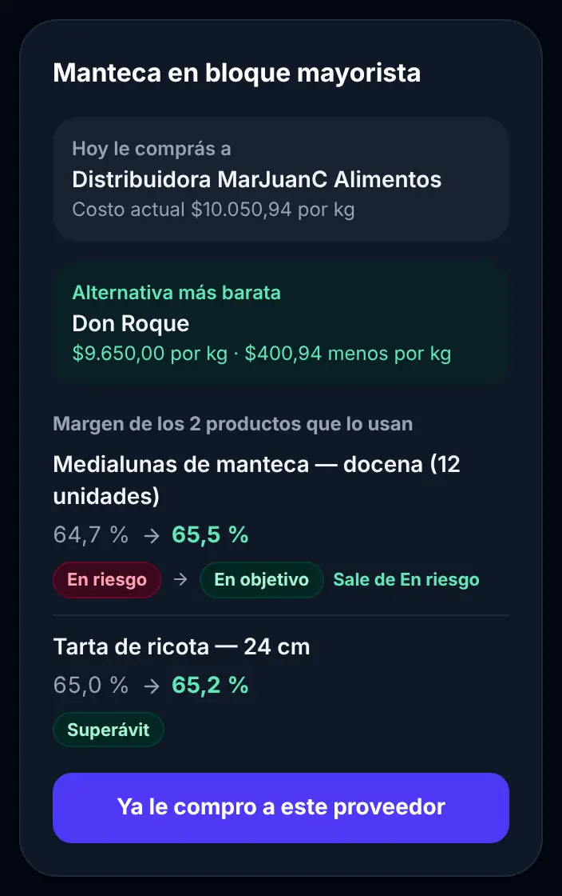
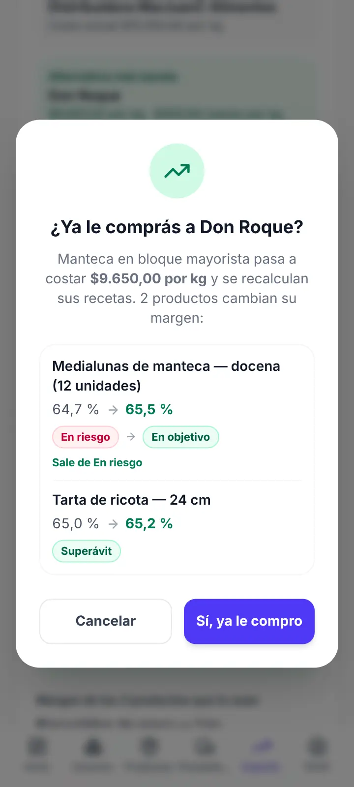

# Manual de Usuario — Impacto en el margen (Compras sugeridas)

La pantalla **Impacto en el margen** (`/compras`) te dice en qué insumos te conviene cambiar de proveedor y cuánto mejora el margen de tus productos si lo hacés. Está pensada para decidir en un minuto, sin hacer cuentas.

Es exclusiva del Administrador. El Colaborador no la ve en los menús y, si escribe la dirección, vuelve a **Productos** con un aviso.

> **Consultar esta pantalla no cambia tus costos ni tus recetas.** Cambian solo cuando confirmás que ya le comprás a otro proveedor.

---

## 1. Dónde se encuentra

- **Desde la computadora:** en la barra superior, el enlace **Impacto** (el ícono de la flecha que sube). En pantallas angostas, como una tablet, la barra muestra solo los íconos: al pasar el mouse aparece el nombre.
- **Desde el celular:** en el menú inferior, la pestaña **Impacto**. El lector de pantalla la anuncia con el nombre completo.

---

## 2. Resumen

Arriba de todo hay tres números:

| Indicador | Qué cuenta |
|---|---|
| **Insumos con alternativa** | Insumos que algún proveedor activo te vende más barato que su costo actual. |
| **Productos que mejoran** | Productos con receta que usan alguno de esos insumos. Un producto que usa dos de ellos cuenta una sola vez. |
| **Salen de En riesgo o Pérdida** | Productos que hoy están **En riesgo** o en **Pérdida** y pasarían a **En objetivo** o **Superávit** con al menos uno de los cambios. |

Si hay precios retenidos en cuarentena, un aviso ámbar te dice cuántos son: no participan del cálculo hasta que los revises. El enlace **Ver cuarentena** te lleva a **Proveedores › Cuarentena**.

---

## 3. Una tarjeta por insumo

Las tarjetas vienen ordenadas por lo que más te conviene: primero los insumos que sacan más productos de **En riesgo** o **Pérdida**, después los que más suben el margen.

Cada tarjeta muestra:

- **Hoy le comprás a:** el proveedor de la presentación predeterminada y el costo actual por unidad (kg, litro o unidad). Si el insumo no tiene predeterminada, dice *Sin presentación predeterminada*.
- **Alternativa más barata:** el proveedor, su costo por unidad y cuánto menos pagarías por unidad.
- **Margen de los productos que lo usan:** cada producto con su margen de hoy y el que tendría con la alternativa, y su estado con los mismos nombres que en el resto de la app (**Pérdida**, **En riesgo**, **En objetivo**, **Superávit**). Si el producto sale de **En riesgo** o **Pérdida**, la tarjeta lo destaca.

Cada tarjeta calcula el cambio de **ese insumo solo**: los demás insumos quedan con su costo actual. Si dos tarjetas afectan al mismo producto, el efecto de hacer los dos cambios es mayor que el de cada tarjeta por separado.

Si ningún producto con receta usa el insumo, la tarjeta lo aclara: cambiarlo solo actualiza su costo.

---

## 4. "Ya le compro a este proveedor"

Cuando ya le comprás a la alternativa (o decidís empezar a hacerlo):

1. Tocá **Ya le compro a este proveedor** en la tarjeta del insumo.
2. Se abre una confirmación con el costo nuevo por unidad y la lista de productos afectados con su margen antes y después.
3. Tocá **Sí, ya le compro**. La presentación de ese proveedor pasa a ser la predeterminada del insumo, su costo cambia y se recalculan las recetas que lo usan.
4. MargenX te avisa *"Listo: {n} productos recalculados"*. El margen de cada producto queda igual al que mostraba la confirmación.

Si cambiaste de idea, tocá **Cancelar**: no se cambia nada.

Si la confirmación no puede calcular el impacto (por ejemplo, porque ese precio entró en cuarentena o el proveedor se desactivó mientras mirabas la pantalla), te muestra el motivo y no deja confirmar.

Es el mismo cambio que la estrella **Usar como predeterminada** de la ficha del proveedor o del insumo ([capítulo 4](04-proveedores-y-listas.md)); acá además ves el efecto en el margen antes de decidir.

---

## 5. Preguntas frecuentes

### ¿Dónde quedó la calculadora de bultos y el pedido semanal?
Se sacaron. Sin stock, MargenX no sabe cuánto consumís de cada insumo, así que las cantidades eran inventadas y el total del pedido no servía para decidir. La reposición con cantidades reales llega con el control de stock, en la Fase 2.

### ¿Por qué MargenX no cambia solo al proveedor más barato?
Porque comprarle a otro distribuidor puede implicar otras condiciones de pago, fletes mínimos o diferencias de calidad que solo vos podés evaluar. MargenX te muestra cuánto ganás con el cambio; la decisión de cambiar el costo de tus recetas siempre es tuya.

### No aparece ningún insumo. ¿Qué hago?
Aparecen solo los insumos que algún proveedor activo vende más barato que su costo actual. Si ves *"No hay proveedores más baratos para tus insumos"*, cargá las listas de otros proveedores desde **Proveedores**.
