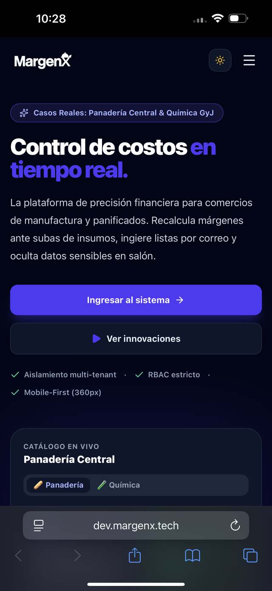
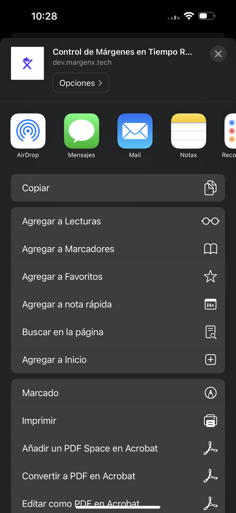
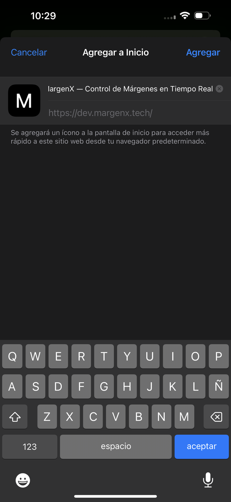

# Instalación de MargenX

Esta guía te ayuda a abrir MargenX como una app desde tu navegador para que quede disponible como acceso directo en tu celular o computadora.

## Android con Chrome

1. Abre MargenX en Chrome.
2. Toca el menú de tres puntos en la esquina superior derecha.
3. Elegí la opción “Instalar app” o “Agregar a pantalla de inicio”.
4. Confirmá la instalación.
5. La app quedará disponible en la pantalla principal como un acceso directo.

## iPhone con Safari

1. Abre MargenX en Safari.
2. Toca el botón de compartir en la parte inferior.

   

3. Seleccioná “Agregar a Inicio” (puede que tengas que deslizar la lista para encontrarla).

   

4. Confirmá el nombre y tocá “Agregar”.

   

5. Quedará disponible en tu home screen como una aplicación independiente.

> Si no aparece la opción, revisá que estés usando Safari y no otra app de navegador.
>
> El ícono que ves en las capturas es genérico (la "M" por defecto) porque todavía no se mergeó la issue que agrega el ícono real de MargenX (#243). Una vez mergeada, el ícono de la pantalla de confirmación va a ser el de la app.

## Escritorio con Chrome o Edge

1. Abre MargenX en Chrome o Edge.
2. Busca el ícono de instalación en la barra de direcciones o en el menú de la pestaña.
3. Seleccioná “Instalar”.
4. La aplicación se creará como acceso directo en tu escritorio o en tu menú de apps.

## Recomendación

- iPhone: usa Safari.
- Android: usa Chrome.
- Escritorio: usa Chrome o Edge.

Esto permite acceder rápidamente sin depender de recordar la URL completa ni de buscar la app en el navegador.
