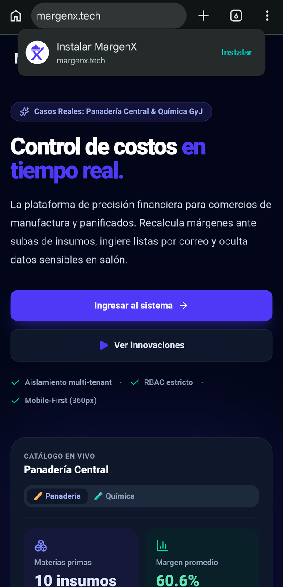
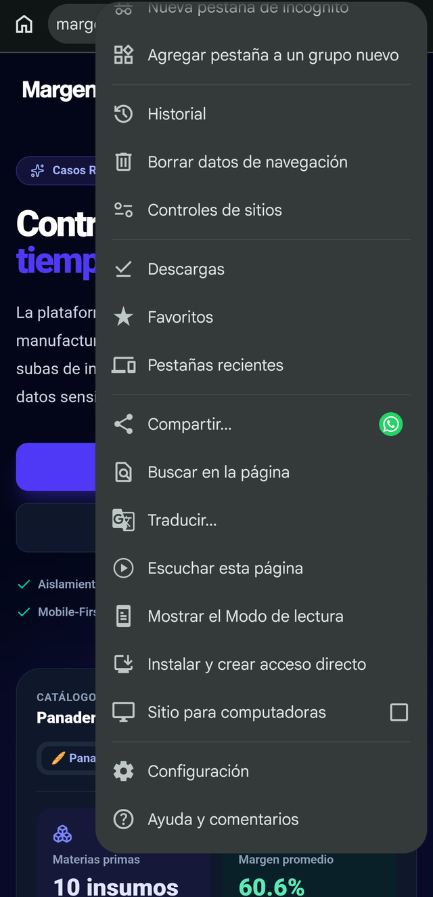
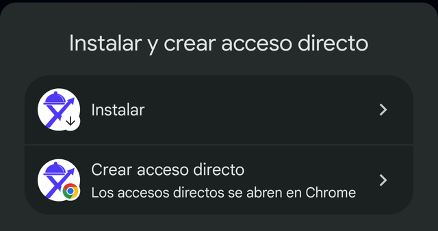
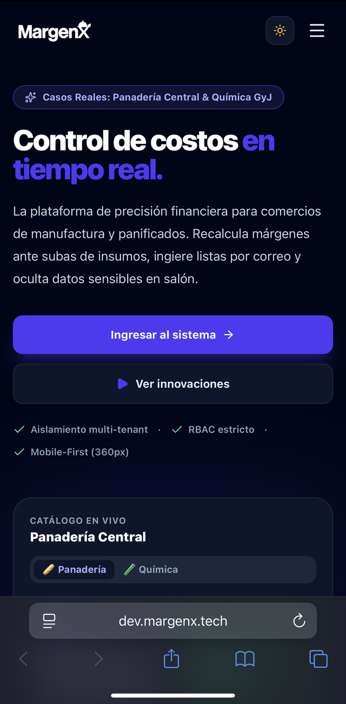
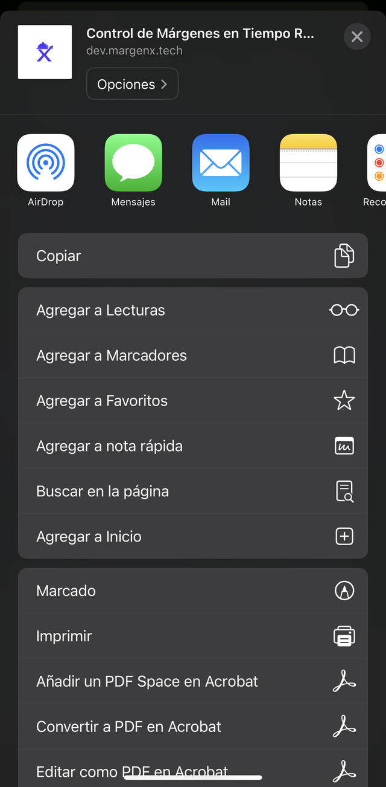
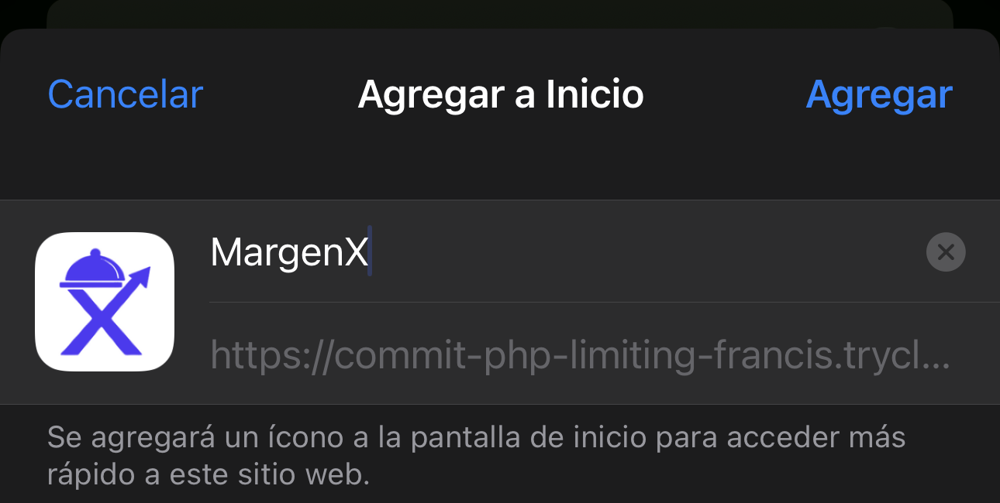
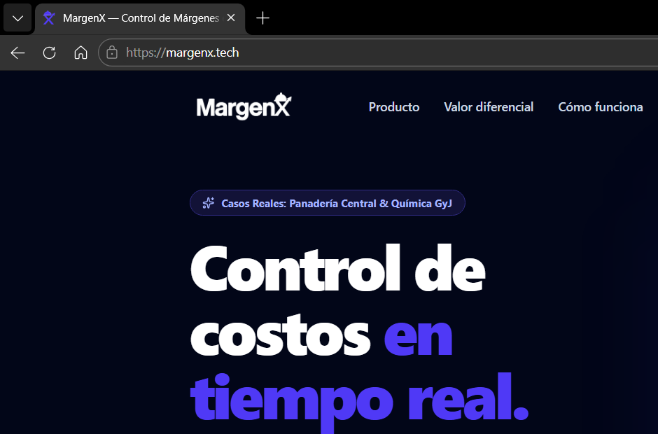
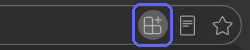
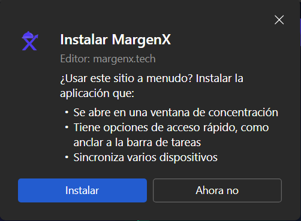

# Instalación de MargenX

Esta guía te ayuda a abrir MargenX como una app desde tu navegador para que quede disponible como acceso directo en tu celular o computadora.

## Android con Chrome

1. Abre MargenX en Chrome.
2. Toca el menú de tres puntos en la esquina superior derecha.

   

3. Elegí la opción “Instalar y crear acceso directo” (en otras versiones de Chrome: “Instalar app” o “Agregar a pantalla de inicio”).

   

4. Elegí “Instalar”. No elijas “Crear acceso directo”: abre MargenX dentro de Chrome, no como app.

   

5. La app quedará disponible en la pantalla principal como un acceso directo.

## iPhone con Safari

1. Abre MargenX en Safari.
2. Toca el botón de compartir en la parte inferior.

   

3. Seleccioná “Agregar a Inicio” (puede que tengas que deslizar la lista para encontrarla).

   

4. Confirmá el nombre y tocá “Agregar”.

   

5. Quedará disponible en tu home screen como una aplicación independiente.

> Si no aparece la opción, revisá que estés usando Safari y no otra app de navegador.

## Escritorio con Chrome o Edge

1. Abre MargenX en Chrome o Edge.

   

2. Busca el ícono de instalación en la barra de direcciones o en el menú de la pestaña.

   

3. Seleccioná “Instalar”.

   

4. La aplicación se creará como acceso directo en tu escritorio o en tu menú de apps.

## Cuánto dura la sesión

- **En la app instalada:** la sesión se mantiene aunque cierres la app, durante hasta **7 días** desde que iniciaste sesión. Así, cuando tocás "Ajustar" en un mail de alerta, llegás directo al producto sin volver a iniciar sesión. Pasados los 7 días, MargenX te pide iniciar sesión de nuevo y después te lleva a la pantalla que querías abrir.
- **En el navegador:** la sesión se cierra al cerrar el navegador o después de 30 minutos sin usar la app, para proteger las computadoras compartidas del comercio.
- Como la app instalada mantiene la sesión abierta, usá un bloqueo de pantalla en el celular. Para salir, usá **Cerrar sesión** en el menú.

## Sin conexión y versiones nuevas

- **Sin internet:** MargenX muestra la pantalla **Sin conexión** con el botón **Reintentar**. No muestra costos ni márgenes guardados: siempre se consultan en el momento. Cuando vuelva la señal, tocá **Reintentar**.
- **Versión nueva:** cuando publicamos una mejora aparece el aviso **Hay una versión nueva de MargenX**. Guardá lo que estés editando y tocá **Actualizar**. Si tocás **Más tarde**, seguís con la versión que tenías abierta.

## Recomendación

- iPhone: usa Safari.
- Android: usa Chrome.
- Escritorio: usa Chrome o Edge.

Esto permite acceder rápidamente sin depender de recordar la URL completa ni de buscar la app en el navegador.
